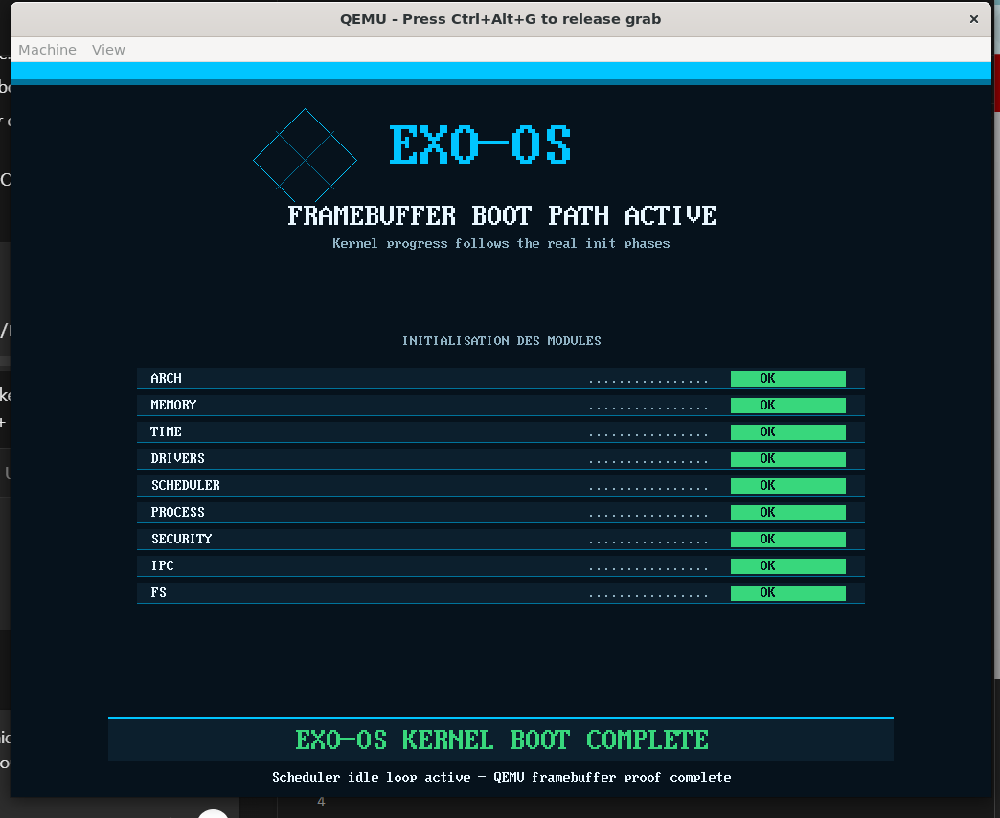
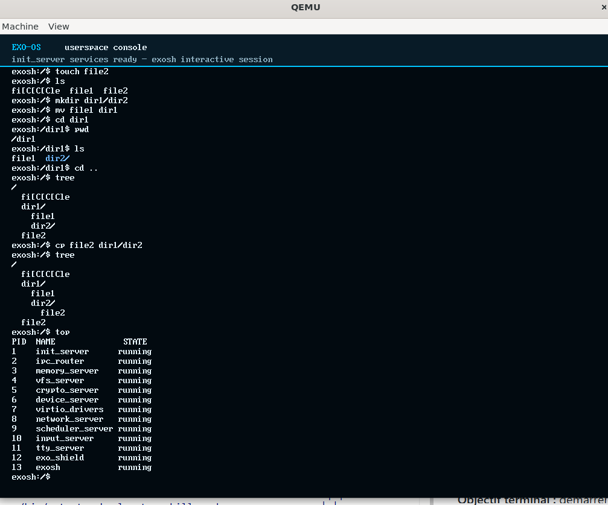

<div align="center">

```
               ███████╗██╗  ██╗ ██████╗       ██████╗ ███████╗
               ██╔════╝╚██╗██╔╝██╔═══██╗     ██╔═══██╗██╔════╝
               █████╗   ╚███╔╝ ██║   ██║     ██║   ██║███████╗
               ██╔══╝   ██╔██╗ ██║   ██║     ██║   ██║╚════██║
               ███████╗██╔╝ ██╗╚██████╔╝     ╚██████╔╝███████║
               ╚══════╝╚═╝  ╚═╝ ╚═════╝       ╚═════╝ ╚══════╝
```

### Microkernel Hybride Haute Performance & Résilience

[](.)
[](.)
[](.)
[](.)
[](.)
[](.)

<br>

*"security, performance and freedom"*

</div>

<br>

# ExoOS

**A formally verified, capability-based microkernel for x86_64 bare-metal hardware.**

ExoOS is a from-scratch Rust microkernel featuring a dual-kernel fault-tolerant architecture (**ExoPhoenix**), hardware-enforced containment and Next-Gen Antivirus (**ExoShield**), and a complete formal verification corpus of 12 TLA+ modules covering 60 safety and liveness properties.

> **Status (v0.2.0 « Strata »):** Consolidation intégrale des 7 organes fondamentaux du système. Amorçage QEMU validé du bootloader Multiboot2 au Framebuffer VGA graphique, initialisation coordonnée des 17 services Ring 1 supervisés, et session interactive complète sur le shell `exosh:/$` avec pipelines Unix, redirections de flux et utilitaires Coreutils enrichis.

---

## Galerie d'Amorçage & Framebuffer VGA

ExoOS intègre un gestionnaire d'affichage graphique haute fidélité (`boot_display` & `fb_server`) fournissant un retour visuel direct sur chaque étape d'initialisation du noyau et des services utilisateurs.

<div align="center">
  
  
  <p><em>Captures d'écran du Framebuffer VGA dans QEMU : séquence d'amorçage modulaire et bascule vers la console interactive.</em></p>
</div>

---

## ExoOS v0.2.0 « Strata » — Bilan de Consolidation

La version **v0.2.0 (« Strata »)** marque l'étape de consolidation en profondeur de l'ensemble des sous-systèmes du noyau et des serveurs Ring 1, articulée autour de 7 organes majeurs audités et certifiés :

| Organe | Domaine Technique | Avancées & Résolutions Majeures |
| :--- | :--- | :--- |
| **1** | **Socle Boot, KASLR, Horloge, Mémoire & Sentinel** | Élimination des fuites CoW/SLUB, initialisation KASLR sécurisée, surveillance d'intégrité Sentinel BLAKE3 coopérative et bornée à 256 PML4. |
| **2** | **SMP, Cycle de vie Processus & Synchronisation** | Récupération intégrale de la mémoire des piles noyau (256 KiB) et TIDs au Drop des PCB, recyclage immédiat des threads défunts, encodage standard wstatus/exit reason, synchronisation SMP du TLB shootdown sur CoW. |
| **3** | **Système de fichiers ExoFS & Cache de Blocs** | Protection stricte contre l'éviction silencieuse des blocs sales sans writeback, intégration du contrôle d'accès Multi-Level Security (MLS) Zero-Trust sur toute ouverture d'objet. |
| **4** | **Pile Réseau ExoNet V5 & Pilotes** | Fermeture stricte de la porte de contournement DMA-0 (élimination de `BYPASS_IOMMU`), réduction du timeout boot à 100ms avec bascule automatique immédiate sur `loopback_net` (127.0.0.1 opérationnel), intégration des CapTokens K1 V5 et vérification Zero-Trust sur les sockets. |
| **5** | **IPC, Registre d'Endpoints & ExoCordon** | Éradication des courses TOCTOU sur destruction d'endpoint, doublement des capacités des boîtes aux lettres brutes (128 slots) et extension du registre des services dynamiques du DAG ExoCordon (64 services). |
| **6** | **Crypto Server & ExoShield NGAV** | Suppression intégrale des faux positifs SCAN-FP-1 dans le scanner NGAV (signatures de vrais shellcodes discriminants), passage de l'IPC Gate en fail-closed, isolation stricte des sessions TLS par PID appelant, protection de l'entropie Phoenix réservée au PID 0. |
| **7** | **Shell `exosh`, Pipelines & Coreutils** | Prise en charge complète des pipelines Unix (`cmd1 \| cmd2`) via `SYS_PIPE2` / `SYS_FORK` / `SYS_DUP2`, redirections (`>`, `>>`, `<`, `2>`), quotes (`'...'`, `"..."`), variables système (`$?`, `$PWD`, `$HOME`), navigation `cd -` et intégration de l'utilitaire `grep` (avec flags `-i`, `-n`, `-v` et lecture STDIN). |

---

## Démarrage Rapide (Quick Start)

### Prérequis
Le développement et l'exécution d'ExoOS reposent sur Linux ou **WSL2 sous Windows** avec QEMU et la chaîne d'outils Rust nightly.

```bash
sudo apt update
sudo apt install -y build-essential qemu-system-x86 xorriso grub-pc-bin grub-common mtools llvm
rustup toolchain install nightly
rustup component add rust-src rustfmt clippy llvm-tools-preview --toolchain nightly
```

### 1. Lancement Graphique Canonique (Fenêtre Framebuffer VGA)
Pour admirer l'écran de démarrage graphique et utiliser la console :

```bash
make qemu
```
*(Depuis Windows PowerShell : `wsl -e bash -lc "cd /mnt/c/Users/xavie/Desktop/Exo-OS && make qemu"`)*

> [!TIP]
> Sous Windows 11 avec WSLg, le `Makefile` détecte automatiquement le socket X11 (`/tmp/.X11-unix/X0`) et exporte `DISPLAY=:0`. La fenêtre QEMU s'affiche directement sur votre bureau Windows.

### 2. Lancement Headless (Directement dans le Terminal)
Pour une exécution purement textuelle dans votre fenêtre de console actuelle sans ouvrir de fenêtre externe :

```bash
make qemu-nographic
```
*(Pour quitter le mode nographic de QEMU : pressez `Ctrl + A` puis `X`)*

### 3. Suivi des Journaux Kernel & Services en Direct
Pour observer les marqueurs d'amorçage et diagnostics en temps réel dans un autre terminal :

```bash
tail -f /tmp/e9k.txt
```

---

## Architecture de Supervision Ring 1 (17 Services Synchronisés)

Sous ExoOS v0.2.0, l'orchestration des services est gérée par `init_server` (PID 1) selon un graphe de dépendances strict vérifié par `check_service_order.py` :

| PID | Service / Composant | Rôle & Responsabilité |
| :---: | :--- | :--- |
| **1** | `init_server` | Superviseur racine, orchestration du graphe de services et respawn |
| **2** | `ipc_router` | Routage des messages IPC et registre de noms d'endpoints |
| **3** | `memory_server` | Allocation et gestion de la mémoire partagée Ring 1 |
| **4** | `loopback_driver` | Interface réseau locale virtuelle (`127.0.0.1`) |
| **5** | `vfs_server` | Système de fichiers virtuel bridgé sur ExoFS |
| **6** | `device_server` | Énumération et gestion des périphériques matériels |
| **7** | `scheduler_server` | Ordonnancement coopératif Ring 1 |
| **8** | `input_server` | Multiplexeur d'événements clavier et souris |
| **9** | `fb_server` | Serveur de Framebuffer graphique et accélération écran |
| **10** | `crypto_server` | Primitives cryptographiques (XChaCha20, Ed25519, TLS, Blake3) |
| **11** | `virtio_drivers` | Pilotes paravirtualisés de stockage VirtIO-Blk |
| **12** | `e1000_driver` | Pilote de carte réseau Intel Gigabit Ethernet |
| **13** | `virtio_net_driver` | Pilote réseau VirtIO PCI haute performance |
| **14** | `network_server` | Pile réseau ExoNet V5 (IP, TCP, UDP, DNS, sockets Unix) |
| **15** | `tty_server` | Gestionnaire de terminaux virtuels et émulation ANSI |
| **16** | `ps2_driver` | Pilote d'entrée clavier PS/2 (i8042 Scan Code Set 2) |
| **17** | `exo_shield` | Module NGAV, Confinement IA, Détection d'anomalies & Forensics |
| **18** | `exosh` | Console utilisateur interactive et shell racine |

---

## Capacités du Shell Utilisateur (`exosh`)

Le shell d'ExoOS fournit un environnement interactif complet pour explorer le système et manipuler les fichiers sur ExoFS :

### Commandes et Utilitaires
- **Navigation & Fichiers** : `pwd`, `cd`, `cd -`, `ls` (`-l`, `-a`, `-la`, `-lah`), `mkdir`, `rmdir`, `touch`, `cat`, `echo`, `cp`, `mv`, `rm` (`-r`, `-rf`), `tree`, `stat`.
- **Filtres & Tubes** : Pipelines Unix complets (`cmd1 | cmd2 | cmd3`), utilitaire `grep` (options `-i`, `-n`, `-v`), comptage `wc`, et redirections (`>`, `>>`, `<`, `2>`).
- **Processus & Diagnostic** : `top`, `ps`, `kill`, `kill -9`, `uptime`, `meminfo`, `ipc-stat`, `syscall-stat`, `uname`, `whoami`.
- **Édition de Ligne** : Historique (`Flèche Haut` / `Bas`), déplacement curseur (`Gauche` / `Droite`), complétion, `Ctrl+L` (effacer), `Ctrl+C` (interrompre).

### Exemple de Session Interactive
```text
exosh:/$ echo "Architecture ExoOS v0.2.0" > /tmp/strata.txt
exosh:/$ cat /tmp/strata.txt | grep -i strata
Architecture ExoOS v0.2.0
exosh:/$ ls -lah /bin | grep grep
-rwxr-xr-x 1 root root 84K Oct 18 16:30 grep
exosh:/$ echo "Code de retour : $?"
Code de retour : 0
exosh:/$ top
```

---

## Vérification Formelle (TLA+)

L'architecture globale est formellement spécifiée et prouvée via 12 modules TLA+ couvrant 60 propriétés de sûreté et de vivacité (absence de famine, exclusivité du double-noyau, unforgeabilité des tokens de capacité, intégrité IOMMU, atomicité des commutations de contexte).

| Module TLA+ | Propriétés Vérifiées | Résultat |
| :--- | :---: | :---: |
| 1 · ExoPhoenix Dual-Kernel Handoff | 178,992 états | ✅ Vérifié |
| 2 · SMP Boot Sequence (18-step) | 481 états | ✅ Vérifié |
| 3 · IRQ Routing & Atomic Invariants | 524,288 états | ✅ Vérifié |
| 4 · IOMMU Fault Queue (CAS-based) | 34,790 états | ✅ Vérifié |
| 5 · PCI Claim & do_exit() 7-step | 37,133 états | ✅ Vérifié |
| 6 · Context Switch Atomicity | 135,117 états | ✅ Vérifié |
| 7 · ExoFS Crash Consistency | 5,128 états | ✅ Vérifié |
| 8+9 · ExoShield + CapTokens | 107,584 états | ✅ Vérifié |
| 10 · Process Death & fd_table restore | 342 états | ✅ Vérifié |
| 11 · Memory Ordering (Release/Acquire) | 184 états | ✅ Vérifié |
| 12 · Adversarial Attack Surface | 1,495 états | ✅ Vérifié |
| **Composition Complète (Monte Carlo)** | **565,076,967 états** | **✅ Vérifié** |

---

## Structure du Dépôt & Modularité

Le noyau ExoOS applique une ségrégation modulaire stricte où chaque grand sous-système est subdivisé en sous-modules spécialisés à responsabilité unique, indexés par un `mod.rs` sans god files (> 900 lignes) :

```text
Exo-OS/
├── bootloader/             # Configuration GRUB 2 et Multiboot2
├── kernel/                 # Ring 0 — Microkernel hybride Rust no_std
│   ├── src/arch/x86_64/    # Boot BSP/AP, GDT/IDT, KASLR, Page Tables, HPET/TSC, Framebuffer early
│   ├── src/memory/         # Allocateur Buddy modulaire (node, stats, zone), SLUB, CoW, VMA, KPTI
│   ├── src/process/        # PCB modulaire (types, file_table), registry, signaux, cycle de vie
│   ├── src/scheduler/      # Ordonnanceur SMP, KTCB, switch de contexte, timers
│   ├── src/security/       # ExoShield, ExoSeal, ExoCage (CET), Zero-Trust Pledge, ExoKairos
│   ├── src/ipc/            # SpscRing, CapTokens, Zero-Copy SHM, mailboxes brutes
│   ├── src/fs/exofs/       # Système de fichiers ExoFS, cache de blocs, object_fd modulaire, journalisation
│   ├── src/syscall/        # Table de dispatch O(1), dispatch modulaire, fs/ & ipc/ ségrégués, fs_bridge modulaire
│   └── src/exophoenix/     # Dual-Kernel Sentinel & Stage0 modulaire (features, scan, routing, isolation)
├── servers/                # Serveurs Ring 1 et espace utilisateur supervisé
│   ├── init_server/        # PID 1 — Superviseur et bootstrap ordonnancé des services
│   ├── ipc_router/         # PID 2 — Annuaire d'endpoints et routage IPC
│   ├── memory_server/      # PID 3 — Gestionnaire mémoire Ring 1
│   ├── vfs_server/         # PID 5 — Serveur VFS
│   ├── device_server/      # PID 6 — Serveur de périphériques matériels
│   ├── scheduler_server/   # PID 7 — Ordonnanceur Ring 1
│   ├── input_server/       # PID 9 — Serveur d'entrées
│   ├── fb_server/          # PID 10 — Serveur Framebuffer graphique
│   ├── crypto_server/      # PID 8 — Crypto-serveur et isolation TLS
│   ├── network_server/     # Pile réseau ExoNet V5 (NetGrant ABI, TCP/UDP/IP)
│   ├── tty_server/         # Serveur TTY et émulation console
│   └── exo_shield/         # Module NGAV, Confinement IA, Détection d'anomalies & Forensics
├── drivers/                # Pilotes Ring 1 (PS/2, VirtIO-Net, e1000, Loopback, FB, VirtIO-Blk)
├── libs/                   # Bibliothèques (exo_syscall_abi, exo_libc, exo_network_common)
├── userspace/apps/         # Utilitaires Coreutils (cat, grep, ls, ps, top, wc...) & exosh
└── docs/                   # Documentation technique, plans d'architecture V5 et preuves TLA+
```

---

*ExoOS — v0.2.0 "Strata" · Octobre 2026*  
*12 modules TLA+ · 60 propriétés · Plus de 565 millions d'états formellement vérifiés*
