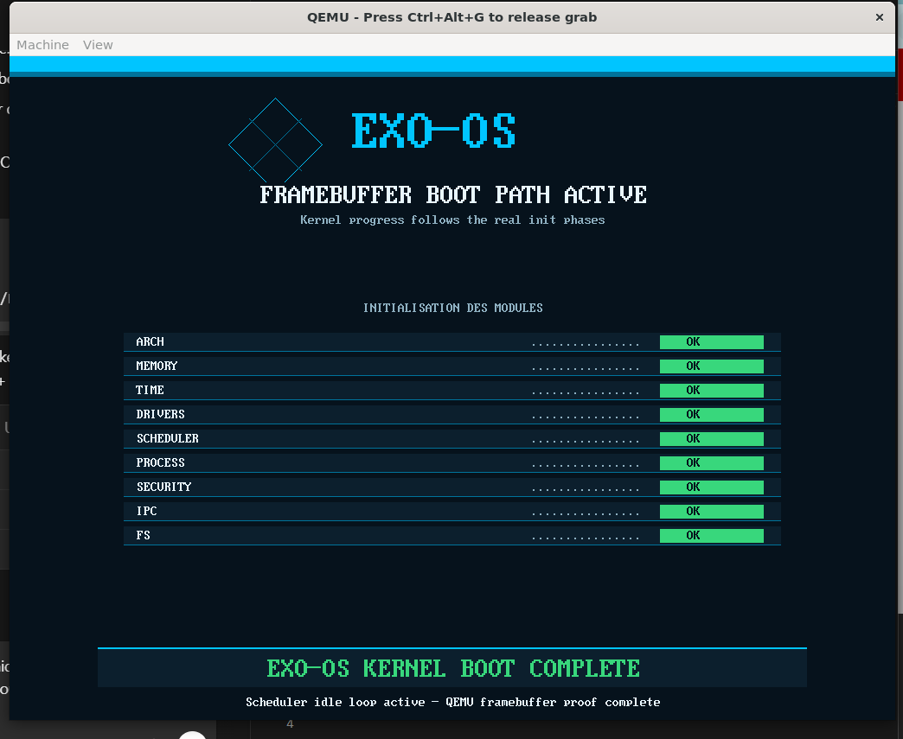
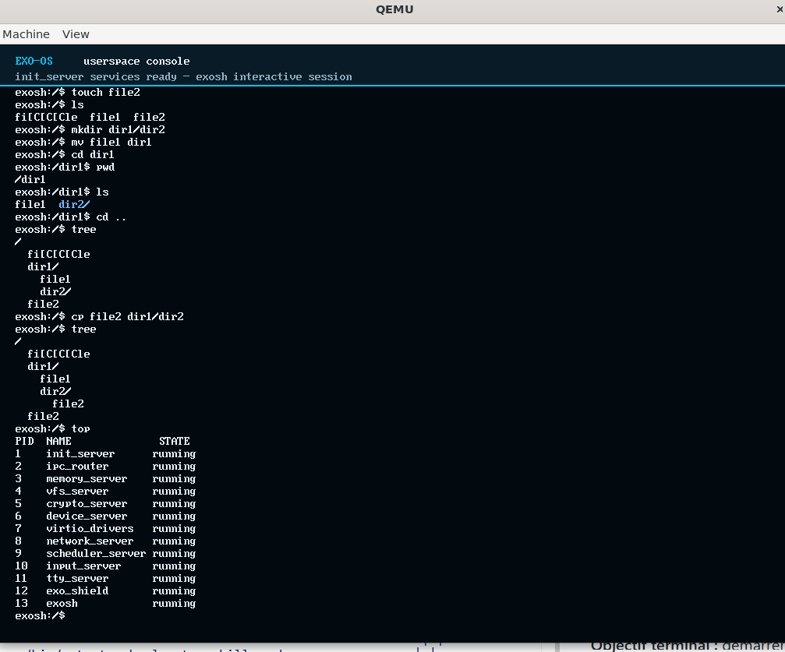

<div align="center">

```
               ███████╗██╗  ██╗ ██████╗       ██████╗ ███████╗
               ██╔════╝╚██╗██╔╝██╔═══██╗     ██╔═══██╗██╔════╝
               █████╗   ╚███╔╝ ██║   ██║     ██║   ██║███████╗
               ██╔══╝   ██╔██╗ ██║   ██║     ██║   ██║╚════██║
               ███████╗██╔╝ ██╗╚██████╔╝     ╚██████╔╝███████║
               ╚══════╝╚═╝  ╚═╝ ╚═════╝       ╚═════╝ ╚══════╝
```

### High-Performance, Fault-Tolerant Hybrid Microkernel

[](.)
[-orange?style=flat-square&logo=rust)](.)
[](.)
[](.)
[](.)
[](.)

<br>

*"security, performance and freedom"*

</div>

<br>

# ExoOS

**A formally verified, capability-based microkernel for x86_64 bare-metal hardware.**

ExoOS is a from-scratch Rust microkernel featuring a dual-kernel fault-tolerant architecture (**ExoPhoenix**), hardware-enforced containment and Next-Gen Antivirus (**ExoShield**), a full native port of the official Rust Standard Library (`library/std` for `target_os = "exo"`), and a complete formal verification corpus of 12 TLA+ modules covering 60 safety and liveness properties.

> **Status (v0.2.0 "Strata"):** Full consolidation of the 7 core system organs and native Rust `std` integration (`x86_64-unknown-exo.json`). Verified QEMU boot from Multiboot2 to graphical VGA Framebuffer, coordinated initialization of 19 supervised Ring 1 services, and interactive session on the `exosh:/$` shell and 35 `coreutils` binaries compiled against the real Rust `library/std`.

---

## Boot Gallery & Graphical VGA Framebuffer

ExoOS includes a high-fidelity graphical display manager (`boot_display` & `fb_server`) providing live visual feedback for every kernel initialization stage and userspace service handoff.

<div align="center">
  
  
  <p><em>VGA Framebuffer screenshots in QEMU: modular boot sequence and transition to the interactive console.</em></p>
</div>

---

## Native Rust `std` Integration (`target_os = "exo"`)

ExoOS enforces a strict privilege boundary between `#![no_std]` kernel/critical services and full Rust `std` userspace applications (detailed in [`docs/std_integration.md`](docs/std_integration.md)):

- **Ring 0 & Critical Ring 1 (`#![no_std]`, `panic = "abort"`)**: `kernel/`, `exo-boot/`, shared ABI crates (`libs/exo_types`, `libs/exo-phoenix-ssr`, `servers/syscall_abi`), and Wave 0–2 system servers (`init_server`, `ipc_router`, `memory_server`, `device_server`, `crypto_server`, hardware drivers) remain strictly `#![no_std]`.
- **Full `rust-lang/rust` `library/std` Port (`x86_64-unknown-exo.json`)**:
  - **Platform Abstraction Layer (`library/std/src/sys/pal/exo_os/`)**: Pure-Rust PAL over ExoOS Ring 0/Ring 1 syscalls (`0..=549`), `GenericTcb`/`ExoTcb` static TLS (`%fs:0`), 0-syscall `sigaction` (`LOCK CMPXCHG16B`) and `sigprocmask` (`AtomicU64`) via the shared `SignalTcb` page (`AT_SIGNAL_TCB = 51`), and a 100% Rust `dlmalloc` global allocator over `SYS_MMAP`/`SYS_MREMAP`/`SYS_MUNMAP` with zero C symbols.
  - **Modular `std::sys::*` Backends (`exo.rs`)**: Native support for `alloc`, `args`, `env`, `fd`, `fs`, `io`, `net`, `pipe`, `process` (`fork`/`execve`/`wait4`), `random` (`SYS_GETRANDOM` + `AT_RANDOM`), `stdio`, `sync` (`futex`), `thread`, `thread_local`, and `time`.
  - **ExoOS-Specific Extensions (`std::os::exo`)**:
    - `CapTokenExt`: Inspect, attenuate (`clone_for_child`), and delegate capability tokens (`AT_CAP_TOKEN = 52`).
    - `ExoFsExt`: Native CoW snapshots, B+Tree searches, and extended attributes on `std::fs::File`.
    - `PhoenixSafeExt`: `PhoenixSafe<T>` fault-surviving allocations (`PROT_PHOENIX_SAFE`) and `SYS_PHOENIX_CHECKPOINT`.
    - `ExoPledgeExt`: Zero-Trust process sandboxing via `pledge()` (`SYS_EXO_PLEDGE`) and `unveil()` (`SYS_EXO_UNVEIL`).
- **Migrated Userspace (`-Z build-std=core,alloc,std,panic_abort`)**: Both the interactive shell (`servers/exosh`) and all 35 `userspace/apps/coreutils` binaries compile directly against the real Rust `std`.

## Pure-Rust Wayland Stack (`wayland-rs`)

With real `std`, `epoll`, and `AF_UNIX` with `SCM_RIGHTS` in place, ExoOS runs the official pure-Rust `wayland-rs` ecosystem in userspace (detailed in [`docs/wayland_rs_integration.md`](docs/wayland_rs_integration.md)):

- **Modular Wayland Crates (`libs/wayland-rs/`)**: Includes `wayland-backend` (pure Rust wire protocol engine), `wayland-client`, `wayland-server`, `wayland-protocols` (XDG Shell, compositor, etc.), and `wayland-cursor`.
- **System Compatibility (`exo-rustix`)**: Lightweight `rustix` compatibility layer enabling standard Wayland server/client socket polling on `target_os = "exo"`.
- **Compositor & Client Communication**: Zero-overhead IPC over Unix domain sockets (`AF_UNIX`) using file descriptor passing (`SCM_RIGHTS`) and `epoll` event dispatching.
- **Live Verification**: `exosh` provides the `exo wayland` builtin verifying live compositor/client roundtrips (`wl_compositor`, `wl_shm`, `xdg_wm_base`, surface allocation).

---

## ExoOS v0.2.0 "Strata" — Consolidation Highlights

Version **v0.2.0 ("Strata")** consolidates all kernel subsystems and Ring 1 servers across 7 audited architectural organs:

| Organ | Technical Domain | Major Advances & Resolutions |
| :--- | :--- | :--- |
| **1** | **Boot Foundation, KASLR, Clock, Memory & Sentinel** | Elimination of CoW/SLUB leaks, secure KASLR initialization, cooperative BLAKE3 Sentinel integrity monitoring bounded to 256 PML4 entries. |
| **2** | **SMP, Process Lifecycle & Synchronization** | Full reclamation of kernel stacks (256 KiB) and TIDs on PCB Drop, immediate recycling of exited threads, standard `wstatus`/exit reason encoding, SMP TLB shootdown synchronization on CoW, FPU/SSE state preservation (`fxsave64`/`fxrstor64`) across signal frames. |
| **3** | **ExoFS File System & Block Cache** | Strict protection against silent eviction of dirty blocks without writeback, Zero-Trust Multi-Level Security (MLS) access control on every object open. |
| **4** | **ExoNet V5 Network Stack & Drivers** | Strict closure of DMA-0 bypass (`BYPASS_IOMMU` removed), 100ms boot timeout with automatic fallback to `loopback_net` (`127.0.0.1`), K1 V5 CapTokens and Zero-Trust socket verification, chunked `NET_INLINE_DATA_MAX` IPC transfers. |
| **5** | **IPC, Endpoint Registry & ExoCordon** | Elimination of TOCTOU races on endpoint destruction, 128-slot raw mailboxes, dynamic service registry extended to 64 DAG services. |
| **6** | **Crypto Server & ExoShield NGAV** | Elimination of false positives (`SCAN-FP-1`) in the NGAV scanner, fail-closed IPC Gate, strict per-PID TLS session isolation, Phoenix entropy reserved for PID 0. |
| **7** | **Native Rust `std`, `exosh` Shell & Coreutils** | Full `library/std` port (`target_os = "exo"`), Unix pipelines (`cmd1 \| cmd2`) via `SYS_PIPE2`/`SYS_FORK`/`SYS_DUP2`, stream redirections (`>`, `>>`, `<`, `2>`), quoting, environment variables (`$?`, `$PWD`, `$HOME`), and 35 `std`-powered Coreutils utilities. |

---

## Quick Start

### Prerequisites
Building and running ExoOS requires Linux or **WSL2 on Windows** with QEMU and the Rust nightly toolchain:

```bash
sudo apt update
sudo apt install -y build-essential qemu-system-x86 xorriso grub-pc-bin grub-common mtools llvm rsync
rustup toolchain install nightly
rustup component add rust-src rustfmt clippy llvm-tools-preview --toolchain nightly
```

### 1. Canonical Graphical Boot (VGA Framebuffer Window)
To launch ExoOS with the graphical boot screen and interactive console:

```bash
make qemu
```
*(From Windows PowerShell: `wsl -e bash -lc "cd /mnt/c/Users/xavie/Desktop/Exo-OS && make qemu"`)*

> [!TIP]
> On Windows 11 with WSLg, the `Makefile` automatically detects the X11 socket (`/tmp/.X11-unix/X0`) and exports `DISPLAY=:0`, displaying the QEMU window directly on your Windows desktop.

### 2. Headless Boot (Terminal Mode)
For a purely text-based session inside your current terminal without opening an external window:

```bash
make qemu-nographic
```
*(To exit QEMU in nographic mode: press `Ctrl + A` then `X`)*

### 3. Live Kernel & Service Log Monitoring
To inspect real-time boot markers and debug output via the QEMU `debugcon` (`0xe9`) port:

```bash
tail -f /tmp/e9k.txt
```

---

## Ring 1 Supervision Architecture (19 Synchronized Services + Shell)

In ExoOS v0.2.0, service orchestration is managed by `init_server` (PID 1) according to a strict dependency DAG verified by `check_service_order.py`:

| PID | Service / Component | Role & Responsibility |
| :---: | :--- | :--- |
| **1** | `init_server` | Root supervisor, service graph orchestration, and fault recovery |
| **2** | `ipc_router` | IPC message routing and endpoint name registry |
| **3** | `memory_server` | Ring 1 shared memory allocation and management |
| **4** | `loopback_driver` | Virtual local network interface (`127.0.0.1`) |
| **5** | `vfs_server` | Virtual File System bridged over ExoFS |
| **6** | `device_server` | Hardware device enumeration and management |
| **7** | `scheduler_server` | Ring 1 cooperative scheduling service |
| **8** | `crypto_server` | Cryptographic primitives (XChaCha20, Ed25519, TLS, BLAKE3) |
| **9** | `input_server` | Keyboard and mouse event multiplexer |
| **10** | `fb_server` | Graphical Framebuffer server and screen acceleration |
| **11** | `virtio_drivers` | Paravirtualized VirtIO-Blk storage drivers |
| **12** | `e1000_driver` | Intel Gigabit Ethernet network card driver |
| **13** | `virtio_net_driver` | High-performance VirtIO PCI network driver |
| **14** | `network_server` | ExoNet V5 network stack (IP, TCP, UDP, DNS, Unix sockets) |
| **15** | `audio_server` | Ring 1 Wave 4 Intel HDA audio server |
| **16** | `usb_server` | Ring 1 Wave 4 xHCI USB host controller server |
| **17** | `tty_server` | Virtual terminal manager and ANSI emulation |
| **18** | `ps2_driver` | PS/2 keyboard & mouse driver (i8042 Scan Code Set 2) |
| **19** | `exo_shield` | NGAV module, AI containment, anomaly detection & forensics |
| **20** | `exosh` | Interactive user console and root shell (compiled with Rust `std`) |

---

## User Shell Capabilities (`exosh`)

The ExoOS shell provides a complete interactive environment for exploring the system and manipulating files on ExoFS:

### Commands and Utilities
- **Navigation & Files**: `pwd`, `cd`, `cd -`, `ls` (`-l`, `-a`, `-la`, `-lah`), `mkdir`, `rmdir`, `touch`, `cat`, `echo`, `cp`, `mv`, `rm` (`-r`, `-rf`), `dd`, `tree`, `stat`, `sync`, `basename`, `dirname`.
- **Filters & Pipes**: Full Unix pipelines (`cmd1 | cmd2 | cmd3`), `grep` (`-i`, `-n`, `-v`), `wc`, and stream redirections (`>`, `>>`, `<`, `2>`).
- **Processes, Capabilities & Diagnostics**: `exo` (`exo cap`), `top`, `ps`, `kill`, `kill -9`, `sleep`, `uptime`, `meminfo`, `ipc-stat`, `syscall-stat`, `uname`, `whoami`, `calendar`, `clear`.
- **Line Editing**: Command history (`Up` / `Down` arrows), cursor movement (`Left` / `Right`), tab completion, `Ctrl+L` (clear screen), `Ctrl+C` (interrupt).

### Interactive Session Example
```text
exosh:/$ echo "ExoOS v0.2.0 Strata" > /tmp/strata.txt
exosh:/$ cat /tmp/strata.txt | grep -i strata
ExoOS v0.2.0 Strata
exosh:/$ ls -lah /bin | grep grep
-rwxr-xr-x 1 root root 84K Oct 18 16:30 grep
exosh:/$ echo "Exit status: $?"
Exit status: 0
exosh:/$ exo cap
```

---

## Formal Verification (TLA+)

The global architecture is formally specified and verified across 12 TLA+ modules covering 60 safety and liveness properties (starvation freedom, dual-kernel exclusivity, capability token unforgeability, IOMMU integrity, context switch atomicity).

| TLA+ Module | Verified States | Status |
| :--- | :---: | :---: |
| 1 · ExoPhoenix Dual-Kernel Handoff | 178,992 states | ✅ Verified |
| 2 · SMP Boot Sequence (18-step) | 481 states | ✅ Verified |
| 3 · IRQ Routing & Atomic Invariants | 524,288 states | ✅ Verified |
| 4 · IOMMU Fault Queue (CAS-based) | 34,790 states | ✅ Verified |
| 5 · PCI Claim & do_exit() 7-step | 37,133 states | ✅ Verified |
| 6 · Context Switch Atomicity | 135,117 states | ✅ Verified |
| 7 · ExoFS Crash Consistency | 5,128 states | ✅ Verified |
| 8+9 · ExoShield + CapTokens | 107,584 states | ✅ Verified |
| 10 · Process Death & fd_table restore | 342 states | ✅ Verified |
| 11 · Memory Ordering (Release/Acquire) | 184 states | ✅ Verified |
| 12 · Adversarial Attack Surface | 1,495 states | ✅ Verified |
| **Full Composition (Monte Carlo)** | **565,076,967 states** | **✅ Verified** |

---

## Repository Structure & Modularity

The ExoOS codebase enforces strict modular segregation where every major subsystem is decomposed into single-responsibility modules without god files (> 900 lines):

```text
Exo-OS/
├── bootloader/                 # GRUB 2 and Multiboot2 configuration
├── x86_64-unknown-exo.json     # Custom Rust target specification for target_os = "exo"
├── library/std/                # Native port of rust-lang/rust library/std for ExoOS
│   ├── src/sys/pal/exo_os/     # Low-level PAL (syscalls, TCB/SignalTcb runtime, dlmalloc, futex)
│   ├── src/sys/*/exo.rs        # Per-subsystem std::sys backends (fs, net, process, thread, fd...)
│   └── src/os/exo/             # Public std::os::exo traits (CapTokenExt, ExoFsExt, PhoenixSafeExt, ExoPledgeExt)
├── kernel/                     # Ring 0 — Hybrid Rust #![no_std] microkernel
│   ├── src/arch/x86_64/        # BSP/AP boot, GDT/IDT, KASLR, Page Tables, HPET/TSC, early Framebuffer
│   ├── src/memory/             # Modular Buddy allocator, SLUB, CoW, VMA, KPTI
│   ├── src/process/            # Modular PCB, registry, 0-syscall SignalTcb & signal delivery, lifecycle
│   ├── src/scheduler/          # SMP scheduler, KTCB, context switch, timers
│   ├── src/security/           # ExoShield, ExoSeal, ExoCage (CET), Zero-Trust Pledge, ExoKairos
│   ├── src/ipc/                # SpscRing, CapTokens, Zero-Copy SHM, raw mailboxes
│   ├── src/fs/                 # ExoFS file system, block cache, ELF64 loader (PT_TLS, SignalTcb, auxv)
│   ├── src/syscall/            # O(1) dispatch table, fs_bridge, net_bridge, ipc_bridge
│   └── src/exophoenix/         # Dual-Kernel Sentinel & Stage0 fault recovery
├── servers/                    # Ring 1 supervised servers and interactive shell
│   ├── init_server/            # PID 1 — Root supervisor and DAG service bootstrap
│   ├── ipc_router/             # PID 2 — Endpoint directory and IPC routing
│   ├── memory_server/          # PID 3 — Ring 1 memory manager
│   ├── vfs_server/             # PID 5 — VFS server
│   ├── device_server/          # PID 6 — Hardware device server
│   ├── scheduler_server/       # PID 7 — Ring 1 scheduler
│   ├── crypto_server/          # PID 8 — Cryptographic server and TLS isolation
│   ├── input_server/           # PID 9 — Input multiplexer
│   ├── fb_server/              # PID 10 — Graphical Framebuffer server
│   ├── network_server/         # PID 14 — ExoNet V5 network stack (NetGrant ABI, TCP/UDP/IP)
│   ├── audio_server/           # PID 15 — Intel HDA audio server
│   ├── usb_server/             # PID 16 — xHCI USB host controller server
│   ├── tty_server/             # PID 17 — TTY server and console emulation
│   ├── exo_shield/             # PID 19 — NGAV, AI containment, anomaly detection & forensics
│   └── exosh/                  # PID 20 — Interactive shell compiled with Rust std
├── drivers/                    # Ring 1 drivers (PS/2, VirtIO-Net, e1000, Loopback, FB, VirtIO-Blk)
├── libs/                       # Runtime & shared crates (exo_types, exo-syscall, exo-alloc, exo-rt, exo-libc)
├── userspace/apps/coreutils/   # 35 standard utilities compiled with Rust std (cat, grep, ls, ps, top, exo...)
└── docs/                       # Technical documentation, std_integration.md, V5 architecture & TLA+ proofs
```

---

*ExoOS — v0.2.0 "Strata" · November 2026*  
*12 TLA+ modules · 60 properties · Over 565 million formally verified states*
