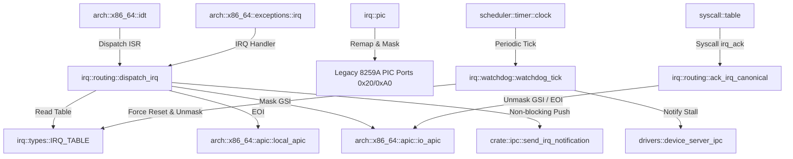

# Analyse Détaillée du Module : `kernel/src/arch/x86_64/irq`

## 1. Vue d'Ensemble du Module

Le module `kernel/src/arch/x86_64/irq` implémente le sous-système de gestion et routage des interruptions matérielles (IRQ) selon les spécifications GI-03 du Driver Framework v10 d'Exo-OS.
Dans l'architecture hybride / micro-noyau d'Exo-OS, le noyau n'exécute pas de pilotes matériels monolithiques dans les ISR (Interrupt Service Routines) ; au lieu de cela, il capture les interruptions matérielles, les assainit, masque les lignes critiques (notamment les interruptions level-triggered), et distribue des messages asynchrones non-bloquants vers les processus serveurs de périphériques (userspace device drivers) enregistrés.

Le module se compose de 5 fichiers sources :
- [`mod.rs`](file:///c:/Users/xavie/Desktop/Exo-OS/kernel/src/arch/x86_64/irq/mod.rs) : Point d'entrée du module, déclarations des sous-modules et réexportation de l'API canonique.
- [`pic.rs`](file:///c:/Users/xavie/Desktop/Exo-OS/kernel/src/arch/x86_64/irq/pic.rs) : Gestion du contrôleur d'interruptions historique 8259A PIC (remap et masquage complet pour éviter les collisions avec les vecteurs d'exceptions CPU).
- [`types.rs`](file:///c:/Users/xavie/Desktop/Exo-OS/kernel/src/arch/x86_64/irq/types.rs) : Types canoniques, structures de routes IRQ, gestionnaires enregistrés, seuils temporels et table globale `IRQ_TABLE`.
- [`routing.rs`](file:///c:/Users/xavie/Desktop/Exo-OS/kernel/src/arch/x86_64/irq/routing.rs) : Moteur central de routage, enregistrement dynamique, désenregistrement automatique des processus morts, distribution en ISR et protocole d'acquittement (ACK).
- [`watchdog.rs`](file:///c:/Users/xavie/Desktop/Exo-OS/kernel/src/arch/x86_64/irq/watchdog.rs) : Watchdog temporel périodique (soft/hard) détectant les pilotes utilisateurs bloqués ou les tempêtes d'interruptions.

---

## 2. Analyse Ligne par Ligne et Invariants de Sécurité

### 2.1 `pic.rs` : Neutralisation du Legacy 8259A PIC
- **Problématique matérielle :** À l'amorçage x86_64, le BIOS/GRUB configure souvent le 8259A PIC avec des vecteurs maîtres à partir de 0x08. En mode long 64-bit, les vecteurs 0x08 à 0x0F correspondent aux exceptions processeur critiques (`#DF` Double Fault, `#TS` Invalid TSS, `#NP` Segment Not Present, `#SS` Stack Fault, `#GP` General Protection Fault). Une interruption PIT (IRQ0) délivrée sur le vecteur 0x08 est interprétée comme un Double Fault fatal provoquant un Triple Fault et un reboot immédiat.
- **Remap & Mask (`remap_and_mask`) :**
  - Utilise `AtomicBool PIC_MASKED` avec `Ordering::AcqRel` pour garantir que l'opération est strictement idempotente et ne s'exécute qu'une seule fois.
  - Envoie la séquence ICW1..ICW4 pour translater le PIC maître à `IRQ_BASE` (0x20) et le PIC esclave à `IRQ_BASE + 8` (0x28).
  - Écrit `0xFF` sur les ports de données `0x21` et `0xA1` afin de masquer l'ensemble des 16 lignes d'interruption du 8259A.
  - Toutes les interruptions passent désormais exclusivement par l'APIC local et l'I/O APIC.

### 2.2 `types.rs` : Modèle de Données et Concurrence
- **`IrqVector` :**
  - Type newtype transparent `IrqVector(pub u8)`.
  - La méthode `is_valid()` vérifie strictement la plage autorisée : `self.0 >= VECTOR_IRQ_BASE (32) && self.0 < VECTOR_RESERVED_END (96) && self.0 < VECTOR_EXOPHOENIX_START (0xF0)`.
- **`IrqSourceKind` :**
  - Distingue `IoApicEdge`, `IoApicLevel`, `Msi`, et `MsiX`.
  - `needs_ioapic_mask()` identifie les sources I/O APIC nécessitant un masquage matériel explicite.
  - `is_cumulative()` spécifie le comportement des acquittements pour le niveau haut continu.
- **`IrqRoute` :**
  - Conçu pour une utilisation concurrente sans allocation dynamique en ISR.
  - Contient un `RwLock<Vec<IrqHandler>>` pour les abonnés (limité à `MAX_HANDLERS_PER_IRQ = 8`).
  - Atomics de synchronisation : `pending_acks` (AtomicU32), `handled_count` (AtomicU32), `dispatch_generation` (AtomicU64), `masked` (AtomicBool), `masked_since` (AtomicU64), `soft_alarmed` (AtomicBool), `overflow_count` (AtomicU32).
- **`IrqTable` :**
  - Tableau à taille fixe `[Option<IrqRoute>; 256]` protégé par un `RwLock<IrqTable>` global `IRQ_TABLE`.

### 2.3 `routing.rs` : Enregistrement, Dispatch et Acquittement
- **Enregistrement Sécurisé (`sys_irq_register_common`) :**
  - Vérifie la validité du vecteur et la vivacité du processus appelant (`process_is_alive(owner_pid.0)`).
  - **Invariant Anti-Deadlock Crucial :** Réalise systématiquement `let _irq_guard = crate::arch::x86_64::irq_save();` AVANT d'acquérir le verrou en écriture `IRQ_TABLE.write()`. Sans cette désactivation des interruptions locales sur le CPU courant, la survenue d'une interruption matérielle sur ce même CPU tenterait d'acquérir `IRQ_TABLE.read()` dans `dispatch_irq`, provoquant un interblocage (deadlock) immédiat et irréversible.
  - **Nettoyage Automatique (CORR-51) :** Parcourt les gestionnaires existants et purge automatiquement les abonnés dont les PIDs sont morts ou zombies.
  - **Configuration Matérielle :** Programme la ligne GSI dans l'I/O APIC via `io_apic::route_irq` et la démasque (`io_apic::unmask_irq`).
- **Distribution en Contexte d'Interruption (`dispatch_irq`) :**
  - Exécuté directement depuis le stub assembleur IDT / ISR.
  - **Garantie LAPIC EOI :** Si le vecteur n'a pas de route enregistrée ou si la route est en surcharge (`overflow_count >= MAX_OVERFLOWS`), un `local_apic::eoi()` est impérativement émis avant de retourner, évitant ainsi le blocage matériel de la file de priorités de l'APIC.
  - **Différenciation Level vs Edge/MSI :**
    - En `IoApicLevel`, la ligne matérielle GSI est immédiatement masquée dans l'I/O APIC (`io_apic::mask_irq`) pour empêcher la tempête d'interruptions tant que le composant n'a pas abaissé sa ligne d'état, et l'EOI LAPIC est différé ou émis après acquittement.
    - En `IoApicEdge` / `Msi` / `MsiX`, l'EOI LAPIC est émis immédiatement (`local_apic::eoi()`).
  - **Collecte Zero-Alloc :** Les descripteurs d'endpoints IPC sont extraits dans un tableau sur la pile `eps: [Option<IpcEndpoint>; MAX_HANDLERS_PER_IRQ]`, évitant toute allocation dynamique sur le tas pendant l'ISR.
  - **Notification Asynchrone :** Distribue l'interruption aux pilotes via `ipc::send_irq_notification` de manière non-bloquante.
- **Protocole d'Acquittement (`ack_irq_canonical`) :**
  - Le pilote utilisateur signale au noyau qu'il a traité la cause matérielle de l'interruption.
  - Vérifie le numéro de génération (`wave_gen == current_wave`) pour ignorer les ACKs obsolètes ou tardifs.
  - Décrémente `pending_acks` atomiquement. Lorsque tous les gestionnaires ont répondu :
    - Réinitialise les compteurs d'alarme et de dépassement.
    - En mode `IoApicLevel`, démasque la ligne GSI dans l'I/O APIC (`io_apic::unmask_irq`) et émet l'EOI.

### 2.4 `watchdog.rs` : Surveillance Temporelle
- Appelé périodiquement depuis le tick du scheduler système.
- Analyse les routes ayant des `pending_acks > 0` et un horodatage `masked_since > 0`.
- **Soft Watchdog (> 100 ms) :** Enregistre une alerte dans les logs (`log::warn!`).
- **Hard Watchdog (> 250 ms) :**
  - Détecte un pilote bloqué, planté ou non coopératif.
  - Incrémente atomiquement `dispatch_generation` pour invalider immédiatement tous les acquittements résiduels en vol.
  - Réinitialise `pending_acks` à 0.
  - En mode Level, force la réémission d'un `local_apic::eoi()` et démasque la ligne GSI dans l'I/O APIC.
  - Notifie le serveur de périphériques (`device_server_ipc::notify_driver_stall`) pour déclencher une éventuelle relance ou quarantaine du pilote.

---

## 3. Matrice des Dépendances et Relations Inter-Modules

---

## 4. Statut de Conformité et Synthèse

| Fichier | Lignes | État de Compilation | Sécurité Concurrence & Memory Safety |
| :--- | :--- | :--- | :--- |
| `mod.rs` | 29 | Conforme (0 warnings) | Exports canoniques validés |
| `pic.rs` | 81 | Conforme (0 warnings) | Ports I/O déclarés unsafe avec documentation précise, atomique idempotent |
| `types.rs` | 226 | Conforme (0 warnings) | Types stricts, pas de stubs, types newtype et RwLock vérifiés |
| `routing.rs` | 560 | Conforme (0 warnings) | Protection `irq_save()` avant lock, EOI garanti en cas de rejet, 0-alloc ISR |
| `watchdog.rs` | 90 | Conforme (0 warnings) | Scan non-bloquant, réinitialisation sûre des routes bloquées |
