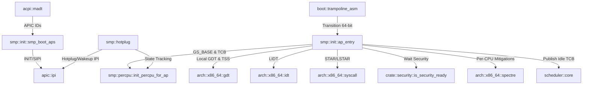

# Analyse Détaillée du Module : `kernel/src/arch/x86_64/smp`

## 1. Vue d'Ensemble du Module

Le module `kernel/src/arch/x86_64/smp` (Symmetric Multi-Processing) assure l'amorçage, la configuration des Application Processors (APs), la gestion des données isolées par processeur (structures `PerCpuData` via le registre de segment `GS`), ainsi que le mécanisme d'activation et désactivation dynamique des cœurs logiques (CPU hotplug).

Le sous-dossier contient 4 fichiers sources :
- [`mod.rs`](file:///c:/Users/xavie/Desktop/Exo-OS/kernel/src/arch/x86_64/smp/mod.rs) : Déclarations de sous-modules et réexportations publiques (`smp_boot_aps`, `PerCpuData`, `cpu_is_online`).
- [`init.rs`](file:///c:/Users/xavie/Desktop/Exo-OS/kernel/src/arch/x86_64/smp/init.rs) : Séquence d'amorçage MP (INIT-SIPI-SIPI), handshake mémoire basse et point d'entrée Rust des APs (`ap_entry`).
- [`percpu.rs`](file:///c:/Users/xavie/Desktop/Exo-OS/kernel/src/arch/x86_64/smp/percpu.rs) : Structure et layout mémoire fixe de `PerCpuData`, accès MSR `GS_BASE`, miroir du compteur de préemption, tests de régression P2-7.
- [`hotplug.rs`](file:///c:/Users/xavie/Desktop/Exo-OS/kernel/src/arch/x86_64/smp/hotplug.rs) : Masque atomique d'état des processeurs, mise en ligne / hors ligne dynamique et boucle d'attente à basse consommation.

---

## 2. Analyse Ligne par Ligne et Invariants de Sécurité

### 2.1 `init.rs` : Séquence d'Amorçage Multiprocesseur et Initialisation des APs
- **Protocole Matériel INIT-SIPI (Intel MP / ACPI) :**
  - Le Bootstrap Processor (BSP) prépare la zone de handshake dans le trampoline en mémoire basse (`0x6000 + 0x10`).
  - Envoi de l'IPI INIT via `ipi::send_init_ipi(dest_apic_id)`.
  - Pause calibrée de 10 ms (`tsc::tsc_delay_ms(10)`).
  - Envoi de deux IPIs STARTUP (SIPI) avec le vecteur de page du trampoline (`TRAMPOLINE_PAGE = 6`, correspondant à l'adresse physique `0x6000`).
  - Attente active avec timeout de 100 ms sur la signature magique `AP_ALIVE_MAGIC = 0xA1_1A_1A_A1`.
- **Point d'Entrée des Cœurs Secondaires (`ap_entry`) :**
  - Exécuté par chaque AP après le passage en mode long 64-bit et activation de la pagination via le trampoline assembleur.
  - Initialise la zone per-CPU (`GS_BASE`) avant tout autre accès.
  - Charge la GDT locale et la TSS dédiée (`super::super::gdt::init_gdt_for_cpu`).
  - Charge l'IDT globale (`load_idt`).
  - **Séquencement Critique Syscall :** Configure les MSRs `STAR`, `LSTAR`, `SFMASK` (`super::super::syscall::init_syscall`) **avant** toute activation des interruptions locales (`sti`).
  - Initialise le contrôleur LAPIC de l'AP (`init_ap_local_apic`).
  - Initialise le TSC invariant et le coprocesseur FPU/AVX (`init_fpu_for_cpu`).
  - **Correction Anti-Race Condition FIX-SMP-RACE (CVE-EXO-001) :**
    - Attend impérativement que le sous-système de sécurité soit totalement opérationnel (`while !crate::security::is_security_ready() { core::hint::spin_loop(); }`) avant de modifier ou d'enregistrer des structures partagées avec le scheduler central.
  - Publie le TCB idle initial de l'AP (`publish_current_boot_idle`).
  - Initialise les runqueues scheduler locales (`scheduler::init_ap`).
  - **Mitigations Spectre AP :** Applique les réglages de sécurité matérielle (IBRS/STIBP/SSBD et PML4 shadow KPTI) sur le cœur secondaire (`spectre::apply_mitigations_ap`).
  - Active les interruptions locales via `sti` et entre dans la boucle `hlt`.

### 2.2 `percpu.rs` : Structure `PerCpuData` et Isolation Cache Line
- **Disposition Fixe (Layout ABI Kernel) :**
  - Les 11 premiers champs 64-bit ont des offsets fixes stricts synchronisés avec le code assembleur (`syscall_entry_asm` et stubs d'exceptions) :
    - `0x00` : `kernel_rsp` (pile noyau du thread courant)
    - `0x08` : `user_rsp` (RSP utilisateur sauvegardé)
    - `0x10` : `cpu_id` (identifiant logique du processeur)
    - `0x18` : `lapic_id` (identifiant matériel APIC)
    - `0x20` : `current_tcb` (pointeur vers le TCB du thread actif)
    - `0x28` : `idle_rsp` (pile de la boucle idle de ce cœur)
    - `0x30` : `preempt_shadow` (miroir du verrou de préemption)
    - `0x38` : `irq_depth` (profondeur d'imbrication des interruptions)
    - `0x40` : `kpti_kernel_cr3` (registre CR3 noyau KPTI)
    - `0x48` : `kpti_user_cr3` (registre CR3 utilisateur KPTI)
    - `0x50` : `syscall_scratch` (registre temporaire pour l'échange CR3)
  - Des assertions statiques compile-time valident ces offsets : `assert!(offset_of!(PerCpuData, current_tcb) == 0x20)`.
- **Alignement et Faux-Partage :**
  - Structure annotée `#[repr(C, align(64))]` pour correspondre à la taille d'une ligne de cache x86_64 (64 octets), éliminant tout phénomène de faux partage (*false sharing*) entre cœurs lors d'accès intensifs.
- **Sécurité Mémoire et Registre GS :**
  - Chaque processeur accède exclusivement à son entrée `PerCpuData` via le registre de segment `GS` configuré par `msr::write_msr(msr::MSR_GS_BASE, addr)`.
  - Le MSR `MSR_KERNEL_GS_BASE` est initialisé à 0 pour éviter d'exposer la mémoire per-CPU noyau à l'espace utilisateur avant l'instruction `SWAPGS`.
  - La fonction `try_read_current_tcb()` valide que le `GS_BASE` actuel est bien dans les bornes autorisées de `PER_CPU_TABLE` avant de déréférencer le pointeur, prévenant les fautes de page en cascade sur `CR2 = 0x20`.

### 2.3 `hotplug.rs` : Gestion Dynamique des Processeurs
- **Bitmask Atomique :**
  - Tableau d'atomes 64-bit `[AtomicU64; ONLINE_MASK_WORDS]`, dimensionné via `MAX_CPUS.div_ceil(64)`.
  - Bit 0 réservé au BSP (toujours initialisé à 1).
- **Invariant BSP Indéboulonnable :**
  - `cpu_offline(cpu_id, lapic_id)` refuse catégoriquement d'éteindre le processeur 0 (`if cpu_id == 0 { return false; }`).
- **Mise Hors Ligne Propre :**
  - Envoie un IPI dédié `ipi::send_ipi_cpu_hotplug(lapic_id)`.
  - Le processeur cible désactive ses interruptions locales (`cli`), met à jour le masque atomique (`set_cpu_offline`), et s'endort dans une boucle contrôlée `sti; hlt; cli`.
- **Réveil / Mise en Ligne :**
  - Tente d'abord un réveil léger via `ipi::send_ipi_wakeup`.
  - Si le cœur ne répond pas sous 100 ms, bascule sur une réinitialisation matérielle complète INIT + SIPI.

---

## 3. Matrice des Dépendances et Relations Inter-Modules

---

## 4. Statut de Conformité et Synthèse

| Fichier | Lignes | État de Compilation | Sécurité Concurrence & Memory Safety |
| :--- | :--- | :--- | :--- |
| `mod.rs` | 19 | Conforme (0 warnings) | Exports canoniques conformes |
| `init.rs` | 198 | Conforme (0 warnings) | Barrière FIX-SMP-RACE respectée, MSRs syscall initialisés avant STI |
| `percpu.rs` | 510 | Conforme (0 warnings) | Alignement 64-byte anti false-sharing, layout GS fixe validé par assertions |
| `hotplug.rs` | 186 | Conforme (0 warnings) | Masque atomique calculé par div_ceil(64), protection stricte du CPU 0 |
