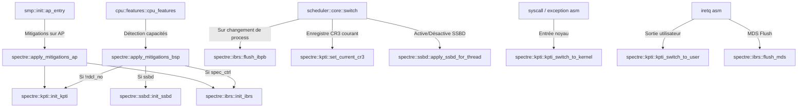

# Analyse Détaillée du Module : `kernel/src/arch/x86_64/spectre`

## 1. Vue d'Ensemble du Module

Le sous-système `kernel/src/arch/x86_64/spectre` implémente les contre-mesures microarchitecturales contre les failles d'exécution spéculative affectant les processeurs modernes x86_64 :
- **Spectre v1 / Bounds Check Bypass** : Barrières `lfence` dans les chemins de désérialisation et d'accès utilisateur.
- **Spectre v2 / Branch Target Injection** : Retpolines, IBRS (Indirect Branch Restricted Speculation), STIBP (Single Thread Indirect Branch Predictor), et IBPB (Indirect Branch Predictor Barrier).
- **Spectre v4 / Speculative Store Bypass (SSBD)** : Désactivation de la spéculation lecture-après-écriture via MSRs Intel et AMD.
- **Meltdown (Rogue Data Cache Load)** : Isolation des tables de pages noyau / utilisateur (KPTI - Kernel Page-Table Isolation) et activation de SMEP / SMAP.
- **MDS (Microarchitectural Data Sampling / RIDL, Fallout, ZombieLoad)** : Vidage des tampons microarchitecturaux via instruction `VERW`.

Le module comprend 5 fichiers sources :
- [`mod.rs`](file:///c:/Users/xavie/Desktop/Exo-OS/kernel/src/arch/x86_64/spectre/mod.rs) : Coordination centrale des mitigations pour le BSP et les APs.
- [`ibrs.rs`](file:///c:/Users/xavie/Desktop/Exo-OS/kernel/src/arch/x86_64/spectre/ibrs.rs) : Gestion matérielle IBRS, eIBRS, STIBP, barrière IBPB et flush MDS (`VERW`).
- [`kpti.rs`](file:///c:/Users/xavie/Desktop/Exo-OS/kernel/src/arch/x86_64/spectre/kpti.rs) : Tables de pages isolées noyau / espace utilisateur, support PCID sans flush TLB, et synchronisation shadow per-CPU.
- [`retpoline.rs`](file:///c:/Users/xavie/Desktop/Exo-OS/kernel/src/arch/x86_64/spectre/retpoline.rs) : Thunks assembleur et macros de sauts indirects sécurisés neutralisant le BTB (Branch Target Buffer).
- [`ssbd.rs`](file:///c:/Users/xavie/Desktop/Exo-OS/kernel/src/arch/x86_64/spectre/ssbd.rs) : Contrôle du Speculative Store Bypass au niveau global et par thread (Intel SPEC_CTRL et AMD VIRT_SPEC_CTRL).

---

## 2. Analyse Ligne par Ligne et Invariants de Sécurité

### 2.1 `mod.rs` : Orchestration des Mitigations
- Détecte les capacités du CPU via `cpu_features()` :
  - Si le CPU ne présente pas le bit `RDCL_NO` (Rogue Data Cache Load Not Susceptible), KPTI est obligatoirement activé (`kpti::init_kpti()`).
  - Si `has_spec_ctrl()`, active IBRS / STIBP (`ibrs::init_ibrs()`).
  - Si `has_ssbd()`, configure SSBD (`ssbd::init_ssbd()`).
- `apply_mitigations_ap()` applique la même rigueur de sécurité sur tous les cœurs secondaires démarrés via SMP.

### 2.2 `ibrs.rs` : IBRS, eIBRS, STIBP, IBPB et MDS
- **Enhanced IBRS (eIBRS) :** Détecté via `features.ibrs_all()`. Une fois activé dans `MSR_IA32_SPEC_CTRL`, eIBRS reste actif en permanence au niveau matériel sans pénalité de réécriture MSR lors des transitions noyau/utilisateur.
- **IBRS Classique :** Activé par le bit `SPEC_CTRL_IBRS`.
- **STIBP :** Activé sur les processeurs supportant le multithreading simultané (HyperThreading / SMT) pour empêcher l'empoisonnement croisé du prédicteur de branche entre threads logiques frères.
- **Barrière IBPB (`flush_ibpb`) :** Écrit dans `MSR_IA32_PRED_CMD` (`PRED_CMD_IBPB`) lors des changements de contexte entre processus mutuellement méfiants pour vider intégralement le prédicteur de branches indirectes.
- **Mitigation MDS (`flush_mds`) :**
  - Exécute `verw [{sel}]` avec le sélecteur `GDT_USER_DS`.
  - Sur les microcodes Intel patchés (flag `md_clear`), l'instruction `VERW` sur un sélecteur de données valide provoque le vidage immédiat des store buffers, des fill buffers et des load ports microarchitecturaux.

### 2.3 `kpti.rs` : Kernel Page-Table Isolation (Meltdown)
- **Architecture Double PML4 :**
  - `cr3_kernel` mappe l'intégralité de la mémoire physique (physmap) et l'espace noyau.
  - `cr3_user` ne mappe que le code utilisateur et une surface minimale de transition (stubs assembleur syscall/interruption et pile de trampoline).
- **Élimination des Conflits Concurrents (FIX-KPTI-01) :**
  - Remplacement des variables globales atomiques uniques par un tableau `CR3_PER_CPU: [Cr3Slot; MAX_CPUS]` aligné sur 128 octets (`#[repr(C, align(128))]`), éliminant tout faux partage et garantissant qu'aucun cœur n'écrase le CR3 d'un autre cœur lors d'un context switch concurrent.
- **Gestion des Fautes de Page Dynamiques (FIX-KPTI-SHADOW-SYNC) :**
  - La méthode `set_current_cr3()` synchronise la moitié utilisateur de la PML4 shadow per-CPU avec la PML4 du processus courant via `sync_user_region_to_shadow()`. Ceci empêche les boucles de fautes de page (`#PF`) lors des accès mémoires demand-paged après un `fork`.
- **Accélération PCID (Process Context Identifiers) :**
  - Si le CPU supporte PCID (`has_pcid()`), KPTI utilise le bit `CR3_NO_FLUSH_BIT (1 << 63)` avec `PCID_KERNEL (0)` et `PCID_USER (1)`, évitant le flush complet du cache TLB à chaque appel système ou interruption.
- **Activation SMEP & SMAP :**
  - `init_kpti()` active matériellement SMEP (Supervisor Mode Execution Prevention, bit 20 du registre `CR4`) et SMAP (Supervisor Mode Access Prevention, bit 21 du registre `CR4`), interdisant au noyau d'exécuter du code utilisateur ou d'accéder aux données utilisateur hors des fenêtres `stac`/`clac`.

### 2.4 `retpoline.rs` : Neutralisation de Spectre v2
- Implémente la séquence retpoline canonique :
  - Empile l'adresse de retour via `call 2f`.
  - Capture la spéculation du processeur dans une boucle infinie de pause/barrière (`3: pause; lfence; jmp 3b`).
  - Le bloc `2:` écrase l'adresse de retour sur la pile avec la cible réelle (`mov [rsp], target`) puis exécute `ret`.
- Exporte les thunks globaux compatibles GCC/LLVM :
  - `__x86_indirect_thunk_rax`
  - `__x86_indirect_thunk_r11`

### 2.5 `ssbd.rs` : Désactivation du Speculative Store Bypass (Spectre v4)
- Gère le support hétérogène des architectures Intel et AMD :
  - Pour Intel : contrôle via `MSR_IA32_SPEC_CTRL` (bit 2 `SPEC_CTRL_SSBD`).
  - Pour AMD : contrôle via le registre spécifique `AMD_MSR_VIRT_SPEC_CTRL` (`0xC001_011F`).
- Fonction `apply_ssbd_for_thread(enable: bool)` permettant d'activer SSBD sélectivement pour les processus sensibles (ex: sandbox, machines virtuelles) sans pénaliser les processus haute performance ne manipulant pas de code non fiable.

---

## 3. Matrice des Dépendances et Relations Inter-Modules

---

## 4. Statut de Conformité et Synthèse

| Fichier | Lignes | État de Compilation | Sécurité Concurrence & Memory Safety |
| :--- | :--- | :--- | :--- |
| `mod.rs` | 45 | Conforme (0 warnings) | Détection rigoureuse des caractéristiques CPU |
| `ibrs.rs` | 125 | Conforme (0 warnings) | eIBRS automatique, IBPB inter-process, VERW MDS validé |
| `kpti.rs` | 237 | Conforme (0 warnings) | Isolation par slot CPU 128-byte anti-race, PCID sans flush, sync shadow |
| `retpoline.rs` | 93 | Conforme (0 warnings) | Thunks assembleurs conformes convention ABI x86_64 |
| `ssbd.rs` | 68 | Conforme (0 warnings) | Support bimodal Intel / AMD validé, granularité par thread |
