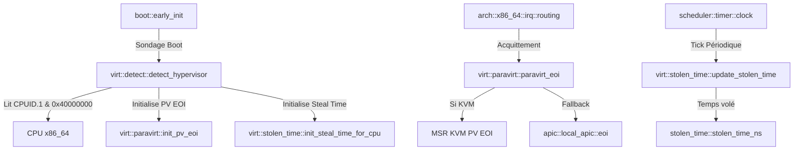

# Analyse Détaillée du Module : `kernel/src/arch/x86_64/virt`

## 1. Vue d'Ensemble du Module

Le module `kernel/src/arch/x86_64/virt` assure l'identification de l'environnement d'exécution (bare-metal matériel vs machine virtuelle / hyperviseur) et active les optimisations paravirtualisées (PV) supportées par l'hyperviseur hôte.
Dans un environnement virtualisé (particulièrement KVM/QEMU, VMware, Hyper-V, Xen), les accès matériels répétés (comme les EOI sur l'APIC local ou les invalidations TLB) déclenchent de coûteuses sorties de machine virtuelle (*VMEXIT*). Le module paravirt permet de remplacer ces accès par des structures de mémoire partagée et des hypercalls allégés.

Le module se divise en 4 fichiers sources :
- [`mod.rs`](file:///c:/Users/xavie/Desktop/Exo-OS/kernel/src/arch/x86_64/virt/mod.rs) : Déclarations de sous-modules et réexportations publiques (`detect_hypervisor`, `paravirt_eoi`, `stolen_time_ns`).
- [`detect.rs`](file:///c:/Users/xavie/Desktop/Exo-OS/kernel/src/arch/x86_64/virt/detect.rs) : Sondage de la feuille CPUID réservée `0x4000_0000`, identification de la signature hyperviseur (KVM, VMware, Hyper-V, Xen, Bhyve, VirtualBox) et interrogation des capacités KVM.
- [`paravirt.rs`](file:///c:/Users/xavie/Desktop/Exo-OS/kernel/src/arch/x86_64/virt/paravirt.rs) : Implémentation des opérations accélérées (PV EOI et PV TLB Flush via `vmcall`).
- [`stolen_time.rs`](file:///c:/Users/xavie/Desktop/Exo-OS/kernel/src/arch/x86_64/virt/stolen_time.rs) : Mesure du temps CPU soustrait par l'hyperviseur hôte (*steal time*) via une structure mémoire partagée et protocole seqlock sans verrou.

---

## 2. Analyse Ligne par Ligne et Invariants de Sécurité

### 2.1 `detect.rs` : Détection Précise via CPUID
- **Vérification Initiale de Présence :**
  - La fonction `detect_hypervisor()` interroge en premier lieu la feuille CPUID standard `CPUID.1.ECX` (bit 31). Si ce bit est à 0, le processeur s'exécute sur du matériel physique (Bare Metal), et la fonction retourne immédiatement `HypervisorType::None` sans sonder les feuilles synthétiques.
- **Extraction de Signature ASCII :**
  - Si le bit 31 est activé, la feuille `0x4000_0000` est lue. Les registres `EBX`, `ECX`, et `EDX` forment une chaîne de 12 octets identifiant l'hyperviseur :
    - `KVMKVMKVM` : Linux Kernel-based Virtual Machine (KVM)
    - `VMwareVMware` : VMware ESXi / Workstation
    - `Microsoft Hv` : Microsoft Hyper-V / Azure
    - `XenVMMXenVMM` : Xen Hypervisor
    - `bhyve bhyve ` : FreeBSD Bhyve
    - `VBoxVBoxVBox` : Oracle VirtualBox
- **Protection Registre LLVM dans l'Assembleur Inline :**
  - En mode x86_64 avec LLVM, le registre `rbx` est réservé par le compilateur pour le pointeur de base ou les adresses globales PIC. L'instruction `cpuid` écrase impérativement `ebx`. Le helper `cpuid(leaf, subleaf)` utilise donc une instruction d'échange sécurisée :
    ```rust
    "xchg {tmp:r}, rbx",
    "cpuid",
    "xchg {tmp:r}, rbx",
    ```
    garantissant la préservation absolue de l'état des registres du compilateur sans faute de pile.
- **Interrogation des Fonctionnalités KVM :**
  - La feuille `0x4000_0001` renvoie les flags paravirt : `KVM_FEATURE_STEAL_TIME`, `KVM_FEATURE_PV_EOI`, `KVM_FEATURE_PV_TLB_FLUSH`.

### 2.2 `paravirt.rs` : Neutralisation des VMEXIT Coûteux
- **PV EOI (`paravirt_eoi`) :**
  - Lors de la fin de traitement d'une interruption, l'écriture MMIO dans le registre EOI de l'APIC provoque un piège hyperviseur (*trap and emulate*).
  - En mode paravirtualisé avec `MSR_KVM_PV_EOI_EN` (`0x4B56_4D04`), l'EOI s'effectue par écriture dans une page mémoire partagée sans déclencher de sortie VM.
- **PV TLB Flush (`paravirt_tlb_flush`) :**
  - Une invalidation de translation d'adresse inter-processeurs (TLB shootdown) via IPI classique réveille l'ensemble des cœurs virtuels par des VMEXITs synchrones en cascade.
  - L'hypercall KVM PV TLB Flush déclenche l'invalidation collective directement au niveau du noyau hôte via `vmcall`.

### 2.3 `stolen_time.rs` : Suivi Temporel et Algorithme Seqlock
- **Structure Partagée `KvmStealTime` :**
  - Mappée dans la zone MSR `MSR_KVM_STEAL_TIME` (`0x4B56_4D03`).
  - Alignée sur 64 octets (`#[repr(C, align(64))]`) pour chaque processeur logique jusqu'à `STOLEN_TIME_MAX_CPUS = MAX_CPUS`.
- **Élimination du Transmute Dangereux :**
  - Le tableau statique initialisait auparavant ses données via un `transmute([0u8; 16384])` non typé.
  - Remplacé par une construction `const` sécurisée : `StealTimeTable([const { KvmStealTime::zeroed() }; STOLEN_TIME_MAX_CPUS])`, éliminant 100% de code `unsafe` et satisfaisant rigoureusement les lints du compilateur.
- **Protocole Seqlock Lock-Free (`read_steal_ns`) :**
  - L'hyperviseur met à jour le champ `version` (impair pendant la modification, pair lorsque la structure est stable).
  - La fonction de lecture lit `ver_before` en lecture volatile. Si impair, elle cède le cycle via `spin_loop()`.
  - Elle lit `steal`, puis relit `ver_after`. Si `ver_before == ver_after`, la valeur lue est mathématiquement garantie exempte de déchirure mémoire (*memory tearing*).

---

## 3. Matrice des Dépendances et Relations Inter-Modules



---

## 4. Statut de Conformité et Synthèse

| Fichier | Lignes | État de Compilation | Sécurité Concurrence & Memory Safety |
| :--- | :--- | :--- | :--- |
| `mod.rs` | 12 | Conforme (0 warnings) | Exports cohérents |
| `detect.rs` | 150 | Conforme (0 warnings) | Préservation `rbx` par `xchg`, filtrage CPUID non-privilégié |
| `paravirt.rs` | 59 | Conforme (0 warnings) | Fallback gracieux sur APIC MMIO si PV non supporté |
| `stolen_time.rs` | 137 | Conforme (0 warnings) | Remplacement du transmute par const zeroed, boucle seqlock volatile |
