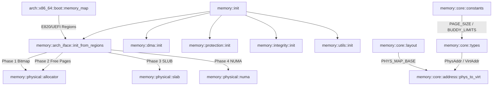

# Analyse Détaillée du Module : `kernel/src/memory` (Racine & `core`)

## 1. Vue d'Ensemble du Module

Le module `kernel/src/memory` constitue la **Couche 0** fondamentale d'Exo-OS.
Conformément aux règles strictes d'architecture du noyau (`regle_bonus.md`, `DOC2`) :
- La couche mémoire n'a **aucune dépendance descendante** vers les couches d'ordonnancement (`scheduler`), de processus (`process`), de communication (`ipc`), ou de système de fichiers (`fs`).
- L'ordonnancement hiérarchique des verrous (*lock ordering*) est strictement déterministe :
  $$\text{Memory} \longrightarrow \text{Scheduler} \longrightarrow \text{Security} \longrightarrow \text{IPC} \longrightarrow \text{FS}$$
- Le sous-dossier `kernel/src/memory/core` regroupe les définitions typées d'adresses physiques/virtuelles, le partitionnement spatial de la mémoire virtuelle 64-bit x86_64, et l'ensemble des constantes fondamentales vérifiées à la compilation.

Le périmètre analysé comprend :
- [`kernel/src/memory/mod.rs`](file:///c:/Users/xavie/Desktop/Exo-OS/kernel/src/memory/mod.rs) : Point d'entrée racine, séquence des 8 phases d'initialisation, réexportation unifiée.
- [`kernel/src/memory/arch_iface.rs`](file:///c:/Users/xavie/Desktop/Exo-OS/kernel/src/memory/arch_iface.rs) : Pont d'intégration entre la détection bootloader (E820 / UEFI) et les allocateurs physiques du noyau.
- [`kernel/src/memory/numa.rs`](file:///c:/Users/xavie/Desktop/Exo-OS/kernel/src/memory/numa.rs) : Façade d'accès transparente vers la topologie NUMA.
- [`kernel/src/memory/core/mod.rs`](file:///c:/Users/xavie/Desktop/Exo-OS/kernel/src/memory/core/mod.rs) : Réexportations des briques de base du sous-système.
- [`kernel/src/memory/core/types.rs`](file:///c:/Users/xavie/Desktop/Exo-OS/kernel/src/memory/core/types.rs) : Types transparents `PhysAddr`, `VirtAddr`, `Frame`, `Page`, indicateurs `PageFlags`, types de zones mémoire.
- [`kernel/src/memory/core/constants.rs`](file:///c:/Users/xavie/Desktop/Exo-OS/kernel/src/memory/core/constants.rs) : Constantes statiques (tailles de pages 4K/2M/1G, lignes de cache 64B, limites buddy, tailles de pools d'urgence, masques futex).
- [`kernel/src/memory/core/layout.rs`](file:///c:/Users/xavie/Desktop/Exo-OS/kernel/src/memory/core/layout.rs) : Cartographie virtuelle 48-bit (physmap 64 TiB, vmalloc 32 TiB, modules 8 TiB, fixmaps, heap, anneaux IPC, DMA coherent).
- [`kernel/src/memory/core/address.rs`](file:///c:/Users/xavie/Desktop/Exo-OS/kernel/src/memory/core/address.rs) : Algorithmes de translation d'adresses, canonicalisation bit 47, arithmétique de pagination et assertions d'alignement.

---

## 2. Analyse Ligne par Ligne et Invariants de Sécurité

### 2.1 `mod.rs` : Architecture et Séquencement d'Initialisation
- **Ordre Strict des Phases (`init`) :**
  - **Phase 1 (Physique) :**
    - `Phase 1a` : `init_phase1_bitmap` initialise le bitmap d'allocation physique couvrant l'espace `[phys_start, phys_end]`. L'EmergencyPool (`EMERGENCY_POOL_SIZE = 256`) est pré-initialisé dans les sections statiques avant tout appel (Règle `EMERGENCY-01`).
    - `Phase 1b` : `init_phase2_free_region` insère les plages physiques libres fournies par le BIOS/UEFI.
    - `Phase 1c` : `init_phase3_slab_slub` initialise les caches d'objets SLUB et le sous-système `cow::init()`.
    - `Phase 1d` : `init_phase4_numa` configure les nœuds NUMA (masque actif par défaut `0xFF`).
  - **Phase 2 (Virtuel) :** Déléguée à l'architecture (`virt::address_space::kernel::KERNEL_AS.init(pml4_phys)`).
  - **Phase 3 (Heap) :** Allocateur global `KernelAllocator` actif statiquement (`#[global_allocator]`).
  - **Phases 4 à 8 :** Initialisation successive de `dma::init()`, `protection::init()` (SMEP/SMAP/PKU), `integrity::init()` (KASAN-lite, canaris), `utils::init()` (futex, OOM killer), et `numa::init()`.

### 2.2 `arch_iface.rs` : Pont d'Intégration Bootloader
- **Normalisation E820 / UEFI (`PhysMemoryRegion`) :**
  - Les structures encapsulent l'adresse de base `base`, la taille `size` et l'énumération `PhysRegionType` (`Usable`, `Reserved`, `AcpiReclaimable`, `AcpiNvs`, `Defective`, `FirmwareReserved`).
- **Filtrage et Alignement :**
  - `init_from_regions` calcule la plus petite borne physique `phys_start` et la plus haute `phys_end`.
  - Aligne strictement les plages libres sur des multiples de `PAGE_SIZE` (4096 octets) vers le haut pour la base et vers le bas pour la fin (`base_adj >= end_adj` ignoré), interdisant toute corruption de mémoire réservée ou chevauchant les tables ACPI.

### 2.3 `core/types.rs` : Abstraction Forte d'Adresses et Documentation de Sécurité
- **`PhysAddr` & `VirtAddr` :**
  - Structures newtype annotées `#[repr(transparent)]` encapsulant un entier 64-bit `u64`.
  - Empêchent à la compilation toute confusion d'arithmétique de pointeur entre adresse physique matérielle et adresse virtuelle traduite par la MMU.
- **Ajout des Sections `# Safety` (Correction Clippy) :**
  - `PhysAddr::new_unchecked(addr: u64)` : Documente l'obligation d'une adresse physiquement adressable.
  - `VirtAddr::new_unchecked(addr: u64)` : Documente l'usage de sentinelles comme `USER_END`.
  - `VirtAddr::from_ptr<T>(ptr: *const T)` : Documente l'invariant de validité canonique.
  - `VirtAddr::as_ptr<T>(self)` et `VirtAddr::as_mut_ptr<T>(self)` : Documentent les exigences de mapping MMU, d'alignement de type `T`, et de droits d'écriture en table de pages.
- **`ZoneType` & `AllocFlags` :**
  - Distingue `ZoneDma` (< 16 MiB), `ZoneDma32` (< 4 GiB) et `ZoneNormal` (>= 4 GiB).
  - Flags d'allocation explicites : `ZEROED`, `DMA`, `DMA32`, `HIGHMEM`, `HUGE`, `ATOMIC`, `KERNEL`, `USER`.

### 2.4 `core/constants.rs` : Validation Statique Compile-Time
- Toutes les constantes structurelles font l'objet d'assertions `const _: () = assert!(...)` :
  - Puissances de 2 obligatoires : `PAGE_SIZE`, `HUGE_PAGE_SIZE`, `GIGA_PAGE_SIZE`, `CACHE_LINE_SIZE`, `DMA_RING_SIZE`, `IPC_RING_SIZE`, `FUTEX_HASH_BUCKETS`.
  - Tailles critiques vérifiées : `PAGE_SHIFT == 12`, `HUGE_PAGE_SHIFT == 21`, `EMERGENCY_POOL_SIZE >= 256` (anti-DoS par épuisement des nœuds d'attente scheduler), `ZONE_DMA_END == 16 * 1024 * 1024`.

### 2.5 `core/layout.rs` : Partitionnement Virtuel Canonique 48-Bit
- **Espace Utilisateur (128 TiB) :**
  - `USER_START` : `0x0000_0000_0001_0000` (page nulle protégée contre les déréférencements NULL).
  - `USER_END` : `0x0000_8000_0000_0000`.
  - `USER_MMAP_BASE` : `0x0000_0001_0000_0000` (4 GiB).
  - `USER_STACK_TOP` : `0x0000_7FFF_FFFF_0000`.
- **Trou Non-Canonique :** `0x0000_8000_0000_0000` à `0xFFFF_7FFF_FFFF_FFFF` (déclenche immédiatement un `#GP` au niveau processeur si accédé).
- **Espace Noyau Supérieur (128 TiB) :**
  - `0xFFFF_8000_0000_0000` : `PHYS_MAP_BASE` (physmap directe de 64 TiB, couverture atomique dynamique `PHYSMAP_LIMIT`).
  - `0xFFFF_C000_0000_0000` : `VMALLOC_BASE` (32 TiB pour vmalloc virtuellement contigu).
  - `0xFFFF_E000_0000_0000` : `MODULES_BASE` (8 TiB pour modules et drivers).
  - `0xFFFF_E800_0000_0000` : `FIXMAP_BASE` (1 TiB pour mappings statiques APIC, ACPI, HPET).
  - `0xFFFF_F000_0000_0000` : `KERNEL_HEAP_START` (1 TiB de tas noyau dynamique).
  - `0xFFFF_F100_0000_0000` : `IPC_RING_MAP_BASE` (256 GiB pour les canaux IPC partagés).
  - `0xFFFF_F200_0000_0000` : `DMA_MAP_BASE` (256 GiB pour la mémoire DMA cohérente).
  - `0xFFFF_FFFF_8000_0000` : `KERNEL_START` (chargement de l'exécutable ELF du noyau).

### 2.6 `core/address.rs` : Translation et Canonicalisation
- **Translations Physmap :**
  - `phys_to_virt(phys)` traduit en temps constant $O(1)$ n'importe quelle adresse physique sans parcours de table de pages : `VirtAddr(PHYS_MAP_BASE + phys)`.
  - `virt_to_phys_physmap(virt)` effectue la réciproque `PhysAddr(virt - PHYS_MAP_BASE)`.
- **Canonicalisation x86_64 :**
  - `canonicalize(addr)` effectue l'extension arithmétique de signe du bit 47 : `(((addr << 16) as i64) >> 16) as u64`.
  - `is_canonical(addr)` vérifie la stricte égalité entre l'adresse et sa forme canonique étendue.

---

## 3. Matrice des Dépendances et Relations Inter-Modules

---

## 4. Statut de Conformité et Synthèse

| Fichier | Lignes | État de Compilation | Sécurité Concurrence & Memory Safety |
| :--- | :--- | :--- | :--- |
| `mod.rs` | 183 | Conforme (0 warnings) | Couche 0 pure, 8 phases d'initialisation déterministes |
| `arch_iface.rs` | 188 | Conforme (0 warnings) | Découpage et alignement sûr des plages E820/UEFI |
| `numa.rs` | 13 | Conforme (0 warnings) | Façade de réexportation propre |
| `core/mod.rs` | 46 | Conforme (0 warnings) | Réexportation centralisée |
| `core/types.rs` | 987 | Conforme (0 warnings) | Sections `# Safety` complètes, types newtype transparents |
| `core/constants.rs` | 241 | Conforme (0 warnings) | Assertions statiques exhaustives à la compilation |
| `core/layout.rs` | 280 | Conforme (0 warnings) | Partitionnement 48-bit validé, limite atomique physmap |
| `core/address.rs` | 405 | Conforme (0 warnings) | Extension de signe bit 47, translations directes vérifiées |
