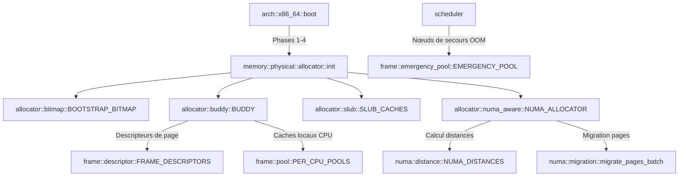

# Analyse Détaillée du Module : `kernel/src/memory/physical`

## 1. Vue d'Ensemble du Module

Le module `kernel/src/memory/physical` gère la mémoire physique matérielle (*RAM*) dans l'architecture Couche 0 d'Exo-OS.
Il intègre l'ensemble de la chaîne d'allocation et de recyclage des cadres de page (*page frames*) :
1. **Bootstrap Bitmap (`allocator/bitmap.rs`)** : Allocateur primaire d'amorçage gérant les allocations avant la mise en place de la physmap complète.
2. **Buddy Allocator (`allocator/buddy/`)** : Allocateur binaire par ordres ($2^0$ à $2^{12}$ pages, soit de 4 KiB à 16 MiB) découpé par zones physiques (`Dma`, `Dma32`, `Normal`, `Movable`).
3. **Caches d'Objets Slab & SLUB (`allocator/slab.rs`, `allocator/slub.rs`)** : Allocateurs d'objets fins (classes de taille de 8 à 2048 octets) prévenant la fragmentation interne.
4. **Descripteurs de Frames & Compteurs de Références (`frame/descriptor.rs`, `frame/ref_count.rs`)** : Table globale statique `FRAME_DESCRIPTORS` où chaque cadre de page 4 KiB physique est représenté par une structure compacte alignée de 32 octets (compteur CoW, drapeaux d'état atomiques, nœud NUMA, ordre buddy).
5. **Pool d'Urgence (`frame/emergency_pool.rs`)** : Réserve inconditionnelle de nœuds d'attente (Règle `EMERGENCY-01`, minimum 256 nœuds) pour garantir l'absence de blocage ou d'épuisement mémoire dans le scheduler lors de situations OOM critiques.
6. **Pools par Processeur (`frame/pool.rs`)** : Caches locaux LIFO per-CPU (`PER_CPU_POOLS`) évitant la contention de verrou sur le Buddy global.
7. **Gestion NUMA et Migration (`numa/`)** : Prise en compte de la topologie multi-nœuds, calcul des distances de proximité (tables ACPI SLIT/SRAT), politiques d'allocation (`LocalFirst`, `Interleave`, `Bind`, `Preferred`) et migration transparente de pages avec mise à jour des PTEs.

---

## 2. Analyse Ligne par Ligne et Invariants de Sécurité

### 2.1 `allocator/bitmap.rs` : Amorçage Sans Tas
- Utilisé pour allouer les structures initiales du noyau avant que la table complète des descripteurs de frames ne soit alimentée.
- Masque de bits statique : `0` représente une page libre, `1` une page allouée ou réservée.
- `add_free_region` est annotée `# Safety` pour garantir son exécution exclusive en phase pré-SMP.
- Implémentation du trait `Default` conforme aux exigences des lints Clippy.

### 2.2 `allocator/buddy/` : Gestion des Ordres et Fusions
- **Nœuds in-place (`node.rs`) :**
  - La structure `FreeNode` est logée directement dans les premiers octets de la page physique libre (aucun surcoût mémoire externe).
  - Dès qu'une page est allouée, le contenu de `FreeNode` est écrasé sans risque de corruption mémoire.
  - Sécurité des pointeurs : utilisation de `core::ptr::eq` pour la vérification de liste circulaire vide (`is_empty`).
- **Gestion des Zones (`zone.rs`) :**
  - Structure `BuddyZoneInner` protégée par un `Mutex`.
  - Opérations sur le bitmap d'ordre avec documentation rigoureuse de `# Safety` pour `bitmap_clear`, `bitmap_set`, `bitmap_is_free`, `init`, et `add_free_range`.
  - Fusion (*coalescing*) automatique des blocs compagnons (*buddies*) lors des libérations pour maximiser la disponibilité de grands ordres continus.

### 2.3 `allocator/slab.rs` & `slub.rs` : Caches d'Objets Fins
- Classes de taille canoniques : 8, 16, 32, 64, 128, 256, 512, 1024, 2048 octets.
- Détection fine des corruptions dans `slub.rs` :
  - Vérification de l'appartenance des objets au cache via `(addr - first_obj).is_multiple_of(self.info.size)`.
  - Détection immédiate des doubles libérations (*double-free*) et écritures après libération (*use-after-free*) via détection de motifs d'empoisonnement (*poison patterns*).

### 2.4 `frame/descriptor.rs` : Compacité Cache-Line (32 Octets)
- Chaque cadre physique est modélisé par `FrameDesc` :
  ```rust
  #[repr(C, align(32))]
  pub struct FrameDesc {
      pub refcount: AtomicU32,
      pub flags: AtomicU16,
      pub zone: u8,
      pub numa_node: u8,
      pub order: AtomicU8,
      pub lru_gen: AtomicU8,
      pub mapcount: AtomicU16,
      _pad: [u8; 20],
  }
  ```
- Deux descripteurs occupent exactement une ligne de cache x86_64 de 64 octets, maximisant le débit lors des balayages LRU.
- Suppression des constantes nommées à mutabilité intérieure (`const E: FrameDescEntry`) au profit de constructions atomiques directes `[const { FrameDescEntry::new() }; MAX_PHYS_FRAMES]`.
- Sécurité `mark_free` : vérifie impérativement `refcount == 0` avant de basculer les drapeaux vers `FREE`, empêchant la réallocation d'une page encore référencée.

### 2.5 `numa/` : Localité et Migration
- Matrice des distances symétrique dans `distance.rs` avec accès atomiques rapides.
- `migration.rs` permet de transférer physiquement le contenu d'un cadre d'un nœud saturé vers un nœud local au CPU actif, avec invalidation de translation MMU (*TLB shootdown*) et échange atomique de PTE via `swap_pte`.

---

## 3. Matrice des Dépendances et Relations Inter-Modules



---

## 4. Statut de Conformité et Synthèse

| Fichier / Sous-module | Description | État de Compilation | Sécurité Concurrence & Memory Safety |
| :--- | :--- | :--- | :--- |
| `allocator/bitmap.rs` | Allocateur bootstrap | Conforme (0 warnings) | Single-CPU lock, vérifications de bornes, Default ajouté |
| `allocator/buddy/` | Allocateur par ordres (0..12) | Conforme (0 warnings) | Coalescing vérifié, `core::ptr::eq` pour listes circulaires |
| `allocator/slab.rs` | Caches slab classiques | Conforme (0 warnings) | `# Safety` complètes, sections atomiques ordonnées |
| `allocator/slub.rs` | Allocateur SLUB sans métadonnées | Conforme (0 warnings) | Calcul d'alignement `is_multiple_of`, détection double-free |
| `allocator/numa_aware.rs` | Distribution par affinité NUMA | Conforme (0 warnings) | `NumaPolicy::Default` dérivé, isolation slot par CPU |
| `frame/descriptor.rs` | Métadonnées de frames 32B | Conforme (0 warnings) | Alignement 32-byte strict, élimination mutabilité const |
| `frame/pool.rs` | Caches LIFO per-CPU | Conforme (0 warnings) | Protection contre contention concurrente |
| `frame/ref_count.rs` | Compteur CoW atomique | Conforme (0 warnings) | CAS lock-free, suppression map_err redondant |
| `numa/` | Topologie, distances et migration | Conforme (0 warnings) | Protocoles de migration avec TLB shootdown |
