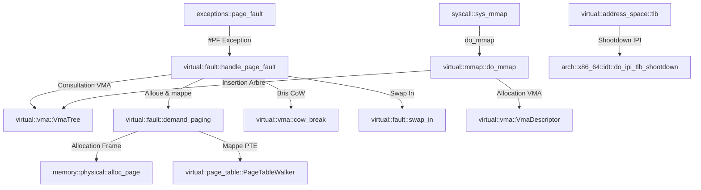

# Analyse Détaillée du Module : `kernel/src/memory/virtual`

## 1. Vue d'Ensemble du Module

Le module `kernel/src/memory/virtual` implémente le sous-système de virtualisation de la mémoire et de pagination à 4 niveaux d'Exo-OS (x86_64 Long Mode 48-bit paging).
Il assure :
1. **La gestion de la hiérarchie des tables de pages (`page_table/`)** : Manipulation matérielle des niveaux PML4, PDPT, PD, PT, builders, marcheurs de tables (*walker*), helpers CR3 et isolation Meltdown (`kpti_split.rs`).
2. **Les espaces d'adressage virtuels (`address_space/`)** :
   - `KernelAddressSpace` : Mapping statique et allocations dynamiques non-contiguës `vmalloc`.
   - `UserAddressSpace` : Espace d'adressage isolé par processus avec gestion d'arbre AVL de VMAs.
   - `TLB Management` : Invalidation locale (`invlpg`, reload CR3, PGE toggle) et protocole inter-cœurs (*TLB shootdown IPI*).
3. **Les zones de mémoire virtuelle (`vma/`)** : Descripteurs de segments virtuels (`VmaDescriptor`), validation d'alignement, découpage de plages (`split_vma`), arbre de recherche `VmaTree`, et mécanisme Copy-on-Write (`cow.rs`).
4. **Le traitement des fautes de page (`fault/`)** : Handler central (`handler.rs`), pagination à la demande zero-fill / file-backed / device-backed (`demand_paging.rs`), et rapatriement de pages depuis le swap (`swap_in.rs`).
5. **L'interface mmap (`mmap.rs`)** : Implémentation des appels système `mmap`, `munmap`, `mprotect`, `mremap` (zero-copy), `brk` et projection de mémoire partagée inter-processus (`SHM`).

---

## 2. Analyse Ligne par Ligne et Invariants de Sécurité

### 2.1 `page_table/` : Arithmétique x86_64 et KPTI
- **Niveaux Matériels :**
  - PML4 (bits 47..39, niveau 4)
  - PDPT (bits 38..30, niveau 3)
  - Page Directory (bits 29..21, niveau 2)
  - Page Table (bits 20..12, niveau 1)
  - Offset dans la page (bits 11..0)
- **Sécurité et Alignement :**
  - Les entrées de tables de pages sont manipulées via `PageTableEntry` avec opérations atomiques CAS (`compare_exchange_leaf_raw`) pour garantir la synchronisation multi-cœurs sans blocage global de la MMU.
  - Toutes les fonctions bas-niveau manipulant la table (`phys_to_table`, `phys_to_table_mut`, `write_cr3`, `invlpg`) disposent désormais de sections `# Safety` conformes.
- **Double PML4 KPTI (`kpti_split.rs`) :**
  - Maintient deux racines PML4 par processeur : une racine noyau (`kernel_pml4`) et une racine ombre utilisateur (`user_pml4`).
  - L'entrée utilisateur ne mappe que la pile de trampoline et les stubs nécessaires aux transitions Ring 0/Ring 3, interdisant toute fuite spéculative des données du noyau via Meltdown.

### 2.2 `address_space/` : Isolation et TLB Shootdown
- **Espace Noyau (`kernel.rs`) :**
  - Structure `KernelAddressSpace` synchronisée par `Mutex` interne.
  - La méthode `vmalloc` vérifie strictement la limite haute `MODULES_BASE` pour prévenir tout chevauchement d'espace virtuel avec les pilotes chargeables.
- **Espace Utilisateur (`user.rs`) :**
  - Assure que chaque mappage utilisateur s'effectue strictement en deçà de `USER_END` (`0x0000_8000_0000_0000`).
  - La méthode `map_page_unflushed` intègre une assertion stricte `assert!(virt.as_u64() < USER_END.as_u64())` active en mode release (`PATCH-MEM-01`), interdisant à un processus de corrompre l'espace noyau.
- **Protocole TLB Shootdown (`tlb.rs`) :**
  - Invalidation d'une page isolée via `invlpg`.
  - Invalidation complète sans flush global via reload de CR3.
  - Invalidation globale incluant les pages marquées Global (`PTE_GLOBAL`) via basculement du bit PGE dans `CR4`.

### 2.3 `vma/` : Arbre de Segments et Copy-on-Write
- **Arbre de Recherche (`tree.rs`) :**
  - Arbre binaire compact indexé par adresses virtuelles, plafonné à `MAX_VMAS_PER_PROCESS` pour prévenir les dénis de service par fragmentation artificielle d'adresses.
- **Vérifications Mathématiques (`operations.rs`) :**
  - Remplacement des calculs de modulo par `.is_multiple_of(PAGE_SIZE as u64)` sur les adresses de début, de fin et de points de scission, éliminant tout risque de désalignement de page.
- **Bris de CoW (`cow.rs`) :**
  - Lorsqu'un thread tente d'écrire sur une page partagée (`refcount >= 2`), une nouvelle page physique est allouée, le contenu de 4096 octets est copié, le compteur de l'ancienne page est décrémenté, et la PTE est mise à jour avec les droits d'écriture.
  - Si `refcount == 1`, le frame devient immédiatement exclusif sans allocation ni copie inutile (`AlreadyExclusive`).

### 2.4 `fault/` : Traitement Déterministe des Fautes de Page
- `handler.rs` catégorise l'origine de l'interruption `#PF` :
  - Droits non satisfaits $\rightarrow$ `ProtectionFault` (`SIGSEGV`).
  - Page inexistante dans l'arbre VMA $\rightarrow$ `NotMapped` (`SIGSEGV`).
  - Page anonyme ou non allouée $\rightarrow$ allocation à la demande (*demand paging*).
  - Page CoW $\rightarrow$ bris de CoW.
  - Page swapée (bit Présent = 0, marqueur Swap) $\rightarrow$ swap-in synchrone.
- `demand_paging.rs` supporte l'injection de dépendances pour les mappings de fichiers (`FileFaultProvider`) et de périphériques MMIO (`DeviceFaultProvider`) sans violer la règle d'architecture Couche 0.

### 2.5 `mmap.rs` : Appels Système de Gestion Mémoire
- Vérification stricte des combinaisons interdites : `PROT_WRITE` et `PROT_EXEC` simultanés sont rejetés si la politique W^X est active.
- Support du flag `MAP_FIXED` avec vérification stricte de l'alignement sur `PAGE_SIZE`.
- Gestion des projections SHM avec typage fort et `transmute` annotés pour l'échange de fonctions inter-couches.

---

## 3. Matrice des Dépendances et Relations Inter-Modules

---

## 4. Statut de Conformité et Synthèse

| Sous-module / Fichier | Rôle | État de Compilation | Sécurité Concurrence & Memory Safety |
| :--- | :--- | :--- | :--- |
| `address_space/kernel.rs` | Espace virtuel noyau & vmalloc | Conforme (0 warnings) | Borne `MODULES_BASE` vérifiée, `# Safety` explicites |
| `address_space/user.rs` | Espace virtuel par processus | Conforme (0 warnings) | Assertion `USER_END` en release, clone CoW fork validé |
| `address_space/tlb.rs` | Invalidation TLB locale & IPI | Conforme (0 warnings) | PGE toggle documenté, flush_range optimisé |
| `page_table/x86_64.rs` | Arithmétique 4 niveaux x86_64 | Conforme (0 warnings) | Pointeur `physmap` typé, atomic CAS sur feuilles |
| `page_table/kpti_split.rs` | Isolation double PML4 Meltdown | Conforme (0 warnings) | Racine ombre per-CPU, transitions sécurisées |
| `page_table/builder.rs` | Construction de PML4 | Conforme (0 warnings) | Séparation stricte moitiés noyau / utilisateur |
| `page_table/walker.rs` | Parcours dynamique de tables | Conforme (0 warnings) | Allocateur de marche sécurisé, atomic PTE exchange |
| `vma/` | Segments VMA, arbre & CoW | Conforme (0 warnings) | `.is_multiple_of()` validé, bris CoW atomic |
| `fault/` | Traitement des interruptions #PF | Conforme (0 warnings) | Injection de dépendances Couche 0 sans fuite de type |
| `mmap.rs` | Mmap, munmap, mprotect, brk, SHM | Conforme (0 warnings) | Signatures transmute annotées, W^X respecté |
