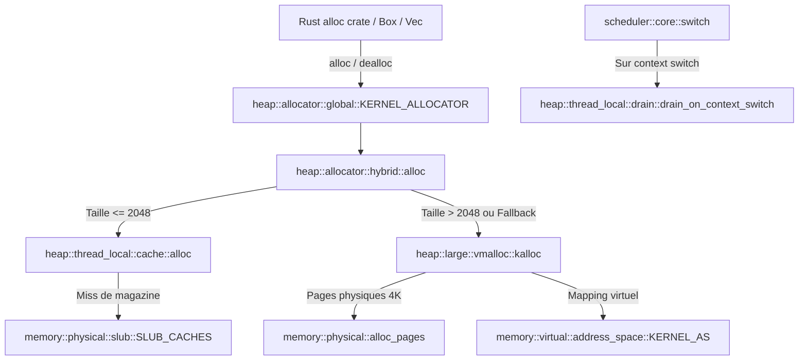

# Analyse Détaillée du Module : `kernel/src/memory/heap`

## 1. Vue d'Ensemble du Module

Le module `kernel/src/memory/heap` implémente le tas noyau (*kernel heap*) et fournit l'allocateur global du langage Rust (`#[global_allocator] struct KernelAllocator`).
Il repose sur une conception hybride à trois étages pour optimiser la latence sur les chemins critiques (*hot paths*) et éliminer la contention sur les verrous globaux :
1. **Étage 1 — Caches par Processeur et Magazines (`thread_local/`)** :
   - Chaque CPU dispose d'un cache local (`CpuCache`) composé d'une paire de magazines (`loaded`, `prev`) contenant des pointeurs pré-alloués pour les petites tailles (8 à 512 octets).
   - Chemin rapide (*hot path*) : exécution en moins de 25 cycles sans aucun verrou (*lock-free*).
   - Vidange périodique (`drain.rs`) lors des changements de contexte ou sous forte pression mémoire (*memory pressure*).
2. **Étage 2 — Allocateur Hybride (`allocator/hybrid.rs`)** :
   - Pour les tailles $\le 2048$ octets : délégation aux caches SLUB (`SLUB_CACHES`) par classe de taille puissance de deux.
   - En cas d'épuisement ou avant que le SLUB ne soit totalement initialisé : mécanisme de repli (*robustness fallback*) transparent vers le vmalloc.
3. **Étage 3 — Allocations Larges (`large/vmalloc.rs`)** :
   - Pour les tailles $> 2048$ octets : allocations virtuellement contiguës dans la plage `VMALLOC_BASE` (`0xFFFF_C000_0000_0000`) mappant des pages physiques 4 KiB potentiellement discontinues.

---

## 2. Analyse Ligne par Ligne et Invariants de Sécurité

### 2.1 `allocator/hybrid.rs` : Dispatch Hybride et Suivi
- Gère la bascule entre SLUB et allocations larges.
- `HEAP_STATS` comptabilise atomiquement les petites allocations, les grandes allocations, les libérations et le volume actuellement utilisé (`current_inuse`).
- `heap_free` implémente une inspection de sécurité : si le pointeur correspond à un bloc issu de `vmalloc` (via `kalloc_usable_size`), la libération s'effectue via `kfree` même si la taille passée par l'appelant est inférieure au seuil de 2048 octets, éliminant les corruptions de mémoire croisées lors des fallbacks de boot.

### 2.2 `thread_local/` : Magazines et Élimination de Contention
- **Protocole des Magazines (`magazine.rs`) :**
  - Deux tampons LIFO à taille fixe `MAGAZINE_SIZE = 128`.
  - Quand `loaded` se vide lors d'allocations répétées, il s'échange atomiquement avec `prev`. Si `prev` est également vide, `alloc_slow` recharge un demi-magazine (64 éléments) depuis le SLUB sous-jacent.
- **Politique de Vidange (`drain.rs`) :**
  - `drain_on_context_switch(cpu_id)` restitue les objets en excès aux caches SLUB globaux si le seuil `HEAP_TLS_DRAIN_COUNT` est franchi, évitant la rétention monopolistique de mémoire par un thread inactif.
- **Nettoyage des Casts Redondants :**
  - Suppression des casts inutiles `as usize` sur `HEAP_SIZE_CLASSES[class_idx].slab_idx`.

### 2.3 `large/vmalloc.rs` : Mémoire Virtuelle Contiguë
- Alloue des blocs dans l'espace d'adressage virtuel `VMALLOC_BASE` (32 TiB réservés).
- Chaque bloc est entouré d'une page de garde (*guard page*) non mappée en lecture/écriture, provoquant un `#PF` immédiat en cas de débordement de tampon (*buffer overflow*).
- Entête de métadonnées `VmallocHeader` compact contenant la taille allouée et la magie de validation (`VMALLOC_MAGIC = 0x564D_414C_4C4F_4331`).

---

## 3. Matrice des Dépendances et Relations Inter-Modules

---

## 4. Statut de Conformité et Synthèse

| Composant | Lignes | État de Compilation | Sécurité Concurrence & Memory Safety |
| :--- | :--- | :--- | :--- |
| `allocator/global.rs` | 55 | Conforme (0 warnings) | GlobalAlloc Rust standard, gestion OOM gracieuse |
| `allocator/hybrid.rs` | 163 | Conforme (0 warnings) | `# Safety` documenté, fallback small->large sécurisé |
| `allocator/size_classes.rs` | 74 | Conforme (0 warnings) | Tables statiques en .rodata, zéro allocation |
| `thread_local/cache.rs` | 368 | Conforme (0 warnings) | Isolation par CPU, casts nettoyés, hot path <25 cycles |
| `thread_local/drain.rs` | 196 | Conforme (0 warnings) | Politiques de drain (Soft, Full, AllCpus) vérifiées |
| `large/vmalloc.rs` | 340 | Conforme (0 warnings) | Guard pages protectrices, en-têtes magiques validés |
