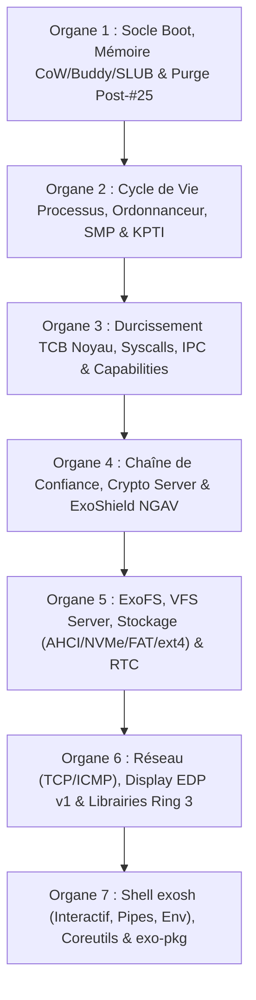

# Diagnostic Complet & Plan Directeur de Consolidation — Exo-OS v0.2.0 (« Strata »)

**Date** : 18 octobre 2026  
**Baseline de départ** : Commit `e7149437` (Bug #25 résolu — les 17 services Ring 1 démarrent et atteignent `exosh:/$`)  
**Périmètre** : `exo-boot/`, `loader/`, `kernel/`, `servers/`, `drivers/`, `libs/`, `userspace/`  
**Référentiels croisés** :
- Vision v0.2.0 (`docs/Vision v0.2.0/INDEX-STRATA.md`, `MASTER-CHECKLIST-STRATA.md`, `ROADMAP-STRATA.md`, `SPEC-*-STRATA.md`)
- Audits de Sécurité (`docs/FIX V2/4/2- audit Security/Audit 1`, `Audit 3`, `Audit 4/PLAN-SECURITE-V020.md`, `AUDIT-100-PERCENT.md`, `AUDIT-CRYPTO-DEEP.md`, `VERIFIED-BOOT.md`)
- Inspection statique et dynamique complète du code source live.

---

## 1. Synthèse Executive du Diagnostic

Maintenant que le **Bug #25** (pollution du slot KPTI `gs:[0x40]` lors d'`execve` in-place) est corrigé et que l'OS atteint `exosh:/$`, l'audit croisé du code source met en évidence **trois catégories de défauts** qui empêchent encore Exo-OS d'être un système d'exploitation véritablement stable, rapide, sécurisé et conforme à la v0.2.0 « Strata » :

1. **Séquelles de bissection Bug #25 & Fuites de ressources critiques (Stabilité & Performance)** :
   - **Échafaudage `#25` actif sur les chemins chauds** : Dans `kernel/src/memory/physical/allocator/buddy.rs` (`zero_pages`, `alloc_pages`, `free_pages`), **chaque allocation `AllocFlags::ZEROED`** appelle `diag_pid1_frame_mapped()`, qui parcourt les 4 niveaux de tables de pages de PID 1 ($O(N)$ par page allouée !). Dans `kernel/src/process/lifecycle/fork.rs`, chaque `fork()` écrase `DIAG25_INITF[0..24]` sans même vérifier `pid == 1` et épingle définitivement 24 frames physiques (`FrameFlags::RESERVED`).
   - **Latence artificielle de 8+ secondes au boot** : `servers/init_server/src/boot_sequence.rs` impose un `SYS_NANOSLEEP` de **500 ms** après chaque `vfork` de service et émet des traces `<P0>`..`<P8>` / `<SR2>`.
   - **Fuite permanente de frames CoW** : `track_cow_frame()` (`fork_impl.rs`) appelle `buddy::reserve_frame()`, mais `handle_cow_fault_in_as()` (`cow.rs`) n'appelle jamais `buddy::unreserve_frame()` lors de la restauration `WRITABLE` in-place (`refcount == 1`) ou de la dernière copie, rendant ces frames définitivement non libérables (`<25RSVD-REFUSE>`).
   - **Fuite critique de 256 KiB par processus terminé (`reap_zombie_child`)** : `ProcessControlBlock` n'a pas de `Drop` et `reap_zombie_child()` (`wait.rs:197–224`) détruit le PCB sans libérer `main_thread_rawptr` (`ProcessThread`), son `ThreadControlBlock`, son `Tid`, ni sa `KernelStack` de **256 KiB** (64 frames physiques + 66 pages `vmalloc`). Après quelques centaines de commandes shell, toute la RAM physique est épuisée.
   - **Corruption CoW dans `munmap` / `mprotect`** : `do_munmap_in_as` (`mmap.rs`) ignore `len` et libère les frames sans consulter `COW_TRACKER` ; `do_mprotect_in_as` écrase `PageFlags::COW` avec `PageFlags::WRITABLE` sur des pages partagées.

2. **Vulnérabilités de Sécurité Ouvertes (Audits 1, 3 et 4)** :
   - **Chaîne de confiance inactive (Tier 2.1-b/c)** : `verify_boot_attestation()` (`secure_boot.rs`) n'est appelée nulle part (`CHAIN_VERIFIED` reste `false`) et `verify_module_signature()` (`code_signing.rs`) n'est pas câblée dans `elf_loader_impl.rs`.
   - **Escalades de privilèges Syscalls / TCB** :
     - `KERN-023` : `sys_arch_prctl(ARCH_SET_FS / ARCH_SET_GS)` (`misc.rs`) exécute `wrmsr` sans vérifier la canonicité `< USER_ADDR_MAX` $\rightarrow$ `#GP(0)` Ring 0 immédiat depuis Ring 3.
     - `POLICY-001` : `sys_exo_ipc_create` (`table.rs:3777`) permet à n'importe quel PID non nul d'enregistrer un nom de service critique (`"crypto_server"`, `"exo_shield"`) et d'obtenir sa `ServiceClass` Ring 1.
     - `KERN-024` : `sys_kill` (`signal.rs:232`) permet à tout processus de tuer n'importe quel PID sans vérification d'UID/capability.
     - `IPC-01` & `KERN-016` : `mailbox_open`/`mailbox_close` (`raw.rs`) et `shm_map` (`mapping.rs`) ne vérifient pas le propriétaire / `CapToken`.
     - `KERN-030` : `sys_dma_alloc` autorise `DMA_MAP_FLAGS_BYPASS_IOMMU` sans contrôle de privilège.
     - `KTCB-02` : `CapTable::check_object` ignore la `generation` lors de la validation des capabilities.
     - `FS-CRIT-03` & `FS-CRIT-04` : `owner_matches` autorise l'accès quand `owner_uid == 0` ; la table globale `mmap` d'ExoFS ne vérifie pas `e.pid == current_pid()`.
   - **Courses SMP** : Absence de TLB shootdown distant sur faute CoW (`MEM-01`), mise à jour non atomique de `LAST_HASH` dans `exo_ledger_append` (`KTCB-04`), et course RMW sur `PKRS` dans `ExoVeil` (`KTCB-03`).
   - **KPTI incomplet (`Stage::Arch`)** : `init_kpti()` échoue car `_boot_pd` utilise des Huge Pages de 2 MiB (`ensure_next_table` refuse `is_huge()`) et `build_user_shadow_pml4` ne mappe pas la GDT (`gdt_base`).
   - **Failles `crypto_server` & `exo_shield`** : Sessions TLS utilisables par n'importe quel PID (`CS-TLS-01`), secret X25519 nul non rejeté (`CS-TLS-02`), `PHOENIX_WAKE_ENTROPY` forgeable (`CS-PHOENIX-01`), patterns jouets dans `exo_shield/src/engine/scanner.rs` (`\x0f\x05`, `\x48\x31\xc0`) déclenchant des faux positifs sur tous les binaires, et `ipc_gate` fail-open.

3. **Dysfonctionnements Opérationnels Serveurs, Libs & Gaps v0.2.0 « Strata »** :
   - **`ipc_router`** : Table `service_id_of(pid)` (`exocordon.rs:299`) désynchronisée de l'ordre réel de `init_server` ; `Registry` écrit sans jamais être lu.
   - **`network_server` & `exosh`** : `ping` échoue avec `EPERM` car `RAW_SOCKET_ALLOWED_PIDS = &[1, 7]` bloque `exosh` ; `tcping` échoue immédiatement car `handle_connect` répond `-EINPROGRESS` tout de suite au lieu de différer la réponse RPC jusqu'au handshake SYN-ACK ; `accept()` renvoie toujours `EAGAIN`.
   - **`exosh` interactif désactivé** : Toute l'édition de ligne interactive et l'historique par flèches Haut/Bas existent dans `servers/exosh/src/main.rs` (`read_line_interactive`), mais `_start` appelle `read_line()` basique ; il manque les pipes `|`, `&&`/`||` et `$VAR`.
   - **`vfs_server` & Stockage** : `MOUNTS` n'est pas consulté lors de la résolution des chemins ; `ahci`, `nvme`, `fat32`, `ext4` et `rtc` (`0x70`/`0x71`) ne sont pas câblés.
   - **Librairies `libs/exo-*`** : `exo-alloc` est un simple bump allocator (`dealloc` est un no-op) ; `exo-crypto`, `exo-network`, `exo-fs`, `exo-runtime`, `exo-posix` sont des stubs.

---

## 2. Plan d'Exécution Organe par Organe (7 Organes Séquentiels)

Conformément à la méthodologie demandée, nous consolidons **un organe complet à la fois**, avec validation systématique (compilation, `audit_constants.py`, tests unitaires et boot QEMU jusqu'à `exosh:/$`) avant de passer au suivant.

---

### ORGANE 1 — Socle Boot, Allocateur Physique/Virtuel (Buddy, SLUB, CoW, VMA) & Purge Post-#25
**Objectif** : Éliminer toute l'instrumentation de bissection `#25`, supprimer la latence artificielle de 8,5 s au boot, et éradiquer toutes les fuites/corruptions de mémoire physique et virtuelle (CoW, `munmap`, `mprotect`, SLUB).

1. **Purge intégrale de l'échafaudage Bug #25 & Accélération du Boot** :
   - `kernel/src/memory/physical/allocator/buddy.rs` : Supprimer `DIAG25_*`, `diag25_on_alloc`, `diag25_on_free`, `diag25_check_init`, `diag25_init_baseline`, `diag_ff_log`, le parcours PT de PID 1 dans `zero_pages` (`diag_pid1_frame_mapped`), et le refus `<25RSVD-REFUSE>` lié au contournement `#25`.
   - `kernel/src/process/lifecycle/fork.rs`, `exec.rs`, `elf_loader_impl.rs`, `switch.rs`, `exceptions.rs`, `table.rs`, `lib.rs`, `main.rs`, `exofs/mod.rs`, `virtio_adapter.rs` : Retirer tous les hooks, compteurs et buffers statiques de diagnostic `#25` (`diag_pfk_pid1`, `diag_wrckp_*`, `diag_ckp_page`, `diag_cka_pid1`, `DIAG25_INITF`).
   - `servers/init_server/src/boot_sequence.rs` & `main.rs` : Supprimer le `SYS_NANOSLEEP` artificiel de 500 ms par service, retirer `diag_step`/`v9_boot_text_hash`/`<SR2>`, et corriger l'appel `SYS_CLOCK_GETTIME` dans `main.rs:417, 423` (passer une vraie struct `Timespec` au lieu de `0`).
2. **Correction du sous-système CoW, `munmap`, `mprotect` et SLUB** :
   - `kernel/src/memory/virtual/address_space/fork_impl.rs` & `kernel/src/memory/virtual/fault/cow.rs` : Retirer l'épinglage abusif `buddy::reserve_frame(frame)` dans `track_cow_frame` et `<25PIN>` dans `cow.rs` ; s'assurer que le cycle de vie des frames CoW repose proprement sur `COW_TRACKER` (incrément au partage, décrément à la faute/libération, libération physique uniquement quand `remaining == 0`).
   - `kernel/src/memory/virtual/mmap.rs` : Corriger `do_munmap_in_as` pour respecter `len` et utiliser la logique de libération consciente de `COW_TRACKER` (`release_leaf_frame`) ; corriger `do_mprotect_in_as` pour préserver `PageFlags::COW` sur les pages partagées lors d'une transition vers `PROT_WRITE`.
   - `kernel/src/memory/physical/allocator/slub.rs` : Isoler/purger les objets corrompus dans `alloc_partial` au lieu de bloquer définitivement la classe de taille.
3. **Corrections Bootloader (`exo-boot`) & Sentinel (`ExoPhoenix`)** :
   - `exo-boot/src/bios/vga.rs:23` : Corriger `VGA_BUFFER_BASE` (`0xB8000` au lieu de `0xB800_0000`).
   - `exo-boot/src/kernel_loader/mod.rs:92–100` : Appliquer l'offset KASLR calculé lorsque `kaslr_enabled && elf.is_pie`.
   - `kernel/src/exophoenix/sentinel.rs` & `kernel/src/lib.rs:350` : Borner `walk_a_page_tables_iterative` à la taille réelle de l'image noyau (`kernel_a_image_size()`), éviter les faux positifs `SCORE_PF_FLOOD` sur les entrées non mappées légitimes, et réactiver `seed_kernel_a_image_blob()`.

---

### ORGANE 2 — Cycle de Vie des Processus, Ordonnanceur, SMP & KPTI
**Objectif** : Stopper l'hémorragie de 256 KiB par processus terminé, fiabiliser `wait4`/signaux, sécuriser le cohérence SMP et rendre KPTI fonctionnel.

1. **Destruction complète des processus et threads (`reap_zombie_child` / `reap_entry`)** :
   - `kernel/src/process/lifecycle/wait.rs`, `reap.rs`, `pcb.rs`, `tcb.rs` : Libérer proprement chaque `ProcessThread` (`main_thread_rawptr` et `thread_slots`), sa `KernelStack` de 256 KiB (64 frames physiques + région `vmalloc`), son `ThreadControlBlock`, son `Tid` (`TID_ALLOCATOR`) et sa table shadow KPTI éventuelle lors de la récolte du zombie.
2. **Correction de `do_waitpid` et de l'encodage `wstatus` des signaux** :
   - `kernel/src/process/lifecycle/wait.rs` : Fermer la fenêtre de *lost wakeup* entre la vérification des enfants zombies et `WAIT_TABLE.wait_interruptible()`.
   - `kernel/src/process/signal/delivery.rs` & `wait.rs` : Encoder correctement le signal de terminaison dans `wstatus` (`bits 0..6 = sig`, `bits 8..15 = exit_code`) pour que `WIFSIGNALED` / `WTERMSIG` et `WIFEXITED` / `WEXITSTATUS` soient conformes à POSIX.
3. **Cohérence SMP (TLB Shootdown CoW, ExoLedger, ExoVeil)** :
   - `kernel/src/memory/virtual/fault/cow.rs` : Déclencher un TLB shootdown inter-CPU (`MEM-01`) lorsqu'un espace d'adressage est partagé par plusieurs threads (`thread_count > 1`).
   - `kernel/src/security/exoledger.rs` : Unifier `exo_ledger_append` sur la boucle CAS sans course (`KTCB-04`).
   - `kernel/src/security/exoveil.rs` : Sérialiser les mises à jour de `PKRS` sous spinlock (`KTCB-03`).
4. **Refonte et Activation propre de KPTI (`kpti_split.rs`, `kpti.rs`)** :
   - Déplacer l'initialisation KPTI après `Stage::Memory` (sur les tables 4 KiB définitives du noyau et non sur `_boot_pd` en Huge Pages 2 MiB).
   - Cloner proprement les tables intermédiaires et mapper la GDT (`gdt_base`), l'IDT, le TSS, les piles d'entrée et le trampoline dans `build_user_shadow_pml4`, plus libérer récursivement les tables intermédiaires lors du teardown.

---

### ORGANE 3 — Durcissement TCB Noyau, Syscalls, IPC & Capabilities
**Objectif** : Fermer toutes les vulnérabilités d'escalade de privilèges identifiées dans les Audits 1, 3 et 4 au niveau des syscalls, de l'IPC noyau et du routeur IPC.

1. **Durcissement des Syscalls Critiques** :
   - `KERN-023` (`kernel/src/syscall/handlers/misc.rs:157–189`) : Valider que l'adresse `ARCH_SET_FS` / `ARCH_SET_GS` est strictement canonique utilisateur (`< USER_ADDR_MAX`) avant `wrmsr`.
   - `KERN-024` (`kernel/src/syscall/handlers/signal.rs:232–275`) : Vérifier que l'émetteur de `sys_kill` possède `uid == 0`, le même UID que la cible, ou la capability `CAP_KILL` (et protéger PID 1 et les serveurs Ring 1).
   - `POLICY-001` (`kernel/src/syscall/table.rs:3777–3836`) : Restreindre l'enregistrement des noms de services système (`register_service_class` dans `sys_exo_ipc_create`) aux processus lancés directement par `init_server` (`ppid == 1` ou capability dédiée).
   - `KERN-030` (`kernel/src/syscall/table.rs:5293–5340`) : Interdire `DMA_MAP_FLAGS_BYPASS_IOMMU` aux processus non privilégiés.
2. **Sécurisation IPC Noyau, Mémoire Partagée & Capabilities** :
   - `IPC-01` (`kernel/src/ipc/channel/raw.rs`) : Vérifier `owner_pid` dans `mailbox_open` / `mailbox_close`, nettoyer les boîtes aux lettres à la mort d'un processus, et remplacer les boucles `spin_loop()` longues par un ordonnancement coopératif (`yield_now` / `WaitQueue`).
   - `KERN-016` (`kernel/src/ipc/shared_memory/mapping.rs`) : Valider le `CapToken` ou l'appartenance ACL du processus appelant dans `shm_map`.
   - `KTCB-02` (`kernel/src/security/capability/table.rs` & `captable.rs`) : Vérifier la `generation` de la capability dans `check_object` pour garantir l'effectivité des révocations.
3. **Alignement de `servers/ipc_router/`** :
   - Synchroniser `service_id_of(pid)` (`exocordon.rs`) et `EXO_SHIELD_ENDPOINT` (`security_gate.rs`) avec la table réelle des services d'`init_server`.
   - Dédupliquer les enregistrements dans `Registry::register_hash` et câbler la résolution de noms IPC.

---

### ORGANE 4 — Chaîne de Confiance, `crypto_server` & `exo_shield` (NGAV)
**Objectif** : Activer la chaîne de confiance de bout en bout (Verified Boot + signature des modules), blinder `crypto_server` et rendre `exo_shield` opérationnel sans faux positifs.

1. **Activation de la Chaîne de Confiance (Tier 2.1-b/c)** :
   - Appeler `verify_boot_attestation()` lors de l'initialisation sécurité du noyau (`kernel/src/lib.rs`) afin d'activer `CHAIN_VERIFIED`.
   - Câbler la vérification des binaires ELF (`verify_module_signature` / manifeste ExoFS) dans `elf_loader_impl.rs` / `exec.rs` et protéger `secure_boot::disable_enforcement()`.
2. **Consolidation de `servers/crypto_server/`** :
   - `CS-TLS-01` : Lier chaque `TlsSession` au `sender_pid` propriétaire et vérifier `session.owner_pid == sender_pid` dans `tls_encrypt_record`, `tls_decrypt_record` et `tls_close`.
   - `CS-TLS-02/03` : Rejeter tout secret partagé X25519 entièrement nul (point d'ordre faible RFC 7748) et vérifier le `Finished` MAC lors du handshake TLS 1.3.
   - `CS-PHOENIX-01` : Authentifier `PHOENIX_WAKE_ENTROPY` via l'identité réelle de l'émetteur (noyau / `init_server`) et non via un bit forgeable dans `req.reply_endpoint`.
   - `CS-IPC-01` : Ajouter une éviction LRU/timeout sur les slots `VerifyContext` pour empêcher tout DoS par épuisement des 4 contextes.
3. **Refonte de `servers/exo_shield/` (Tier 3.2 / 3.3 & Strate 4)** :
   - Supprimer les signatures jouets de `scanner.rs` (`\x0f\x05` = `syscall`, `\x48\x31\xc0` = `xor rax,rax`) qui matchent 100 % des binaires légitimes (`SCAN-FP-1`), et ne conserver que de vraies signatures multi-octets d'exploits/shellcodes et règles YARA (`engine/yara.rs`).
   - Passer `ipc_gate/access.rs` en mode **fail-closed** (rejeter les `msg_type` inconnus et valider `sender_pid` / `target_pid != 0`).
   - Câbler les moteurs `yara`, `behavioral/heuristic` et `network/ids` dans la boucle principale d'`exo_shield`.

---

### ORGANE 5 — ExoFS, `vfs_server`, Stockage (`ahci`, `nvme`, `fat32`, `ext4`) & Horloge RTC
**Objectif** : Fermer les failles de sécurité système de fichiers, activer le Tier 4 (affichage capability), et câbler le routage VFS multi-FS ainsi que l'horloge matérielle CMOS RTC.

1. **Sécurité & Robustesse ExoFS (`kernel/src/fs/`)** :
   - `FS-CRIT-03` (`object_fd.rs:31` & `vfs_compat.rs:362`) : Supprimer la condition `owner_uid == 0` qui court-circuite le contrôle de propriétaire.
   - `FS-CRIT-04` (`mmap.rs:309–416`) : Vérifier `e.pid == current_pid()` dans `munmap`, `msync` et `mprotect` du pont POSIX ExoFS.
   - `KC-29` & `KC-34` : Zeroizer systématiquement les clés `fscrypt` à la destruction (`Drop`) et supprimer le fallback pseudo-aléatoire LCG dans `entropy.rs`.
   - `elf_loader_impl.rs` : Gérer proprement les segments `PT_LOAD` adjacents partageant une frontière de page 4 KiB.
2. **Tier 4 — Affichage Natif des Capabilities (`PLAN-SECURITE-V020.md` Tier 4)** :
   - Enrichir `stat` / `SYS_EXOFS_STAT_EXT` et `ls` (`coreutils` et `exosh`) pour afficher les capabilities ExoFS (`[R·W·X·D·G·A | gen:N | obj:0x...]`) au lieu des permissions factices `rwxr-xr-x 1 root root`.
3. **Routage `vfs_server` & Horloge matérielle RTC (`0x70`/`0x71`)** :
   - Câbler la table `MOUNTS` dans `servers/vfs_server/src/main.rs` pour router effectivement `/`, `/proc`, `/sys`, `/dev` et les points de montage secondaires.
   - Implémenter la lecture CMOS RTC (`0x70`/`0x71`) au boot pour initialiser l'heure epoch réelle du système (`SYS_CLOCK_GETTIME` `CLOCK_REALTIME`).

---

### ORGANE 6 — Pile Réseau (`network_server`), Display EDP v1 (`fb_server`) & Librairies Ring 3 (`libs/exo-*`)
**Objectif** : Rendre les outils réseau (`ping`, `tcping`, sockets TCP) pleinement fonctionnels, enrichir `fb_server` avec le protocole EDP v1, et doter les crates `libs/exo-*` de vraies implémentations.

1. **Correction de `servers/network_server/`** :
   - Corriger le handshake TCP asynchrone dans `handle_connect` (`main.rs:519, 716`) : ne pas envoyer `NetReply::ok(-EINPROGRESS)` immédiatement au client, mais enregistrer `(call.reply_ep, call.cookie)` dans `register_pending_connect` et envoyer la réponse RPC uniquement lorsque la connexion passe en `Established` (ou expire).
   - Autoriser `SOCK_RAW` (`IPPROTO_ICMP`) pour les processus disposant des droits nécessaires (dont `exosh`) afin de débloquer `ping`.
   - Implémenter `SocketTable::accept()` pour les sockets TCP en écoute (`Listen`).
2. **Protocole Graphique EDP v1 dans `servers/fb_server/`** :
   - Ajouter les primitives graphiques 2D et de gestion de surfaces (`FB_DRAW_RECT`, `FB_BLIT`, `FB_FLIP`, `CREATE_SURFACE`, `DAMAGE`, `COMMIT`) et supprimer l'inclusion relative fragile `#[path = "../../../exo-boot/..."]`.
3. **Consolidation des Librairies Ring 3 (`libs/` & `userspace/libexo`)** :
   - `libs/exo-alloc` : Remplacer le bump allocator par un véritable allocateur à listes libres (free-list / segregated bins) gérant `dealloc`, le coalescing et l'extension via `SYS_MMAP`.
   - `userspace/libexo/src/vfs.rs` : Garantir la terminaison par `\0` des chemins passés aux syscalls noyau.
   - `libs/exo-crypto`, `exo-network`, `exo-fs`, `exo-runtime`, `exo-posix` : Remplacer les stubs de constantes par les wrappers IPC/syscalls réels.

---

### ORGANE 7 — Shell `exosh` Interactif, Pipes/Variables, Coreutils Strata & `exo-pkg`
**Objectif** : Offrir une expérience utilisateur complète et fluide dans `exosh` et les utilitaires système v0.2.0.

1. **Shell `servers/exosh/` Complet** :
   - Activer l'édition de ligne interactive avec curseur et historique par flèches Haut/Bas (`read_line_interactive` / séquences ANSI).
   - Implémenter le chaînage de commandes (`&&`, `||`, `;`), les variables d'environnement (`$VAR`, `export`, `env`) et les pipes (`cmd1 | cmd2`).
2. **Utilitaires Système & Coreutils v0.2.0** :
   - Corriger `cmd_ps` / `cmd_top` dans `userspace/apps/coreutils/src/lib.rs` (3e argument `sizeof(ExoProcessInfo)` + affichage de l'état).
   - Ajouter/compléter les commandes d'administration système Strata : `lspci`, `lsblk`, `df`, `free`, `dmesg`, `ifconfig`, `date`, `grep`, `head`, `tail`, `mount`, `umount`, et le gestionnaire de paquets `exo` (`exo-pkg`).
