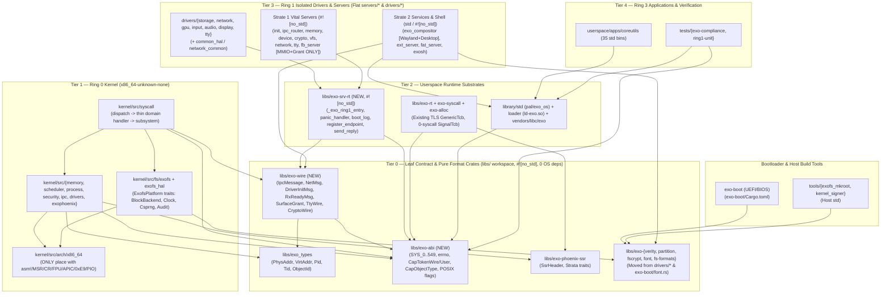

# Exo-OS v0.2.0 ("Strata") — Real-Code Segregation of Responsibilities & Unified Adaptation Plan

> **Document ID**: `EXO-ARCH-SEGREGATION-2026-11`  
> **Scope**: Full multi-workspace Exo-OS v0.2.0 repository (`exo-boot`, `kernel`, `libs`, `library/std`, `loader`, `drivers`, `servers`, `userspace`, `tests`, `tools`, CI/Semgrep/TLA+ gates)  
> **Inputs Compared**: Real repository source tree (`1,287` first-party `.rs` files, `423,491` LOC) vs. 5 pre-research PDF studies

---

## 1. Executive Summary & Real-Repository Baseline

### 1.1 Why All 5 Pre-Research PDFs Require Adaptation Before Execution

All five attached pre-research PDFs analyzed **only a partial archive (`kernel.zip`)** containing three directories (`kernel/`, `drivers/`, `servers/`, ~1,091–1,141 files, ~390,446 LOC). None of the five studies had access to the complete repository, which actually contains **six separate Cargo workspaces**, a **forked Rust `library/std` sysroot** (`target_os = "exo"`), a **custom dynamic linker** (`loader/` -> `/lib/ld-exo.so`), a **UEFI/BIOS verified bootloader** (`exo-boot/`), **five distinct compiler target specs**, and **hardcoded file-path CI/Semgrep/TLA+ enforcement scripts**.

Executing any of the five PDFs verbatim on the real repository would immediately break compilation or CI:
- **Workspace nesting failure**: Root [`Cargo.toml`](../Cargo.toml) already exists and explicitly excludes `libs`, `libs/wayland-rs`, `library`, and `tests/exo-compliance` because Cargo forbids nested workspaces across mixed `#![no_std]` and `-Z build-std` targets (breaks PDF 2 Phase P0).
- **Crate name collision**: [`libs/exo-rt`](../libs/exo-rt/src/lib.rs) already exists (500 lines implementing TLS `GenericTcb`, 0-syscall `SignalTcb` via `LOCK CMPXCHG16B`, `fork`/`execve`, and `PhoenixSafe`), colliding directly with PDF 1's proposal to create a new `libs/exo-rt` for Ring 1 `#![no_std]` server panic/IPC boilerplate.
- **7-way ABI duplication (not 2-way)**: Syscall numbers, `errno`, and capability layouts are duplicated across **seven** places (adding `library/std`, `libs/vendors/libc/src/unix/exo`, `loader`, `userspace/libexo`, and `tests/exo-compliance` to `kernel` and `servers/syscall_abi`), with **live discriminant/layout drift** already present in `CapToken` (`20 B` vs `48 B`, `IpcEndpoint = 1` vs `2`).
- **CI, Semgrep & Strata gate breakage**: [`tools/semgrep-rules/exoos.yaml`](../tools/semgrep-rules/exoos.yaml), [`tools/audit_constants.py`](../tools/audit_constants.py), [`tools/check_service_order.py`](../tools/check_service_order.py), [`tools/check_phoenix_strata.py`](../tools/check_phoenix_strata.py), [`tools/check_ipc_policy_mirror.py`](../tools/check_ipc_policy_mirror.py), and [`.github/workflows/audit.yml`](../.github/workflows/audit.yml) hardcode exact file paths (`exokairos.rs`, `exoargos.rs`, `elf_loader_impl.rs`, `scheduler/core/switch.rs`, flat `servers/<crate>/Cargo.toml`) that PDF 2, PDF 3, and PDF 4 propose renaming or nesting.
- **Post-S5B architectural evolution**: Wayland isolation (`servers/exo_compositor`, Strate 2 `std` with zero MMIO) and VirtIO-GPU (`servers/virtio_drivers` linking `exo-virtio-gpu`) are already live in [`Makefile`](../Makefile), invalidating PDF 2's claim that `virtio_drivers` is a dead block stub while leaving 2,854 lines of legacy `wayland.rs` inside `fb_server`.

### 1.2 Verified Ground-Truth Repository Inventory

Metrics below exclude upstream non-Exo targets in `libs/vendors/libc`, `libs/wayland-rs`, and `library/{core,alloc,std}` so first-party responsibilities are measured accurately:

| Subsystem / Directory | Cargo Workspace | Target Triple(s) | Environment | First-Party `.rs` Files | First-Party LOC | Actual Role in Repository |
| :--- | :--- | :--- | :--- | ---: | ---: | :--- |
| [`kernel/`](../kernel/Cargo.toml) | Root (`Cargo.toml`) | `x86_64-unknown-none` (+ host `test`) | Ring 0 `#![no_std]` + `alloc` | 826 | 308,919 | Dual-role microkernel/hybrid (`Kernel A` + `ExoPhoenix Kernel B`), memory, scheduler, IPC, security, GI-03 DMA/IOMMU, ExoFS |
| [`servers/`](../Cargo.toml) | Root (`Cargo.toml`) | `x86_64-exo-userspace.json` (19) & `x86_64-unknown-exo.json` (2: `exosh`, `exo_compositor`) | Ring 1 `#![no_std]` & Strate 2 `std` | 174 | 66,624 | 19 system servers + `exosh` shell + `syscall_abi` lib + `phase5-tests` lib |
| [`drivers/`](../drivers/Cargo.toml) | Root (`Cargo.toml`) | `x86_64-exo-userspace.json` (+ host rlibs) | Ring 1 `#![no_std]` | 91 | 14,903 | Hardware drivers (NVMe, AHCI, VirtIO-Blk/Net/GPU, e1000, PS/2, USB HID, VGA, HDA, TTY) **plus** 4 misplaced pure format/crypto libs (`verity`, `partition`, `fscrypt`, `fs`) |
| [`libs/`](../libs/Cargo.toml) (first-party) | `libs/Cargo.toml` | Multi-target (`none`, `userspace`, `exo`, host) | `#![no_std]` (+ `alloc`) | 71 | 7,418 | `exo_types`, `exo-phoenix-ssr`, `exo-rt`, `exo-syscall`, `exo-alloc`, `exo_allocator`, `exo-libc`, `exo-observability`, `exo-pkg`, + 8 port-catalog stubs |
| [`exo-boot/`](../exo-boot/Cargo.toml) | `exo-boot/Cargo.toml` | `x86_64-unknown-uefi` / BIOS | Boot `#![no_std]` | 35 | 6,980 | UEFI/BIOS bootloader with mandatory Ed25519+SHA-512 verification (`exo-verity`) and GPT scan (`exo-partition`) |
| [`loader/`](../loader/Cargo.toml) | Root (`Cargo.toml`) | `x86_64-exo-loader.json` | Ring 3 `#![no_std]` ET_DYN | 25 | 5,271 | `/lib/ld-exo.so` self-relocating ELF dynamic linker enforcing `EXO_RESTRICTION_NO_DLOPEN` |
| [`tests/exo-compliance/`](../tests/exo-compliance/Cargo.toml) | `tests/exo-compliance/Cargo.toml` | `x86_64-unknown-exo.json` | Ring 3 `std` | 4 | 4,095 | Bare-metal QEMU compliance, security, and ExoPhoenix 1s SLA qualification suite |
| [`userspace/`](../userspace/Cargo.toml) | `userspace/Cargo.toml` | `x86_64-unknown-exo.json` | Ring 3 `std` | 50 | 3,515 | 35 `coreutils` binaries (staged in `/bin`) + orphaned legacy `libexo` & `apps/exosh` |
| [`library/std/.../exo*`](../library/std/src/sys/pal/exo_os) | Synced to nightly sysroot | `x86_64-unknown-exo.json` (`-Z build-std`) | Ring 3 `std` PAL | ~24 (`8` in `pal/exo_os`) | ~7,100 (`3,337` in `pal/exo_os`) | Official Rust `std` port (`pal/exo_os`, `sys/*/exo.rs`, `std::os::exo`) |
| [`libs/vendors/libc/.../exo`](../libs/vendors/libc/src/unix/exo/mod.rs) | `libs/Cargo.toml` (`[patch.crates-io]`) | `x86_64-unknown-exo.json` | `#![no_std]` C ABI types | 1 | 1,439 | Patched `libc` definitions for `target_os = "exo"` |
| [`tools/`](../Cargo.toml) (Rust bins) | Root (`Cargo.toml`) | Host (`std`) | Host build tools | 2 | 990 | `exofs_mkroot` (root image builder) & `kernel_signer` (Ed25519 kernel signer) |
| **Total First-Party** | **6 Cargo Workspaces** | **5 Target Triples + Host** | **Rings 0 / 1 / 3 + Boot + Host** | **1,287+** | **~423,491** | **77 files > 800 lines; 328 files > 500 lines** |

*(In addition, [`libs/wayland-rs/`](../libs/wayland-rs/Cargo.toml) serves as the 6th Cargo workspace providing the pure-Rust Wayland stack + `exo-rustix` on `target_os = "exo"`.)*

### 1.3 Active Invariant Gates That Any Refactoring Must Preserve

| Gate / Script | Enforced Invariant | Hardcoded Paths / Structural Constraints |
| :--- | :--- | :--- |
| [`tools/semgrep-rules/exoos.yaml`](../tools/semgrep-rules/exoos.yaml) | 16 AST security/correctness rules (`SEC-09`, `KERN-01`, `SCHED-01..02`, `IPC-01..06`, `MEM-01`, `PROC-01`, `SYS-01`, `KAIROS-01`) | Hardcodes `/kernel/src/fs/exofs/syscall/**`, `/kernel/src/arch/constants.rs`, `/kernel/src/memory/physical/allocator/slub.rs`, `/kernel/src/scheduler/policies/cfs.rs`, `/kernel/src/scheduler/core/switch.rs`, `/kernel/src/ipc/**`, `/kernel/src/fs/elf_loader_impl.rs`, `/kernel/src/syscall/table.rs`, `/kernel/src/security/exokairos.rs` |
| [`tools/audit_constants.py`](../tools/audit_constants.py) | Cross-checks `MAX_CPUS`, `TICK_HZ`, `EXOARGOS_EPOCH_INTERVAL_MS`, `SSR_MAGIC`, IPC payload constants against docs | Hardcodes `kernel/src/arch/constants.rs`, `kernel/src/security/exoargos.rs`, `kernel/src/exophoenix/ssr.rs`, `docs/kernel/ipc/README.md` |
| [`tools/check_service_order.py`](../tools/check_service_order.py) | Verifies boot-wave topological DAG in `init_server` | Hardcodes `servers/init_server/src/service_table.rs` |
| [`tools/check_phoenix_strata.py`](../tools/check_phoenix_strata.py) | Enforces 3-Strata ExoPhoenix separation (`STRATE0` Ring 0, `STRATE1` 9 vital servers, `STRATE2` transient) | Requires **flat** `servers/<crate>` & `drivers/<crate>` directories; checks `libs/exo-phoenix-ssr/src/lib.rs`, `servers/exo_shield/src/{subscription,restore_sequence}.rs`; forbids `isolation.rs` outside Strate 1 |
| [`tools/check_ipc_policy_mirror.py`](../tools/check_ipc_policy_mirror.py) | Guarantees 67-edge `AUTHORIZED_EDGES` bit-for-bit parity between Ring 0 and Ring 1 | Hardcodes `kernel/src/security/ipc_policy.rs` and `servers/ipc_router/src/exocordon.rs` |
| [`.github/workflows/audit.yml`](../.github/workflows/audit.yml) | Runs `cargo deny`, Semgrep, clippy, Ring 1 server checks | Iterates `for manifest in servers/*/Cargo.toml` (forbids nesting `servers/<group>/<crate>`) |
| [`Makefile`](../Makefile) | Dual-pass Kernel A/B build, `exofs-root.img` staging, `-Z build-std` sysroot sync, QEMU smoke/compliance gates | Expects exact binary names in `ROOTFS_SERVER_PACKAGES` & `ROOTFS_SBIN_BINS` (including `exo-virtio-drivers`, `exo-compositor`, `exosh`) |
| [`kernel/src/lib.rs`](../kernel/src/lib.rs#L6-L24) | Layer 0..3 hierarchy, NO-ALLOC in `scheduler/core/` + ISR, Lock Order `Memory < Scheduler < Security < IPC < FS`, `SIGNAL-01`, `CAP-01`, `SCHED-03` | `futex` owned by `memory/utils/`; bare-metal target disables SSE2 (`-sse2`), requiring pure-`u32` ChaCha20 + BLAKE3 (never `poly1305`/`polyval` 128-bit split) |

---

## 2. Reference OS Segregation Models & The 8 Exo-OS Architectural Laws

### 2.1 Lessons Extracted from Production Reference OSes

| Reference OS | Core Segregation Mechanism | What Exo-OS Adopts | What Exo-OS Rejects |
| :--- | :--- | :--- | :--- |
| **Linux** (`include/uapi/`, `arch/`, `MAINTAINERS`) | Strict split between kernel-internal headers and user-visible `uapi/`; all CPU instructions/MSRs/trampolines isolated behind `arch/<isa>/`. | Dedicated zero-dependency ABI/wire contract crates (`libs/exo-abi`, `libs/exo-wire`); zero inline `asm!` outside `kernel/src/arch/` and leaf syscall/TLS runtime crates. | Monolithic C directory layout collapsing Ring 0, Ring 1 servers, and Ring 3 tools into one tree (PDF 4's error). |
| **Windows NT** (`hal.dll`, Executive `Ex`/`Mm`/`Ps`/`Se` vs private `Exp`/`Mi`/`Psp`, UMDF `Wudfhost.exe`) | Two-tier visibility (`Public` cross-subsystem API vs `Internal` subsystem-private helpers); user-mode driver host isolating driver crashes from Ring 0. | Explicit narrow `pub` facade per subsystem (`pub(super)`/`pub(crate)` internals; ban `use super::*` glob imports across large bridges); Ring 1 isolated driver servers over GI-03 syscalls. | Single giant executive binary for filesystems, networking, and GUI compositing. |
| **MINIX 3 & seL4** (`libsel4`, capability IPC, Reincarnation Server) | Tiny leaf ABI contract crate; mechanism in Ring 0, policy in tables/Ring 1 servers; stateless/checkpointed server resurrection. | `libs/exo-abi` leaf crate with zero internal dependencies; `ExoCordon` data-driven IPC policy; `ExoPhoenix` 3-Strata SSR recovery; Ring 0 IOMMU/DMA enforcement (`S19/S20/S39/S40`). | Moving hardware IOMMU page-table manipulation into Ring 1 (PDF 2's error—violates seL4/MINIX Ring 0 DMA isolation). |
| **Fuchsia / Zircon** (`//zircon/vdso/*.fidl`, `starnix` / `vfs`) | Single canonical ABI definition consumed by kernel, vDSO, libc, and `std`; pragmatic boundary keeping latency-critical primitives in kernel while isolating complex parsers/compositors in user space. | Canonical ABI crate + CI sync gate across `kernel`, `syscall_abi`, `loader`, `libc`, and `library/std`; S5B split keeping MMIO scanout in `fb_server` (Strate 1) and Wayland wire parsing in `exo_compositor` (Strate 2). | Full FIDL codegen compiler dependency in early bootstrap waves when a zero-dep Rust `#[repr(C)]` leaf crate works natively across all 6 workspaces. |
| **Redox & Theseus** (`redox-syscall`, `partitionlib`, strict crate DAG) | Pure `#![no_std]` leaf crates for syscalls and disk/crypto formats shared across bootloader, kernel, mkfs, and servers; strict bottom-up dependency direction. | Relocating cross-ring pure format/crypto crates (`exo-verity`, `exo-partition`, `exo-fscrypt`, `exo-font`, `exo-fs-formats`) into `libs/` so dependency arrows point strictly downward. | Splitting every struct/function into its own tiny crate (Theseus ~270-crate overhead) or keeping zero shared contract crates (PDF 3's error). |

### 2.2 The 8 Exo-OS Segregation Laws (`LAW-01` .. `LAW-08`)

1. **`LAW-01` (Leaf Contract Uniqueness)**: Every cross-boundary ABI constant (`SYS_*`, `errno`, flags) and `#[repr(C)]` wire struct (`CapToken*`, `NetMsg`, `DriverInitMsg`, `SurfaceGrant`, `TtyRequest`) is defined **exactly once** in a `#![no_std]`, zero-dependency leaf crate under `libs/` (`exo-abi` or `exo-wire`) with compile-time `size_of!`/`offset_of!` assertions.
2. **`LAW-02` (Strict Acyclic Workspace & Ring Direction)**: Dependency arrows flow strictly downward:
   - `libs/{exo_types, exo-abi, exo-wire, exo-phoenix-ssr, exo-font, exo-partition, exo-fscrypt, exo-verity}` ← **leaf tier** (never imports `kernel/`, `drivers/`, or `servers/`).
   - `kernel/` imports only leaf `libs/*` crates (plus `exo-virtio-blk` behind an explicit boot-storage adapter trait until initramfs/Ring 1 handoff). **Never** `kernel -> servers/*` or `#[path = ".../exo-boot/..."]`.
   - `drivers/*` import `libs/{exo-abi, exo-wire, exo-srv-rt}` and `drivers/*/common*`. **Never** `drivers/* -> servers/*`.
   - `servers/*` import `libs/*` and, **only for dedicated hardware-hosting daemons** (`virtio_drivers`, `tty_server`, `audio_server`, `usb_server`), their bound `drivers/*` crate. Pure format parsers (`ext4`, `fat32`) live in `libs/exo-fs-formats`, not `drivers/`.
3. **`LAW-03` (Hardware Behind the `arch/` & HAL Border)**: In Ring 0, raw `asm!`, `global_asm!`, `naked_asm!`, MSRs, CR0/CR3/CR4, `gs:` per-CPU offsets, FPU `fxsave64`/`xsave`, APIC/IOAPIC, and I/O ports (`0xE9`, `0x1F0`, `0xCF8`) live exclusively inside `kernel/src/arch/<isa>/` and expose safe/documented traits or functions to upper layers.
4. **`LAW-04` (Mechanism in Ring 0 Core, Policy in Data Tables or Ring 1/2)**: Syscall handlers validate pointers/capabilities and call one domain subsystem (`RULE SYS-03`). Device port whitelists (`0x60`/`0x64` PS/2), IPC authorization edges (`ExoCordon`), and untrusted wire parsers (Wayland `/run/wayland-0`, TCP/IP `smoltcp`) stay out of generic syscall dispatchers and MMIO guardians.
5. **`LAW-05` (Cohesive Module Duty, Not Mechanical Line-Count Slicing)**: Split files that mix **multiple responsibilities, lock levels, or state tables** (`special.rs`, `net_bridge.rs`, `fb_server/wayland.rs`, `handlers/misc.rs`, `mmap.rs`). Do **not** fracture cohesive single-duty modules (`memory/core/types.rs`, `syscall/validation.rs`, `fs_bridge/poll.rs`) just to hit an arbitrary line number.
6. **`LAW-06` (Wiring-Only `mod.rs` & Binary-Thin `main.rs`)**: `mod.rs` files declare submodules, `pub use` narrow facades, and run at most thin module-level `init()` orchestration (< 120 lines). Ring 1 `main.rs` files hold only `_start` + IPC loop, while pure state/protocol logic lives in `src/lib.rs` so host `cargo test` tests the **real** server code without copy-pasting (`phase5-tests`) or `#[path]` hacks.
7. **`LAW-07` (POSIX / Linux Compatibility Strictly on Top)**: Native Exo-OS mechanisms (capabilities, `EndpointId`, `ObjectId`/`BlobId`, `SurfaceGrant`, `NetGrant`) never depend on `compat/linux` or `compat/posix` translation layers.
8. **`LAW-08` (CI, Semgrep, TLA+ & Strata Co-Evolution)**: Flat `servers/<crate>` and `drivers/<crate>` layouts are preserved; when any file referenced by `exoos.yaml` or `tools/*.py` is split, either keep a thin facade at the audited path or update the Semgrep/Python rule **in the exact same commit**.

---

## 3. Critical Comparison of the 5 Pre-Research PDFs vs. Real Code

### 3.1 Side-by-Side Evaluation Matrix

| Evaluation Dimension | PDF 1 (*Reference Models & Files to Modify*, 13p) | PDF 2 (*Segregation Audit & Restructuring Plan*, 18p) | PDF 3 (*EXO/ARCH/2026-11 Refactoring Plan*, 26p) | PDF 4 (*Linux Model Tracker*, 351p) | PDF 5 (*Responsibility Segregation Plan*, 10p) | **Real Codebase Truth & Unified Decision** |
| :--- | :--- | :--- | :--- | :--- | :--- | :--- |
| **Input Scope Analyzed** | Partial `kernel.zip` (`kernel`, `drivers`, `servers`) | Partial `kernel.zip` (`kernel`, `drivers`, `servers`) | Partial `kernel.zip` (`kernel`, `drivers`, `servers`) | Partial `kernel.zip` (`1,141` files) | Partial `kernel.zip` (`1,091` files) | **6 Cargo workspaces**, `library/std`, `loader`, `exo-boot`, `userspace`, `tests`, `tools`, CI/Semgrep (`1,287+` FP files) |
| **Workspace Strategy** | Add `libs/exo-{abi,proto,rt}` | Create missing root `Cargo.toml` nesting `libs/*` | **Zero new crates** (pure file splits + `pub use`) | Collapse into Linux C tree (`fs/`, `net/`, `tools/`) | Add `libs/exo-{abi,wire,svc-rt,wayland-wire}` | Keep existing root `Cargo.toml` + separate `libs/Cargo.toml` (non-nested!); cross-link leaf crates via relative `path =` |
| **ABI / Syscall Strategy** | `libs/exo-abi` (saw 2 copies: `numbers.rs` & `syscall_abi`) | `abi/syscall_abi/` top-level dir | Keep separate copies (no new crates) | Linux `include/uapi/` style | `libs/exo-abi` (saw 2 copies, 330/331 consts) | **`libs/exo-abi`** feeding all **7 real consumers** (`kernel`, `syscall_abi` shim, `exo-syscall`, `loader`, `std`, `libc/exo`, `exo-compliance`) + CI sync script |
| **Runtime Helper Crate** | Proposes `libs/exo-rt` (**NAME COLLISION!**) | Not addressed | Keep per-server helpers | Not addressed | Proposes `libs/exo-svc-rt` (avoids collision!) | Keep existing Ring 3 `libs/exo-rt`; create **`libs/exo-srv-rt`** for Ring 1 `#![no_std]` servers/drivers |
| **Kernel `asm!` Border** | Measured 66 non-`arch` files; Wave 3 `arch::cpu/fpu/switch` | Brief mention | Partial (`entry_asm`) | Mechanical per-file notes | Brief mention | Verified **67 non-`arch` files**; isolate behind `kernel/src/arch/` while preserving Semgrep rule on `scheduler/core/switch.rs` |
| **IOMMU Split (`memory/dma/iommu` vs `drivers/iommu`)** | Unify DMA/IOMMU responsibilities cleanly in Ring 0 | **Move both into Ring 1 `drivers/iommu/`** (**UNSAFE!**) | Correctly distinguishes VT-d hardware vs PID domain table! | Mechanical keep/split | Merge or clarify boundary | **Keep both in Ring 0**; rename `drivers/iommu/domain_registry.rs` -> `pid_domain_registry.rs` to eliminate naming ambiguity |
| **`servers/virtio_drivers`** | Not flagged | Claims dead block stub -> **fold into `device_server`** (**WRONG!**) | Claims VirtIO-GPU server -> **rename `virtio_gpu_server`** (**BREAKS CI!**) | Keep | Not flagged | Verified: hosts **`exo-virtio-gpu` (`0x1AF4:0x1050`)** on endpoint 13! Keep crate/bin name for `Makefile`/Strata; fix stale `README.md` |
| **Misplaced `drivers/{verity,partition,fscrypt}`** | Not analyzed | Move `verity` to `drivers/staging/`; sever `kernel -> fscrypt/partition` | Keep in place | Move under Linux-like dirs | Not analyzed | Verified: shared across **`exo-boot`**, **`kernel`**, **`exofs_mkroot`**, **`kernel_signer`**! Relocate to **`libs/exo-{verity,partition,fscrypt}`** |
| **Wayland (`fb_server` vs `exo_compositor`)** | Wave 4: deduplicate `fb_server` & `exo_compositor` | Missed `exo_compositor` | Split `fb_server/wayland/` into 4 files inside `fb_server`! | Split by struct | Decision D1 + `libs/exo-wayland-wire` (14 dup items) | S5B already isolated `/run/wayland-0` in `exo_compositor`! **Delete dead Wayland wire/socket engine from `fb_server`**, leaving only `SurfaceGrant`/`DamageRect` scanout |
| **ExoFS (157K LOC in Ring 0)** | **Option A now** (Ring 0 behind traits `BlockDevice`/`Clock`/`Entropy`), preserve B/C | **P2a: Move all 157K LOC to Ring 1 in 1–2 weeks** (**UNREALISTIC**) | Keep in Ring 0; trim fat `mod.rs` files | Mechanical Linux `fs/` splits | Decision D3: trait-bounded crate | **Option A now** (`ExofsPlatform` traits + deduplicate `crypto`/`audit` + merge duplicate `test_standard.rs`), staging cold ops (`export`, `dedup`, `compress`) for Option B later |
| **CI / Semgrep / TLA+ Safety** | High (mostly additive/internal splits) | **Breaks Cargo workspace, `Makefile`, Ring 0 IOMMU, Semgrep** | **Breaks 6 CI scripts & Semgrep via path/server renames** | **Breaks entire Rust workspace & Ring boundaries** | High (`exophoenix/mod.rs` gating claim was false, otherwise sound) | **100% gate-preserving**: co-updates `exoos.yaml` & `tools/*.py` with thin facades where required |

### 3.2 Specific Factual Corrections to the 5 PDFs

1. **`kernel/src/exophoenix/mod.rs` line 9–10 (PDF 1 vs. PDF 5 contradiction)**:
   - PDF 5 claimed `pub mod fault_inject;` on line 10 was unconditionally compiled into release kernels.
   - **Verified ground truth** ([`kernel/src/exophoenix/mod.rs`](../kernel/src/exophoenix/mod.rs#L9-L10)): `#[cfg(feature = "phoenix-fault-injection")]` **is already present on line 9**. No bug exists there; only splitting the 1,181-line `fault_inject.rs` (if desired for readability under that feature) is optional.
2. **`kernel/src/memory/utils/futex_table.rs` placement (PDF 1 vs. `DOC3 RULE SCHED-03`)**:
   - PDF 1 Wave 2 proposed moving `futex_table.rs` (1,313 lines) to `kernel/src/sync/futex/*`.
   - **Verified ground truth** ([`kernel/src/lib.rs`](../kernel/src/lib.rs#L23)): `DOC3 RULE SCHED-03` explicitly mandates `futex ∈ memory/utils/` so Layer 0/1 lock ordering (`Memory < Scheduler`) is structurally respected without circular module dependencies. Therefore, `futex_table.rs` should be split **in place** under `kernel/src/memory/utils/futex/{mod,table,pi_robust,syscall_ops}.rs` with a re-export in `memory/utils/mod.rs`.
3. **Single-duty files > 800 lines that MUST NOT be split (PDF 3 right, PDF 2 & PDF 4 wrong)**:
   - [`kernel/src/memory/core/types.rs`](../kernel/src/memory/core/types.rs) (999 lines: Layer-0 `PhysAddr`/`VirtAddr`/`PageFlags` value types + compile-time layout tests), [`kernel/src/syscall/validation.rs`](../kernel/src/syscall/validation.rs) (917 lines: `UserPtr`/`UserSlice` SMAP-safe boundary checks), and [`kernel/src/syscall/fs_bridge/poll.rs`](../kernel/src/syscall/fs_bridge/poll.rs) (826 lines: cohesive `poll`/`select`/`epoll` readiness multiplexer) each hold a single cohesive responsibility and should **not** be artificially sliced.
4. **`special.rs` omission in PDF 4**:
   - PDF 4's automated tracker flagged 8 P1 files but missed [`kernel/src/syscall/fs_bridge/special.rs`](../kernel/src/syscall/fs_bridge/special.rs) (**3,054 lines** — the single largest first-party `.rs` file in the entire repository!), classifying it only as P2 REVIEW. In reality, `special.rs` is the #1 mandatory decomposition target in Ring 0.

---

## 4. Verified Ground-Truth Findings in the Real Codebase (`F-01` .. `F-12`)

### `F-01` — 7-Way Syscall & Errno Duplication + Live Naming/Doc Drift

Syscall numbers and `errno` constants are independently maintained in **seven** first-party files:

| # | File | Lines | Consumer Tier | Observed Drift / Defect |
| :-: | :--- | ---: | :--- | :--- |
| 1 | [`kernel/src/syscall/numbers.rs`](../kernel/src/syscall/numbers.rs) | 640 | Ring 0 dispatch (`0..550`) | Defines `SYS_PHOENIX_FORCE = 523`; duplicates `EINVAL` with `syscall/errno.rs`, `net_bridge.rs`, `exofs/syscall/validation.rs`, `pthread_compat.rs` |
| 2 | [`servers/syscall_abi/src/lib.rs`](../servers/syscall_abi/src/lib.rs) | 1,129 | Ring 1 `#![no_std]` servers & drivers | Renames `523` to `SYS_EXO_PHOENIX_FORCE`; mixes `SYS_*`, wire structs, and `_exo_ring1_entry` CRT assembly in `servers/` |
| 3 | [`library/std/src/sys/pal/exo_os/syscall.rs`](../library/std/src/sys/pal/exo_os/syscall.rs) | 1,653 | Rust `std` PAL (`target_os = "exo"`) | Renames `523` to `SYS_EXO_RESURRECT`; omits GI-03 (`530..549`); defines its own `errno` & `AF_INET` |
| 4 | [`libs/vendors/libc/src/unix/exo/mod.rs`](../libs/vendors/libc/src/unix/exo/mod.rs) | 1,439 | Patched `libc` crate | Independent copy of `SYS_*`, `errno`, `epoll_event`, `sigaction`, `stat` layouts |
| 5 | [`loader/src/syscall.rs`](../loader/src/syscall.rs) | 224 | `/lib/ld-exo.so` dynamic linker | Independent `SYS_*` subset + positive `EINTR: i64 = 4` (vs negative `-4` in kernel/servers!) + custom `syscall6` |
| 6 | [`tests/exo-compliance/src/raw.rs`](../tests/exo-compliance/src/raw.rs) | 398 | Bare-metal compliance suite | Independent `SYS_*`, `errno`, `ExoProcessInfoWire`, `PhoenixTimingRecordWire` |
| 7 | [`userspace/libexo/src/sys.rs`](../userspace/libexo/src/sys.rs) | 89 | Legacy `userspace/` prototype | Orphaned `SYS_*` + `userspace/libexo/src/errno.rs` + `syscall6` |

Additional verified constant drifts:
- **`AF_INET` type mismatch**: `u16 = 2` in [`kernel/src/syscall/net_bridge.rs:52`](../kernel/src/syscall/net_bridge.rs#L52) and `servers/exosh/src/util.rs`, vs `u32` in `servers/network_server/src/socket_table.rs`.
- **Documentation/code drift**: [`docs/std_integration.md:101-102`](../docs/std_integration.md#L101-L102) documents `SYS_EXO_PLEDGE = 530`, `SYS_EXO_UNVEIL = 531`, and `SYS_PHOENIX_CHECKPOINT = 548`—numbers that actually belong to **GI-03 hardware driver syscalls** (`SYS_IRQ_REGISTER = 530`, `SYS_IRQ_ACK = 531`, `SYS_IOPORT_READ = 548`), while [`servers/exosh/src/builtins/exo.rs:6`](../servers/exosh/src/builtins/exo.rs#L6) documents `SYS_EXO_PERF_READ (330)` instead of `342`.

### `F-02` — Live Capability Token Layout & Enum Drift Across 4 Crates

Capability types are defined incompatibly across four locations:
1. [`servers/syscall_abi/src/cap_abi.rs`](../servers/syscall_abi/src/cap_abi.rs#L9-L61): `CapTokenWire` = **20 bytes** (`#[repr(C, packed)]`, embedded at the tail of the 200-byte IPC envelope), with `CapObjectType`: `Null = 0, IpcEndpoint = 1, MemoryRegion = 2, FileObject = 3, DeviceBar = 4, IrqLine = 5, NetworkSession = 6, PortalDevice = 7, SecurityDomain = 8`.
2. [`library/std/src/os/exo/mod.rs`](../library/std/src/os/exo/mod.rs#L23-L190): `CapTokenUser` = **48 bytes** (`AT_CAP_TOKEN = 52` initial process token), with `CapabilityType`: `Invalid = 0, MemoryPage = 1, IpcEndpoint = 2, FileObject = 3, DeviceMmio = 4, IrqLine = 5, ProcessControl = 6, IoPort = 7, DmaBuffer = 8, CryptoKey = 9, BpfProgram = 10` (**`IpcEndpoint` and `MemoryPage`/`MemoryRegion` discriminants are swapped!**).
3. [`libs/exo_types/src/cap.rs`](../libs/exo_types/src/lib.rs): separate `CapToken`, `CapId`, `CapRights` types.
4. `kernel/src/security/capability/`: internal Ring 0 capability table entries and rights bitmasks.

Both wire formats (`CapTokenWire` 20B IPC footer and `CapTokenUser` 48B `auxv` token) are legitimate distinct structures, **but** their object-type enum discriminants and permission bitmasks MUST come from one canonical definition in `libs/exo-abi`.

### `F-03` — Inverted Cross-Workspace Crate Edges & Cross-Workspace `#[path]` Hacks

Auditing all `Cargo.toml` manifests across all 6 workspaces revealed four classes of dependency inversions:
1. **`libs/*` -> `servers/syscall_abi` (4 crates)**: `libs/exo-syscall`, `libs/exo-rt`, `libs/exo-libc`, and `libs/exo-pkg` reach upward out of `libs/` into `../../servers/syscall_abi`.
2. **`drivers/*` & `userspace/*` -> `servers/syscall_abi` (13 crates)**: All 12 hardware driver crates under `drivers/` and `userspace/apps/coreutils` depend on `../../../servers/syscall_abi`.
3. **Pure format/crypto libraries misfiled inside `drivers/` (4 crates)**:
   - [`drivers/security/verity`](../drivers/security/verity/Cargo.toml) (`exo-verity`): pure Ed25519 + SHA-512 verified-boot format shared by `exo-boot` and host `tools/kernel_signer` (not a driver!).
   - [`drivers/storage/partition`](../drivers/storage/partition/Cargo.toml) (`exo-partition`): pure `#![no_std]` GPT/MBR parser shared by `exo-boot` and `kernel` (not a driver!).
   - [`drivers/storage/fscrypt`](../drivers/storage/fscrypt/Cargo.toml) (`exo-fscrypt`): pure-`u32` XChaCha20 + Argon2 + BLAKE3 volume encryption shared by `kernel` and host `tools/exofs_mkroot` (not a driver!).
   - [`drivers/fs`](../drivers/fs/src/lib.rs) (`exo-os-driver-fs`): pure `#![no_std]` `ext4` and `fat32` filesystem parsers linked by `servers/ext_server` and `servers/fat_server` (zero hardware/MMIO/PCI access).
4. **Cross-workspace `#[path = ...]` source inclusions (2 locations + 4 test files)**:
   - [`kernel/src/arch/x86_64/framebuffer_early.rs:22`](../kernel/src/arch/x86_64/framebuffer_early.rs#L22): `#[path = "../../../../exo-boot/src/display/font.rs"]`
   - [`servers/fb_server/src/main.rs:13`](../servers/fb_server/src/main.rs#L13): `#[path = "../../../exo-boot/src/display/font.rs"]`
   - `servers/network_server/tests/{dhcp_state,icmp_echo,routing_table,socket_handles}.rs`: `#[path = "../src/..."]` because `network_server` lacks a `[lib]` target.

### `F-04` — Incomplete S5B Wayland Split (`fb_server` vs. `exo_compositor`)

Per [`servers/exo_compositor/src/main.rs:1-12`](../servers/exo_compositor/src/main.rs#L1-L12) and [`servers/fb_server/src/main.rs:2053-2055`](../servers/fb_server/src/main.rs#L2053-L2055), S5B moved `/run/wayland-0` (`AF_UNIX` + `SCM_RIGHTS` + `epoll` + per-client SHM sealing checks) into the isolated Strate 2 `exo_compositor` binary (1,214 lines, `std`, zero MMIO). However:
- `fb_server` **still** compiles [`servers/fb_server/src/wayland.rs`](../servers/fb_server/src/wayland.rs) (**2,854 lines** with `#![allow(dead_code)]`, duplicating `WlObjectKind`, `ShmPoolInfo`, `WlBuffer`, `F_SEAL_SHRINK`, and binary Wayland wire parsing!) alongside [`desktop.rs`](../servers/fb_server/src/desktop.rs) (1,872 lines) and [`main.rs`](../servers/fb_server/src/main.rs) (2,136 lines = **6,862 lines** in one Strate 1 critical server!).
- `servers/fb_server/src/wallpaper_640x348_rgb565.bin` (445,440 bytes) sits directly inside `src/`.
- `fb_server` must retain **only** Strate 1 duties: linear framebuffer MMIO + shadow buffer, emergency/VT ANSI terminal, hardware/software mouse cursor, and `SurfaceGrant` / `DamageRect` composited scanout from `exo_compositor`. All desktop shell chrome, Kickoff/dock overlays, and Wayland client state belong in Strate 2 (`exo_compositor`).

### `F-05` — IPC Wire Protocol & Ring 1 Server Boilerplate Duplication

Verified cross-crate copies across `kernel/`, `drivers/`, and `servers/`:
- **Network IPC & DMA ring messages**:
  - `NetMsg` (48 B), `NetReply` (48 B), `NET_OP_OPEN..NET_OP_POLL` (`0x4E00..0x4E11`), `NET_FLAG_USE_DATA_WINDOW`: duplicated in [`kernel/src/syscall/net_bridge.rs`](../kernel/src/syscall/net_bridge.rs#L29-L200) and [`servers/network_server/src/protocol.rs`](../servers/network_server/src/protocol.rs#L11-L100).
  - `DriverInitMsg` (32 B) & `RxReadyMsg` (88 B) & `RxReleaseMsg` (48 B) & `TxSubmitMsg` (8 B): duplicated **4 times** across `servers/network_server/src/protocol.rs`, `drivers/network/e1000/src/main.rs`, `drivers/network/loopback/src/main.rs`, and `drivers/network/virtio_net/src/{main,net}.rs`—even though `drivers/network/common` and `servers/syscall_abi/src/netgrant_abi.rs` already exist!
- **TTY & Crypto wire messages**:
  - `TtyRequestWire`/`TtyReplyWire` in [`kernel/src/syscall/fs_bridge/special.rs:31-60`](../kernel/src/syscall/fs_bridge/special.rs#L31-L60) duplicates `TtyRequest`/`TtyReply` in [`servers/syscall_abi/src/lib.rs:854-897`](../servers/syscall_abi/src/lib.rs#L854-L897).
  - `CryptoRequest` duplicated **3 times** (`servers/crypto_server/src/wire.rs`, `servers/exo_shield/src/signatures/update.rs`, `servers/phase5-tests/src/lib.rs`).
- **Ring 1 micro-runtime boilerplate**:
  - `#[panic_handler]` duplicated in **26** Ring 1 server/driver `main.rs` files; `fn boot_log` in **10** crates; `fn register_endpoint` in **10** Ring 1 crates; `fn send_reply` in **7** Ring 1 crates; `_exo_ring1_entry` CRT assembly embedded inside `servers/syscall_abi/src/lib.rs:1069-1080`.

### `F-06` — Kernel Syscall Layer Overlap & Multi-Responsibility God-Files

1. **Three overlapping syscall subtrees** (`kernel/src/syscall/{dispatch, table, handlers}/`): `dispatch/` validates and translates syscall numbers, calls `table::get_handler(nr)`, where `table/*` implements some syscalls directly (e.g., `table/drivers.rs` 871L, `table/ipc/*`) and forwards others to `handlers/*`, which in turn violates its own `RULE SYS-03: THIN WRAPPERS ONLY` header!
2. **[`kernel/src/syscall/fs_bridge/special.rs`](../kernel/src/syscall/fs_bridge/special.rs) (3,054 lines)** combines **five unrelated subsystems** under `use super::*;`:
   - `L27–309`: Ring 0 ↔ `tty_server` IPC client & line-refill buffer (`TtyInputBuffer`, `tty_call`, `tty_read_bytes`, `tty_write_from_user`)
   - `L310–331`: Pseudo-blob ID allocator (`pseudo_blob_id`, `next_pseudo_blob`)
   - `L332–394` & `L1090–1124`: `eventfd` / `eventfd2` state & syscalls
   - `L890–1089`: Anonymous POSIX pipes (`read_pipe_to_user`, `write_pipe_bytes`, `fs_pipe2`)
   - `L395–889` & `L1125–2750+`: Full `AF_UNIX` stream + datagram socket stack, listener backlog, `SCM_RIGHTS` ancillary FD passing (`SOCKET_ANCILLARY_FDS`), `setsockopt`/`getsockopt`, and poll readiness masks
   - Tail section: `splice`, `tee`, `vmsplice`, `sendfile`, `copy_file_range`
3. **[`kernel/src/syscall/net_bridge.rs`](../kernel/src/syscall/net_bridge.rs) (1,853 lines)** mixes `NetMsg` wire definitions, `NET_SOCKET_MAP` pseudo-FD lifecycle, the custom sleepable `NET_DATA_WINDOW` 16 KiB cross-address-space page-table copier (`lock_net_data_window`), and 18 BSD socket syscall implementations.
4. **[`kernel/src/syscall/handlers/misc.rs`](../kernel/src/syscall/handlers/misc.rs) (869 lines)** embeds raw `asm!("mov {}, gs:[0x20]")` (`L14, L29, L48`), 214 lines of `sys_prctl` (`L298–511`), and **358 lines** (`L512–869`) of scheduler policy/priority/affinity syscalls (`sys_sched_*`, `sys_getpriority`, `sys_setpriority`, `sys_getcpu`).
5. **[`kernel/src/syscall/table/drivers.rs`](../kernel/src/syscall/table/drivers.rs) (871 lines)** hardcodes PS/2 hardware policy (`caller_is_ps2_driver`, ports `0x60 | 0x64`, IRQ vector `+1` at `L78–94`) directly inside the syscall dispatch table instead of `kernel/src/drivers/device_claims.rs`.

### `F-07` — Hardware Border Leaks (`67` Kernel Files Using `asm!` Outside `arch/`)

Exact scan of `kernel/src/` outside `kernel/src/arch/` confirmed **67 files** invoking `asm!`, `global_asm!`, or `naked_asm!`:
- **Boot & Root (`3`)**: [`main.rs`](../kernel/src/main.rs) (32→64-bit Multiboot2 page-table/GDT trampoline!), [`lib.rs:163`](../kernel/src/lib.rs#L163) (`out 0xE9`), `userspace_boot.rs`.
- **Syscall (`10`)**: `entry_asm.rs`, `fast_path.rs`, `fixup.rs`, `dispatch/{process_ops,signals}.rs`, `handlers/{misc,process,signal}.rs` (direct `gs:[0x20]` reads!), `table/{common,process}.rs`.
- **Scheduler (`9`)**: `core/{preempt,switch}.rs`, `energy/c_states.rs` (`mwait`/`hlt`), `fpu/{lazy,save_restore,state}.rs` (`fxsave64`/`xsave`), `policies/idle.rs`, `sync/spinlock.rs` (`cli`/`pushfq`), `timer/clock.rs` (`rdtsc`).
- **Memory (`12`)**: `protection/{nx,pku,smap,smep,umip}.rs` (`stac`/`clac`/`wrpkru`/CR4), `virtual/address_space/tlb.rs` (`invlpg`), `virtual/page_table/x86_64.rs` (CR3), `dma/{completion/polling,core/error,engines/idxd}.rs` (`enqcmds`/`pause`), `integrity/canary.rs`, `utils/oom_killer.rs`.
- **Security (`11`)**: `exocage.rs`, `exoledger.rs`, `exonmi.rs`, `exoveil.rs`, `mod.rs`, `audit/{logger,syscall_audit}.rs`, `crypto/{aes_gcm,rng}.rs`, `exploit_mitigations/cet.rs`, `integrity_check/runtime_check.rs`.
- **ExoPhoenix (`10`)**: `fault_inject.rs`, `forge.rs`, `golden_mirror.rs`, `handoff.rs`, `interrupts.rs`, `isolate.rs`, `resurrection.rs`, `sentinel.rs`, `stage0/{features,mod}.rs`.
- **FS (`6`)**: `elf_loader_impl/trace.rs` (`0xE9`), `exofs/mod.rs` (`0xE9`), `exofs/core/clock.rs` (`rdtsc`), `exofs/crypto/entropy.rs` (`rdrand`), `exofs/storage/ata_pio.rs` (ports `0x1F0..0x1F7`), `exofs/storage/virtio_adapter.rs` (PCI `0xCF8`/`0xCFC`).
- **Process (`5`) & IPC (`1`)**: `lifecycle/{exit,reap}.rs`, `signal/{handler,tcb}.rs`, `thread/local_storage.rs` (`wrfsbase`/MSR), `ipc/core/mod.rs`.
- Meanwhile `kernel/src/arch/aarch64/` is a ~156-line stub because x86_64 hardware instructions leaked into all 7 subsystems above.

### `F-08` — Dual IOMMU Subtrees in Ring 0 (Naming Ambiguity, NOT a Ring Inversion)

- [`kernel/src/memory/dma/iommu/`](../kernel/src/memory/dma/iommu/mod.rs): Layer-0 **hardware mechanism** — Intel VT-d (`intel_vtd.rs`), AMD-Vi (`amd_iommu.rs`), root/context tables, second-level IOVA page tables (`page_table.rs`), and hardware `IommuDomain` table (`IOMMU_DOMAINS`).
- [`kernel/src/drivers/iommu/`](../kernel/src/drivers/iommu/mod.rs): GI-03 **PID ownership & fault policy** — maps Ring 1 driver PIDs to `IommuDomainId` (`domain_registry.rs`), queues lock-free ISR DMA fault records (`fault_queue.rs`), and revokes bus-master/IOMMU domains in `driver_do_exit(pid)` (`TLA+ PciDoExit.tla`).
- **Resolution**: Both MUST stay in Ring 0. Do **not** move either to Ring 1 `drivers/`. Simply rename `kernel/src/drivers/iommu/domain_registry.rs` -> `pid_domain_registry.rs` and document the Layer-0 hardware vs GI-03 PID-lease split in both `mod.rs` headers.

### `F-09` — 4-Way File System / POSIX Bridge Overlap & ExoFS Internal Duplication

File operations currently span four overlapping layers:
1. `kernel/src/syscall/fs_bridge/` (POSIX FD table dispatch, CWD, pipes, sockets, TTY client, `poll`/`epoll`).
2. `kernel/src/fs/exofs/posix_bridge/` (VFS close hooks, POSIX mode/uid/gid mapping onto ExoFS objects).
3. `kernel/src/fs/exofs/syscall/` (native 500–520 object syscalls **plus** `OBJECT_TABLE` global open-handle table imported directly by `fs_bridge` and `net_bridge`!).
4. `servers/vfs_server/` (Ring 1 mount table & pseudo-FS `/proc`, `/sys`, `/dev` namespace router) + `servers/{ext_server,fat_server}`.

Inside `kernel/src/fs/exofs/` (156,936 lines across ~290 files):
- ExoFS duplicates ChaCha20/BLAKE3 primitives (`exofs/crypto/` vs `exo-fscrypt` and `kernel/src/security/crypto/`) and audit ring logic (`exofs/audit/` vs `kernel/src/security/audit/`).
- [`kernel/src/fs/exofs/tests/test_standard.rs`](../kernel/src/fs/exofs/tests/test_standard.rs) (930 lines) and [`kernel/src/fs/exofs/tests/integration/test_standard.rs`](../kernel/src/fs/exofs/tests/integration/test_standard.rs) (945 lines) are near-duplicates (~115-line diff).

### `F-10` — Fat `mod.rs` Files (`38` First-Party `mod.rs` > 180 Lines) & Embedded Binary Blobs

- **Top kernel `mod.rs` files containing heavy implementation logic** instead of module wiring: `process/core/pcb/mod.rs` (697L), `fs/exofs/export/mod.rs` (669L), `fs/exofs/posix_bridge/mod.rs` (632L), `arch/x86_64/time/calibration/mod.rs` (630L), `security/capability/mod.rs` (624L), `fs/exofs/crypto/mod.rs` (585L), `fs/elf_loader_impl/mod.rs` (552L), `fs/exofs/syscall/mod.rs` (537L), `fs/exofs/storage/mod.rs` (515L), `security/mod.rs` (497L).
- **Binary/data blobs inside Rust source directories**:
  - [`servers/fb_server/src/wallpaper_640x348_rgb565.bin`](../servers/fb_server/src/wallpaper_640x348_rgb565.bin) (445,440 bytes) -> move to `assets/wallpapers/`.
  - [`servers/exo_shield/src/ml/trained_weights.rs`](../servers/exo_shield/src/ml/trained_weights.rs) (1,013 lines / 92 KB of float array literals) -> serialize to binary `.weights` asset loaded via `include_bytes!` + compile-time length/checksum check.

### `F-11` — Orphaned / Stub Crates & Copy-Pasted Test Harnesses

1. **Shadow shell & orphaned `libexo`**: [`userspace/apps/exosh`](../userspace/apps/exosh/src/main.rs) (63 lines) and [`userspace/libexo`](../userspace/libexo/src/lib.rs) (89 lines) are dead prototypes superseded by [`servers/exosh`](../servers/exosh/Cargo.toml) (`exo-exosh`, staged to `/bin/exosh` by `Makefile` on `x86_64-unknown-exo.json`) and `library/std`.
2. **8 port-catalog stubs in `libs/`**: `exo-services`, `exo-network`, `exo-fs`, `exo-crypto`, `exo-device`, `exo-graphics`, `exo-posix`, and `exo-runtime` hold static `PortPolicy` metadata tables + Phoenix stress-signature arrays, not actual client SDKs. Consolidating port catalogs into `libs/exo-service-catalog` (or documenting their exact role) prevents confusion with `libs/exo-wire`.
3. **[`servers/phase5-tests`](../servers/phase5-tests/src/lib.rs) (1,381 lines)**: Lives in `servers/` and **copy-pastes** simplified/stale versions of `ipc_router::Registry`, `init_server::Service`, `crypto_server::derive_key_stub`, and `vfs_server` mount tables instead of testing the real server modules.

### `F-12` — Exemplary Existing Patterns That MUST Be Preserved

- **Function-pointer upward hook injection** ([`kernel/src/lib.rs:240-246`](../kernel/src/lib.rs#L240-L246), [`kernel/src/fs/exofs/mod.rs:168-179`](../kernel/src/fs/exofs/mod.rs#L168-L179)): Lower layers (`process`, `pcb/file_table`) expose `register_*_hook(...)` slots populated at boot by upper layers (`memory/virt/fork_impl`, `exofs`, `fs_bridge`), preserving strict acyclic Layer 0..3 compilation.
- **Reusable driver HAL crates**: [`drivers/storage/common_hal`](../drivers/storage/common_hal/src/lib.rs) (enforcing TLA+ `S19/S20` atomic `SYS_PCI_CLAIM`, `S24` topology-before-IRQ, `S39/S40` IOMMU DMA alloc) and [`drivers/network/common`](../drivers/network/common/src/lib.rs).
- **Bare-metal `-sse2` pure-`u32` crypto discipline** in `exo-fscrypt` and `exo-verity` (`force-soft` SHA-512, pure-`u32` XChaCha20, BLAKE3).

---

## 5. Target Segregation Architecture (Multi-Workspace Safe)

### 5.1 Target Crate & Ring Dependency DAG



### 5.2 Resolution of the 4 Key Architectural Decisions

1. **Multi-Workspace ABI Sharing Without Nesting Workspaces**:
   - Root [`Cargo.toml`](../Cargo.toml) keeps `exclude = ["libs", ...]`, while `libs/Cargo.toml` adds `exo-abi`, `exo-wire`, `exo-srv-rt`, `exo-verity`, `exo-partition`, `exo-fscrypt`, `exo-font`, and `exo-fs-formats`.
   - Just as `kernel/Cargo.toml` already imports `exo-types = { path = "../libs/exo_types" }`, crates in all workspaces import `exo-abi` and `exo-wire` by path.
   - **`servers/syscall_abi` Compatibility Shim**: During migration, `servers/syscall_abi` stays at its existing path as a 30-line `#![no_std]` facade (`pub use exo_abi::*; pub use exo_wire::*; pub use exo_srv_rt::arch_entry::*;`), so zero existing `servers/*` break while dependencies flip cleanly to `libs/`.
   - **`library/std` (`-Z build-std`) Integration**: Because `Makefile` syncs `library/std/` into the rustc nightly sysroot (outside the repo tree), `library/std/src/sys/pal/exo_os/` must remain self-contained when copied to sysroot. Solution: `Makefile`'s sysroot-sync recipe copies `libs/exo-abi/src/numbers.rs` & `cap.rs` into `library/std/src/sys/pal/exo_os/abi_gen/` (checked in + verified identical by `tools/check_abi_sync.py` in CI!).
2. **Display & Wayland Boundary (Completing S5B)**:
   - **`servers/fb_server` (Strate 1, `#![no_std]`)**: Owns **only** framebuffer MMIO + shadow buffer, boot/emergency ANSI text console, hardware/software cursor sprite, and `DISPLAY_OP_{GET_INFO, CREATE_SURFACE, DESTROY_SURFACE, COMMIT_DAMAGE, FLIP, MOVE_WINDOW}` (`SurfaceGrant` + `DamageRect`). Remove the 2,854-line `wayland.rs` protocol engine from `fb_server`.
   - **`servers/exo_compositor` (Strate 2, `std`, zero MMIO)**: Sole owner of `/run/wayland-0`, client SHM pools (`F_SEAL_SHRINK`), window decorations, dock/panel/Kickoff desktop shell, and wallpaper loading from `/usr/share/exo/wallpaper.bin`. If `exo_compositor` crashes, `init_server` restarts it cleanly without touching `fb_server` or triggering a Strate 1 kernel/display reset.
3. **ExoFS Boundary (Option A Now -> Option B Hybrid Ready)**:
   - Keep ExoFS in Ring 0 for v0.2.x so `execve` demand paging, `MAP_SHARED` `EXOFS_SHARED_MAPPING_TABLE`, `boot_recovery_sequence`, and `ExoPhoenix` cold fallback preserve deterministic sub-second latency and all Semgrep rules (`/kernel/src/fs/exofs/syscall/**`).
   - Immediately isolate ExoFS behind an internal `ExofsPlatform` trait bundle (`BlockBackend`, `MonotonicClock`, `Csprng`, `AuditSink`) implemented in `kernel/src/fs/exofs_hal/`, removing all raw `asm!` (`0xE9`, `0x1F0`, `0xCF8`, `rdtsc`, `rdrand`) from `kernel/src/fs/exofs/` and routing encryption-at-rest exclusively through `libs/exo-fscrypt`.
   - Separate the POSIX FD table (`kernel/src/fs/fd_table/` or `process/core/pcb/file_table`) from ExoFS's internal `OBJECT_TABLE` so pipes, eventfds, `AF_UNIX` sockets, and `AF_INET` sockets no longer masquerade as fake `BlobId` entries inside ExoFS!
4. **Ring 1 Server Host Unit Testing (Retiring `servers/phase5-tests`)**:
   - Give stateful Ring 1 servers (`ipc_router`, `init_server`, `crypto_server`, `vfs_server`, `network_server`) a `#![cfg_attr(target_os = "none", no_std)]` `src/lib.rs` containing pure protocol/table/state machines, while `src/main.rs` contains only `#![no_std] #![no_main]` `_start` + syscall transport.
   - Replace `servers/phase5-tests` and `servers/network_server/tests/*.rs` `#[path]` hacks with real `#[test]` / `tests/` suites importing the actual server libraries.

---

## 6. Phased File-by-File Adaptation Plan (Waves W0 → W5)

> [!IMPORTANT]
> Execute waves sequentially (`W0` -> `W5`). Every wave leaves `make check`, `make test`, `make iso`, Semgrep, and all Python invariant scripts green. Never rename paths hardcoded by CI without applying the listed **Mandatory CI Co-Update** in the same commit.

### Wave W0 — Leaf Contract Crates, Pure-Lib Relocations & CI Sync Guard (Zero Logic Change)

**Goal**: Eliminate the 7-way ABI drift, fix the live `CapToken` discriminant mismatch, eliminate all cross-workspace `#[path]` hacks, and reverse all `libs/drivers/kernel/exo-boot -> drivers/servers` dependency inversions.

| Action | Source Path(s) | Target Path(s) | Exact Responsibility Change |
| :--- | :--- | :--- | :--- |
| **CREATE** | [`kernel/src/syscall/numbers.rs`](../kernel/src/syscall/numbers.rs) (`L37–614`), [`servers/syscall_abi/src/cap_abi.rs`](../servers/syscall_abi/src/cap_abi.rs), [`library/std/src/os/exo/mod.rs`](../library/std/src/os/exo/mod.rs) (`L19–215`) | `libs/exo-abi/{Cargo.toml, src/lib.rs, src/numbers.rs, src/errno.rs, src/cap.rs, src/posix_consts.rs, src/syscall_arch.rs}` | Canonical zero-dep `#![no_std]` leaf crate: all `SYS_*` (`0..550`, keeping aliases `SYS_EXO_PHOENIX_FORCE = SYS_PHOENIX_FORCE` & `SYS_EXO_RESURRECT = SYS_PHOENIX_FORCE`), negative `i64` & positive `i32` `errno`, unified `CapObjectType` + both `CapTokenWire` (20B) and `CapTokenUser` (48B), canonical `AF_INET: u16 = 2`, and optional `x86_64` `syscall0..syscall6` inline asm. |
| **CREATE** | [`servers/syscall_abi/src/{lib,display_abi,netgrant_abi}.rs`](../servers/syscall_abi/src/lib.rs), [`servers/network_server/src/protocol.rs`](../servers/network_server/src/protocol.rs) (`L11–195`), [`kernel/src/syscall/net_bridge.rs`](../kernel/src/syscall/net_bridge.rs) (`L29–60, L188–235`), `servers/crypto_server/src/wire.rs` | `libs/exo-wire/{Cargo.toml, src/lib.rs, src/ipc.rs, src/net.rs, src/netgrant.rs, src/display.rs, src/tty.rs, src/input.rs, src/audio.rs, src/crypto.rs, src/storage.rs}` | Canonical `#[repr(C)]` IPC wire messages with compile-time `size_of!`/`offset_of!` asserts (`IpcMessage` 200B, `NetMsg` 48B, `NetReply` 48B, `DriverInitMsg` 32B, `RxReadyMsg` 88B, `RxReleaseMsg` 48B, `TxSubmitMsg` 8B, `SurfaceGrant` 32B, `DamageRect` 16B, `TtyRequest` 216B, `CryptoRequest`). |
| **CREATE** | [`servers/syscall_abi/src/lib.rs`](../servers/syscall_abi/src/lib.rs) (`L1053–1090`), 26× `main.rs` helpers | `libs/exo-srv-rt/{Cargo.toml, src/lib.rs, src/entry.rs, src/panic.rs, src/ipc_client.rs, src/log.rs}` | Ring 1 `#![no_std]` server/driver micro-runtime (**distinct from existing Ring 3 `libs/exo-rt`!**): `_exo_ring1_entry`, `__exo_sigreturn_trampoline`, `boot_log`, `register_endpoint`, `recv_with_timeout`, `send_reply`, opt-in `panic_abort_handler!`. |
| **MOVE** | [`drivers/security/verity`](../drivers/security/verity/Cargo.toml), [`drivers/storage/partition`](../drivers/storage/partition/Cargo.toml), [`drivers/storage/fscrypt`](../drivers/storage/fscrypt/Cargo.toml), [`drivers/fs`](../drivers/fs/src/lib.rs) | `libs/exo-verity/`, `libs/exo-partition/`, `libs/exo-fscrypt/`, `libs/exo-fs-formats/` | Move 4 pure format/crypto libraries out of `drivers/` into `libs/Cargo.toml`; update `Cargo.toml` paths in `kernel`, `exo-boot`, `tools/exofs_mkroot`, `tools/kernel_signer`, `servers/ext_server`, `servers/fat_server`. |
| **CREATE** | `exo-boot/src/display/font.rs` | `libs/exo-font/{Cargo.toml, src/lib.rs}` | Extract shared bitmap glyph table into `libs/exo-font`; delete `#[path = ".../exo-boot/src/display/font.rs"]` from `kernel/src/arch/x86_64/framebuffer_early.rs:22` and `servers/fb_server/src/main.rs:13`! |
| **SHIM & DEDUPE** | `kernel/src/syscall/numbers.rs`, `servers/syscall_abi/src/lib.rs`, `libs/exo-syscall`, `loader/src/syscall.rs`, `tests/exo-compliance/src/raw.rs`, `library/std/src/sys/pal/exo_os/syscall.rs`, `drivers/network/{e1000,loopback,virtio_net}` | Re-export from `exo-abi` & `exo-wire` | `numbers.rs` and `servers/syscall_abi` become thin `pub use exo_abi::*;` / `pub use exo_wire::*;` facades; network drivers & `net_bridge.rs` delete duplicate wire structs; update stale numbers in [`docs/std_integration.md`](../docs/std_integration.md) and [`README.md`](../README.md). |

- **Mandatory CI Co-Updates (W0)**:
  - Add `libs/exo-{abi,wire,srv-rt,verity,partition,fscrypt,font,fs-formats}` to [`libs/Cargo.toml`](../libs/Cargo.toml) and remove moved crates from root [`Cargo.toml`](../Cargo.toml) `members` (`drivers/security/verity`, `drivers/storage/partition`, `drivers/storage/fscrypt`, `drivers/fs`).
  - Update [`Makefile`](../Makefile) sysroot-sync target to copy `libs/exo-abi/src/{numbers,errno,cap}.rs` into `library/std/src/sys/pal/exo_os/abi_gen/` and add `tools/check_abi_sync.py` to `audit.yml`.

---

### Wave W1 — Kernel Syscall Layer Flattening & Bridge Decomposition

**Goal**: Eliminate the 3,054-line `special.rs` and 1,853-line `net_bridge.rs` god-files, stop storing non-filesystem IPC handles (`pipe`, `eventfd`, `AF_UNIX`, `AF_INET`) as fake ExoFS `BlobId`s over time, enforce `RULE SYS-03` in `handlers/`, and remove device policy from `table/drivers.rs`.

| Action | Source File & Verified Lines | Target Module Layout | Exact Responsibility Split |
| :--- | :--- | :--- | :--- |
| **SPLIT** | [`kernel/src/syscall/fs_bridge/special.rs`](../kernel/src/syscall/fs_bridge/special.rs) (`3,054` lines) | `kernel/src/syscall/fs_bridge/special/mod.rs` (facade)<br/>`tty_bridge.rs` (`L27–309`)<br/>`pseudo_blob.rs` (`L310–331`)<br/>`eventfd.rs` (`L332–394, L1090–1124`)<br/>`pipe.rs` (`L890–1089`)<br/>`unix_socket/{mod,state,stream,dgram,ancillary_fds,sockopt,readiness}.rs` (`L395–889, L1125–2750`)<br/>`splice.rs` (tail `splice`/`tee`/`vmsplice`/`copy_file_range`) | Replace `use super::*;` with explicit imports per file; isolate each lock (`TTY_REFILL_LOCK`, `EVENTFD_LOCK`, `PIPE_PAYLOAD_LOCK`, `SOCKET_PAYLOAD_LOCK`, `UNIX_LISTENERS`, `SOCKET_ANCILLARY_FDS`) inside its own module with `pub(super)` state. |
| **MOVE** | [`kernel/src/syscall/fs_bridge/types.rs`](../kernel/src/syscall/fs_bridge/types.rs) (`CwdMap`) | [`kernel/src/syscall/fs_bridge/cwd.rs`](../kernel/src/syscall/fs_bridge/cwd.rs) | Move `CwdMap` state out of pure ABI value-types module `types.rs` into `cwd.rs`. |
| **SPLIT** | [`kernel/src/syscall/net_bridge.rs`](../kernel/src/syscall/net_bridge.rs) (`1,853` lines) | `kernel/src/syscall/net_bridge/mod.rs`<br/>`socket_map.rs` (`NET_SOCKET_MAP`, handle lifecycle)<br/>`data_window.rs` (`lock_net_data_window`, 16 KiB `NET_DATA_WINDOW` PT copy)<br/>`ops_connect.rs` (`open`/`bind`/`listen`/`accept`/`connect`/`shutdown`/`close`)<br/>`ops_io.rs` (`sendto`/`recvfrom`/`sendmsg`/`recvmsg`/`poll`/`sockopt`) | Import `NetMsg`/`NetReply`/`NET_OP_*` from `exo_wire::net`; isolate the sleepable `NET_DATA_WINDOW` page-table copier from BSD socket state and syscall argument decoding. |
| **SPLIT** | [`kernel/src/syscall/handlers/misc.rs`](../kernel/src/syscall/handlers/misc.rs) (`869` lines) | `handlers/creds_info.rs` (`L10–148`: `get*id`, `uname`, `sysinfo`)<br/>`handlers/prctl.rs` (`L154–511`: `arch_prctl`, `set_tid_address`, `prctl`)<br/>`handlers/sched.rs` (`L512–869`: `sched_*`, `get/setpriority`, `getcpu`)<br/>`handlers/misc.rs` (thin `pub use` facade) | Delegate scheduler policy logic to `kernel/src/scheduler/syscall_ops.rs` (`RULE SYS-03`); replace raw `asm!("mov {}, gs:[0x20]")` (`L14, L29, L48`) with `crate::arch::cpu::current_tcb_ptr()`. |
| **MOVE** | [`kernel/src/syscall/table/drivers.rs`](../kernel/src/syscall/table/drivers.rs) (`L78–94`) | [`kernel/src/drivers/device_claims.rs`](../kernel/src/drivers/device_claims.rs) | Move `caller_is_ps2_driver`, `ps2_ioport_allowed` (`0x60 \| 0x64`), and `ps2_keyboard_vector` policy checks into `drivers::device_claims::authorize_legacy_ioport(...)`. |
| **CONSOLIDATE** | `kernel/src/syscall/table/` + `kernel/src/syscall/handlers/` | Keep `kernel/src/syscall/table/mod.rs` O(1) `get_handler(nr)` match -> call domain modules under `handlers/` | Stop implementing business logic inside `table/*.rs`; `table/mod.rs` remains the pure `.rodata`/match router. |

- **Mandatory CI Co-Updates (W1)**:
  - [`tools/semgrep-rules/exoos.yaml`](../tools/semgrep-rules/exoos.yaml) rule `SYS-01` targets `/kernel/src/syscall/table.rs` (note: already stale vs `table/mod.rs`! Update `paths.include` to `/kernel/src/syscall/table/**` and `/kernel/src/syscall/handlers/**` so Semgrep actively scans the split syscall table/handlers!).

---

### Wave W2 — Kernel Core & Hardware (`arch/`) Border Clean-Up

**Goal**: Bring all **67 non-`arch/` inline-assembly files** behind `kernel/src/arch/x86_64/`, split multi-duty core files (`main.rs`, `lib.rs`, `mmap.rs`, `futex_table.rs`, `scheduler/core/task.rs`, top fat `mod.rs` files), and clarify the Ring 0 IOMMU naming boundary.

| Action | Source File(s) | Target File(s) | Exact Responsibility Change |
| :--- | :--- | :--- | :--- |
| **MOVE ASM** | [`kernel/src/main.rs`](../kernel/src/main.rs) (`L53–260+` Multiboot2 header, `_boot_pml4`, `_boot_gdt`, `_start` 32→64 trampoline) | `kernel/src/arch/x86_64/boot/multiboot2_trampoline.rs` | Reduce `kernel/src/main.rs` to ~90 lines (`kernel_main` entry + panic/alloc handlers); all 32-bit/64-bit boot assembly lives under `arch/x86_64/boot/`. |
| **SPLIT** | [`kernel/src/lib.rs`](../kernel/src/lib.rs) (`L139–508` `kernel_init` sequence) | `kernel/src/boot_seq.rs` (`pub unsafe fn kernel_init`) + `kernel/src/arch/x86_64/debug_e9.rs` (`kdb`) | Reduce `kernel/src/lib.rs` to pure Layer 0..3 module declarations, `#[cfg]` guards, and `pub use kernel_init;` (eliminating `out 0xE9` asm from `lib.rs`). |
| **MOVE ASM** | `kernel/src/syscall/{entry_asm,fast_path,fixup}.rs` | `kernel/src/arch/x86_64/syscall/{entry_asm,fast_path,fixup}.rs` (re-exported in `syscall/`) | Move `SYSCALL`/`SYSRET`, usercopy `#PF` fixup table asm, and register-frame fast-path into `arch/x86_64/syscall/`. |
| **WRAP ASM** | Remaining non-`arch/` `asm!` sites (`memory/protection/*`, `virtual/page_table/x86_64.rs`, `scheduler/fpu/*`, `scheduler/sync/spinlock.rs`, `security/{cet,exocage,exonmi,rng}`, `exophoenix/*`) | `kernel/src/arch/x86_64/{cpu_ctrl,fpu_hw,irq_flags,tlb_hw,vmx_nmi,debug_e9}.rs` | Centralize CR0/CR3/CR4, `stac`/`clac`, `wrpkru`, `fxsave64`/`xsave`, `invlpg`, `rdtsc`, `rdrand`, `enqcmds`, and `out 0xE9` in `arch/x86_64/` (`#[inline(always)]`), leaving upper layers 100% ISA-portable. |
| **PRESERVE PATH** | [`kernel/src/scheduler/core/switch.rs`](../kernel/src/scheduler/core/switch.rs) (`950` lines) | Keep `switch.rs` (`context_switch` + `fpu::save_restore` call) delegating `naked_asm!` to `arch::x86_64::context_switch_asm` | **CRITICAL**: `exoos.yaml` rule `exoos-sched-02-fpu-before-switch` checks `fn context_switch(...)` inside `/kernel/src/scheduler/core/switch.rs`! Keep `context_switch` & FPU save/restore orchestration in `switch.rs` and delegate only the raw register-swap asm block to `arch/x86_64/`. |
| **SPLIT** | [`kernel/src/memory/virtual/mmap.rs`](../kernel/src/memory/virtual/mmap.rs) (`1,538` lines) | `memory/virtual/mmap/{mod,vma_ops,file_backed,shared_shm,mprotect_munmap}.rs` | Separate anonymous VMA allocation, demand-paged ExoFS file mappings, `MAP_SHARED` `EXOFS_SHARED_MAPPING_TABLE` frame retention, and `mprotect`/`munmap`/`mremap` TLB shootdown logic. |
| **SPLIT IN PLACE** | [`kernel/src/memory/utils/futex_table.rs`](../kernel/src/memory/utils/futex_table.rs) (`1,313` lines) | `memory/utils/futex/{mod,bucket_table,pi_robust,syscall_ops}.rs` + facade `futex_table.rs` | Honors `DOC3 RULE SCHED-03` (`futex ∈ memory/utils/`) while separating wait-bucket hash table, priority-inheritance/robust-list walk, and `sys_futex` user-key resolution. |
| **RENAME / DOC** | [`kernel/src/drivers/iommu/domain_registry.rs`](../kernel/src/drivers/iommu/mod.rs) | `kernel/src/drivers/iommu/pid_domain_registry.rs` | Explicitly distinguish GI-03 PID-to-domain ownership leases (`drivers/iommu/`) from Layer-0 VT-d/AMD-Vi page-table hardware (`memory/dma/iommu/`). |
| **TRIM FAT `mod.rs`** | `process/core/pcb/mod.rs` (697L), `security/capability/mod.rs` (624L), `fs/elf_loader_impl/mod.rs` (552L), `arch/x86_64/time/calibration/mod.rs` (630L) | Move impl bodies to `pcb/struct_impl.rs`, `capability/table_ops.rs`, `elf_loader_impl/loader.rs`, `calibration/runner.rs` | Keep `mod.rs` < 120 lines of submodule declarations + `pub use` facades. |

- **Mandatory CI Co-Updates (W2)**:
  - Keep `kernel/src/fs/elf_loader_impl/mod.rs` / facade path intact or update [`tools/semgrep-rules/exoos.yaml`](../tools/semgrep-rules/exoos.yaml) (`/kernel/src/fs/elf_loader_impl/**`).
  - **Do NOT rename** `kernel/src/security/exokairos.rs`, `kernel/src/security/exoargos.rs`, `kernel/src/arch/constants.rs`, or `kernel/src/exophoenix/ssr.rs` (hardcoded in `exoos.yaml` & `audit_constants.py`).

---

### Wave W3 — ExoFS Platform Border & POSIX FD Decoupling (Option A)

**Goal**: Decouple ExoFS from raw x86_64 hardware, deduplicate its internal crypto/audit copies, separate generic POSIX pseudo-FDs from ExoFS `OBJECT_TABLE`, and merge duplicate ExoFS integration tests.

| Action | Source File(s) | Target File(s) | Exact Responsibility Change |
| :--- | :--- | :--- | :--- |
| **CREATE TRAITS** | `exofs/storage/{ata_pio,virtio_adapter,ramdisk}.rs`, `exofs/core/clock.rs`, `exofs/crypto/entropy.rs`, `exofs/mod.rs` (`fsdbg`) | `kernel/src/fs/exofs/platform.rs` (`BlockBackend`, `MonotonicClock`, `EntropySource`, `BootTrace`) + `kernel/src/fs/exofs_hal/{mod,virtio_blk,ata_pio,ramdisk,x86_clock_rng}.rs` | Zero `asm!`, PCI `0xCF8`, ATA `0x1F0`, or `0xE9` inside `kernel/src/fs/exofs/**`; hardware adapters live outside ExoFS core in `fs/exofs_hal/`. |
| **DEDUPE CRYPTO/AUDIT** | `kernel/src/fs/exofs/crypto/*`, `kernel/src/fs/exofs/audit/*` | Delegate cipher/KDF/MAC to `libs/exo-fscrypt` and audit sink to `ExofsPlatform::AuditSink` -> `security::audit` | Single bare-metal `-sse2` pure-`u32` XChaCha20 + Argon2 + BLAKE3 implementation shared with `exofs_mkroot`. |
| **TRIM FAT `mod.rs`** | `exofs/{export,posix_bridge,crypto,syscall,storage,quota,compress,numa,cache,observability,io,dedup}/mod.rs` (12 files, 433–669L each) | Extract impl bodies into sibling files (`export/pipeline.rs`, `posix_bridge/ops.rs`, etc.) | Reduce all 12 ExoFS `mod.rs` files to clean wiring + `pub use` facades. |
| **MERGE TESTS** | [`exofs/tests/test_standard.rs`](../kernel/src/fs/exofs/tests/test_standard.rs) (930L) & [`exofs/tests/integration/test_standard.rs`](../kernel/src/fs/exofs/tests/integration/test_standard.rs) (945L) | Single canonical `kernel/src/fs/exofs/tests/integration/test_standard.rs` | Reconcile the ~115-line delta and delete the duplicate 930-line copy. |
| **FD TABLE SEAM** | ` pcb.files` + `exofs/syscall/object_fd/OBJECT_TABLE` | Introduce `KernelFdKind` (`ExoFsObject(ObjectHandle)` \| `Pipe(PipeId)` \| `EventFd(EventFdId)` \| `UnixSocket(UnixSockId)` \| `NetSocket(NetSockId)` \| `Tty(u16)` \| `Epoll(EpollId)`) | Stop allocating fake `PSEUDO_*_TAG` `BlobId` entries in `exofs::OBJECT_TABLE` for pipes and sockets; ExoFS owns **only** real storage/memfd objects! |

- **Mandatory CI Co-Updates (W3)**:
  - Preserve `/kernel/src/fs/exofs/syscall/**` and `/kernel/src/fs/exofs/syscall/object_delete.rs` paths so `exoos.yaml` rule `SEC-09` (`copy_from_user` enforcement) continues scanning every ExoFS syscall entry point.

---

### Wave W4 — Ring 1 Servers, Completing S5B Display Split & Server `[lib]` Extraction

**Goal**: Complete the S5B Wayland segregation between `fb_server` (Strate 1) and `exo_compositor` (Strate 2), decompose `network_server` & `exosh` god-files, extract binary assets out of `src/`, adopt `libs/exo-srv-rt`, and replace `servers/phase5-tests` with real `[lib]` unit tests.

| Action | Source Path(s) | Target Path(s) | Exact Responsibility Change |
| :--- | :--- | :--- | :--- |
| **COMPLETE S5B** | [`servers/fb_server/src/{main,wayland,desktop}.rs`](../servers/fb_server/src/main.rs) (`6,862` lines total) + [`servers/exo_compositor/src/main.rs`](../servers/exo_compositor/src/main.rs) (`1,214` lines) | **Strate 1 `fb_server/src/`**: `main.rs` (IPC loop), `framebuffer.rs` (MMIO + shadow + damage flush), `vt_console.rs` (ANSI emergency/boot terminal), `cursor.rs` (12×18 sprite), `surface_table.rs` (`SurfaceGrant` scanout). **DELETE `fb_server/src/wayland.rs`!**<br/>**Strate 2 `exo_compositor/src/`**: `main.rs`, `wl_protocol.rs`, `shm_pool.rs`, `xdg_shell.rs`, `desktop_chrome.rs` (dock/panel/Kickoff/calendar moved from `fb_server/src/desktop.rs`), `fb_grant_client.rs`. | `fb_server` drops from ~6,862 lines to ~1,400 lines of pure `#![no_std]` MMIO scanout + emergency console; `exo_compositor` becomes the single Wayland & desktop window manager in Strate 2 (`std`, zero MMIO). |
| **MOVE ASSETS** | `servers/fb_server/src/wallpaper_640x348_rgb565.bin` (445 KB)<br/>`servers/exo_shield/src/ml/trained_weights.rs` (1,013L / 92 KB) | `assets/wallpapers/wallpaper_640x348_rgb565.bin` (staged to `/usr/share/exo/` or loaded by `exo_compositor`)<br/>`servers/exo_shield/assets/trained_weights.bin` + 40-line `ml/trained_weights.rs` loader | Remove raw binary media and 1,000-line float literal tables from Rust source modules. |
| **SPLIT** | [`servers/network_server/src/smoltcp_iface.rs`](../servers/network_server/src/smoltcp_iface.rs) (`1,533` lines) & `main.rs` (`1,169` lines) | `network_server/src/lib.rs` + `smoltcp_stack/{mod,storage,loopback_dev,exo_net_dev,iface_ops}.rs` + `rpc_dispatch.rs` + thin `main.rs` | Expose `[lib]` so `servers/network_server/tests/*.rs` import `exo_network_server::*` directly (deleting all 4 `#[path = "../src/..."]` attributes!). |
| **SPLIT** | [`servers/exosh/src/builtins/exo.rs`](../servers/exosh/src/builtins/exo.rs) (`1,456` lines) & `builtins/fs.rs` (`1,407` lines) | `servers/exosh/src/builtins/exo/{mod,doctor,metrics,phoenix,pkg,net_audit,wayland_probe}.rs` & `builtins/fs/{mod,ReadOps,WriteOps,TreeOps}.rs` | Separate `exo` CLI subcommands (`doctor`, `phoenix`, `install`, `wayland` self-test client) into focused modules (< 300 lines each). |
| **ADOPT `exo-srv-rt`** | 19 `#![no_std]` Ring 1 servers & 10 Ring 1 driver binaries | Import `exo_srv_rt::{boot_log, register_endpoint, send_reply, panic_handler!}` | Delete 26 duplicate `#[panic_handler]` blocks, 10 `boot_log` copies, 10 `register_endpoint` copies, and 7 `send_reply` copies. |
| **REPLACE `phase5-tests`** | [`servers/phase5-tests/`](../servers/phase5-tests/src/lib.rs) (`1,381` lines) | Add `src/lib.rs` to `ipc_router`, `init_server`, `crypto_server`, `vfs_server` + move integration harness to `tests/ring1-unit/` | Test the **real** `Registry`, `Service`, real crypto KDF, and `vfs_server` mount table on host; remove `servers/phase5-tests` from `servers/`. |

- **Mandatory CI Co-Updates (W4)**:
  - Keep all 20 server directory names flat under `servers/<name>` (`servers/virtio_drivers`, `servers/fb_server`, `servers/exo_compositor`, etc.) so [`tools/check_phoenix_strata.py`](../tools/check_phoenix_strata.py), [`tools/check_service_order.py`](../tools/check_service_order.py), [`tools/check_ipc_policy_mirror.py`](../tools/check_ipc_policy_mirror.py), [`.github/workflows/audit.yml`](../.github/workflows/audit.yml), and [`Makefile`](../Makefile) require **zero** service-table or Strata whitelist changes (only removing `servers/phase5-tests` from root `Cargo.toml` and adding `tests/ring1-unit`).

---

### Wave W5 — Userspace, `libs/` Catalog Consolidation & Documentation Hygiene

**Goal**: Clean up orphaned Ring 3 prototypes, consolidate the 8 port-catalog stub crates in `libs/`, and align top-level documentation.

| Action | Source Path(s) | Target Path(s) | Exact Responsibility Change |
| :--- | :--- | :--- | :--- |
| **REMOVE ORPHANS** | [`userspace/apps/exosh`](../userspace/apps/exosh/Cargo.toml) (63L) & [`userspace/libexo`](../userspace/libexo/Cargo.toml) (89L) | Delete from `userspace/Cargo.toml` (keep `userspace/apps/coreutils`!) | Eliminate shadow `exosh` binary and 7th syscall/errno table (`libexo`); canonical shell is `servers/exosh` (`exo-exosh` -> `/bin/exosh`). |
| **CONSOLIDATE STUBS** | `libs/exo-{services,network,fs,crypto,device,graphics,posix,runtime}` (8 port-policy metadata crates) | Consolidate static port/SSR metadata into `libs/exo-service-catalog` (re-exporting under old crate names only if externally referenced) | Prevent developers from confusing 60-line port-number tables with real protocol/SDK crates (`libs/exo-wire`, `libs/exo-syscall`, `library/std`). |
| **SPLIT** | `userspace/apps/coreutils/src/bare/util.rs` (`945` lines) | `bare/{io_util,fmt_util,path_util,num_util}.rs` | Separate formatting, path manipulation, and buffered I/O helpers across the 35 coreutils binaries. |
| **DOC SYNC** | `README.md` (`L149` `virtio_drivers` description), `docs/std_integration.md` (`L101–102` syscall numbers), root `TESTS_STATUS_REPORT.md` (if generated) | Update `README.md` (`virtio_drivers` = VirtIO Control Plane & VirtIO-GPU, endpoint 13) & `docs/std_integration.md` (`SYS_EXO_PLEDGE = 324`, `SYS_PHOENIX_FORCE = 523`) | Zero drift between documentation, `libs/exo-abi`, and running code. |

---

## 7. Validation Gates & Anti-Regression Enforcement

### 7.1 Mandatory Verification Commands After Every Wave

```bash
# 1. Static policy, dependency license/ban audit, and invariant scripts
cargo deny check
python3 tools/audit_constants.py
python3 tools/check_service_order.py
python3 tools/check_phoenix_strata.py
python3 tools/check_ipc_policy_mirror.py
semgrep scan --config tools/semgrep-rules/exoos.yaml --error

# 2. Multi-target compilation gates (all 6 workspaces & 5 target triples)
make check
cargo check --manifest-path libs/Cargo.toml --workspace
cargo check --manifest-path exo-boot/Cargo.toml

# 3. Host unit & integration test suites (kernel + libs + Ring 1 server [lib]s)
make test

# 4. Full bootable image build (-Z build-std sysroot sync + Dual Kernel A/B + ExoFS rootfs) & QEMU smoke/compliance
make iso
make qemu-shell-smoke
make qemu-compliance
```

### 7.2 Four New Automated CI Guards to Lock In Segregation Permanently

Add the following lightweight Python checks to `tools/` and wire them into [`.github/workflows/audit.yml`](../.github/workflows/audit.yml):

1. **`tools/check_abi_sync.py`**: Verifies that `libs/exo-abi` is the sole definition of `SYS_*`, `errno`, and `CapObjectType` (checking that `library/std/src/sys/pal/exo_os/abi_gen/` and `libs/vendors/libc/src/unix/exo/mod.rs` match `libs/exo-abi` 100%, and rejecting any new `const SYS_` definition outside `libs/exo-abi`).
2. **`tools/check_crate_dag.py`**: Parses `Cargo.toml` across all 6 workspaces and fails CI on:
   - Any `path =` from `libs/*`, `kernel/`, `exo-boot/`, or `drivers/*` pointing into `servers/*`;
   - Any `path =` from `kernel/`, `exo-boot/`, or `tools/*` pointing into `drivers/*` (except the explicit temporary `exo-virtio-blk` boot-disk adapter);
   - Any cross-crate `#[path = "..."]` attribute crossing a `Cargo.toml` boundary.
3. **`tools/check_arch_asm_border.py`**: Scans `kernel/src/` outside `kernel/src/arch/` for `asm!`, `global_asm!`, and `naked_asm!`, ratcheting the count from `67 -> 0` across Wave W2 so ISA instructions can never leak back into `memory/`, `scheduler/`, `syscall/`, `security/`, or `fs/`.
4. **`tools/check_module_hygiene.py`**: Fails CI if any non-vendored `mod.rs` exceeds `150` lines, if any `use super::*;` glob import is added to `kernel/src/syscall/` or `kernel/src/fs/`, or if any binary blob (`.bin`, `.img`, `.weights`) is committed under `**/src/**`.
